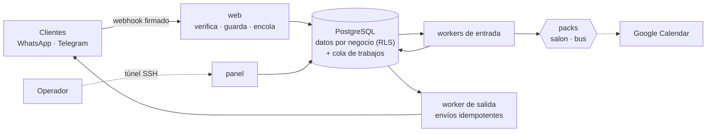

# Autobot

Plataforma de automatización para pequeños negocios: atiende a sus clientes por WhatsApp o Telegram, gestiona reservas sobre la agenda que ya usan (peluquerías) o responde consultas de horarios (autobuses), y avisa al dueño por Telegram. Una sola plataforma para todos los negocios, en una VPS con Docker Compose (dimensionado en [capacidad y crecimiento](docs/arquitectura/capacidad-y-crecimiento.md)). Visión de conjunto en [docs/arquitectura/vision-general.md](docs/arquitectura/vision-general.md).

## Arquitectura

Un monolito modular (Django, PostgreSQL y Procrastinate) en una sola VPS con Docker Compose. Cada negocio está aislado por Row-Level Security en una base de datos compartida, y la cola de trabajos vive en el mismo PostgreSQL: cada mensaje y su trabajo se confirman en la misma transacción, así que nada se pierde ni se contesta dos veces. La lógica de cada tipo de negocio va en un **pack** que no sabe por qué canal habla.



Detalle en la [visión general](docs/arquitectura/vision-general.md) y en las [decisiones (ADR)](docs/arquitectura/adr/README.md).

## Requisitos

- [uv](https://docs.astral.sh/uv/) (instala Python 3.14 por su cuenta).
- Docker con `compose` v2 y `curl`.
- Node 24 y pnpm (`corepack enable`), solo para trabajar en el panel.

## Arranque rápido

```bash
cd apps/backend && uv sync && cd -
make local     # entorno local completo: db, migraciones, demos, web y workers
make check     # ruff, mypy, import-linter y tests (necesita la BD local)
make docs      # documentación como sitio, en http://localhost:8100
make help      # todos los objetivos
```

## Mapa del repo

```
apps/backend/   Backend Django (src/, tests/, pyproject.toml, Dockerfile)
apps/panel/     Panel interno (React, TypeScript, Vite)
deploy/         Compose por entorno, scripts, systemd, Caddy, PostgreSQL
docs/           Documentación (docs/README.md); sitio con mkdocs.yml
var/            Ficheros de ejecución, ignorados por git
privado/        Notas locales, ignoradas por git
CLAUDE.md       Reglas para trabajar en el repo
```

## Documentación

Índice por intención en [docs/README.md](docs/README.md). Se publica como sitio con `make docs` (o `make docs-check` para validar enlaces) y, desplegado, el panel la sirve en `/docs/`. Reglas de trabajo: [CLAUDE.md](CLAUDE.md).
