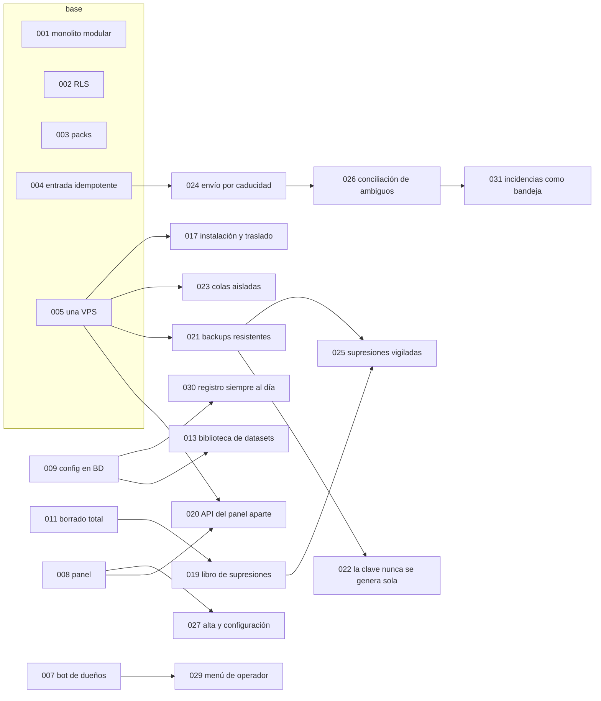

# Decisiones de arquitectura (ADR)

Un ADR se escribe cuando se toma una decisión que no es trivial de deshacer (arquitectura, aislamiento de datos, despliegue) o cuando una decisión existente cambia. Documenta el contexto, la decisión, las alternativas descartadas y cuándo revisarla; no describe el código, de eso se ocupan las páginas de [Conceptos](../vision-general.md). Plantilla: [plantilla.md](plantilla.md).

La fecha es la del alta del ADR en git. Si una decisión cambia, el ADR afectado lo indica en su línea «Estado:» y en esta tabla.

Las decisiones de base y lo que se ha construido encima:

| ADR | Título | Estado | Fecha | Modificado o sustituido por |
|---|---|---|---|---|
| [001](ADR-001-monolito-modular.md) | Monolito modular Django + Procrastinate | vigente | 2026-10-06 | |
| [002](ADR-002-multitenancy-rls.md) | Multitenancy con Row-Level Security | vigente | 2026-10-06 | |
| [003](ADR-003-packs.md) | Packs con máquina de estados propia | vigente | 2026-10-21 | |
| [004](ADR-004-entrada-idempotente.md) | Entrada idempotente y «al menos una vez» | vigente | 2026-10-06 | |
| [005](ADR-005-vps-docker-compose.md) | Una VPS con Docker Compose | vigente | 2026-10-21 | Ampliado por ADR-020, ADR-021 y ADR-023 |
| [006](ADR-006-bot-de-demo.md) | Bot de demo con dos puertas y negocios de demostración | vigente | 2026-10-26 | |
| [007](ADR-007-bot-de-duenos.md) | El bot de avisos se convierte en el asistente del dueño | vigente | 2026-10-29 | |
| [008](ADR-008-panel.md) | Panel interno: arquitectura, acceso y observabilidad | vigente | 2026-11-03 | Actualizado por ADR-020 |
| [009](ADR-009-config-en-bd.md) | Config y datasets de los negocios en PostgreSQL, versionados | vigente; datasets y caché modificados | 2026-11-03 | ADR-013 (datasets); ADR-030 (caché del registro) |
| [010](ADR-010-estructura-del-repo.md) | Estructura del repositorio: apps autocontenidas, compose por entorno y `var/` | vigente | 2026-11-04 | |
| [011](ADR-011-borrado-total-de-un-cliente.md) | Borrado total de un cliente | vigente | 2026-11-09 | |
| [013](ADR-013-biblioteca-de-conjuntos-de-datos.md) | Biblioteca de conjuntos de datos | vigente | 2026-11-17 | Modifica el ADR-009 |
| [015](ADR-015-varios-peluqueros.md) | Varios peluqueros en `salon` | aceptado, pendiente de implementar | 2026-11-17 | |
| [017](ADR-017-instalador-de-la-vm-y-entorno-local.md) | Instalación, acceso y traslado del servidor | vigente | 2026-11-20 | Reúne el antiguo ADR-012 |
| [018](ADR-018-documentacion-en-el-panel.md) | Documentación como sitio servido por el panel | vigente | 2026-11-21 | |
| [019](ADR-019-libro-de-supresiones.md) | Libro de supresiones para no resucitar datos olvidados | vigente | 2026-11-22 | Complementa el ADR-011; ADR-025 (exportación automática) |
| [020](ADR-020-api-del-panel-aparte.md) | La API del panel en un servicio propio, redes separadas y contenedores endurecidos | vigente | 2026-11-22 | Actualiza ADR-005 y ADR-008 |
| [021](ADR-021-backups-resistentes.md) | Backups resistentes a un servidor comprometido y clave de cifrado aparte | vigente | 2026-11-22 | Complementa ADR-011 y ADR-019; ADR-025 (vigilancia de la purga) |
| [022](ADR-022-la-clave-de-cifrado-nunca-se-genera-sola.md) | La clave de cifrado nunca se genera sola | vigente | 2026-11-23 | Complementa ADR-021 |
| [023](ADR-023-colas-aisladas-y-degradacion.md) | Colas aisladas y degradación ante servicios externos | vigente | 2026-11-23 | Modifica ADR-005 (workers) |
| [024](ADR-024-envio-saliente-por-caducidad.md) | Envío saliente por caducidad | vigente | 2026-11-23 | Complementa ADR-004 |
| [025](ADR-025-libro-de-supresiones-y-purga-vigilados.md) | Libro de supresiones y purga vigilados automáticamente | vigente; alerta de purga desactivada por defecto | 2026-11-23 | Complementa ADR-019 y ADR-021 |
| [026](ADR-026-conciliacion-de-envios-ambiguos.md) | Conciliación de envíos ambiguos y recuperación en bloque | vigente; modificado por el ADR-031 | 2026-11-23 | Cambia la regla de `unknown` (ADR-004, ADR-024) |
| [027](ADR-027-alta-y-configuracion-en-una-pestana.md) | Alta y configuración de un negocio en el panel | vigente | 2026-11-24 | Reúne los antiguos ADR-014 y ADR-016 |
| [028](ADR-028-aviso-en-una-linea-sin-persona-ni-baja.md) | Aviso inicial en una línea, sin PERSONA ni BAJA | vigente | 2026-11-24 | |
| [029](ADR-029-menu-de-operador.md) | Menú de operador en el bot de avisos, solo consulta | vigente | 2026-11-24 | Amplía el ADR-007 |
| [030](ADR-030-registro-siempre-al-dia.md) | Registro de negocios siempre al día | vigente | 2026-11-25 | Modifica el ADR-009 (caché) |
| [031](ADR-031-incidencias-como-bandeja.md) | Incidencias como bandeja: condición y evento, «Lo he revisado» y «Descartar» | vigente | 2026-11-25 | Modifica el ADR-026 y el ADR-008 |
