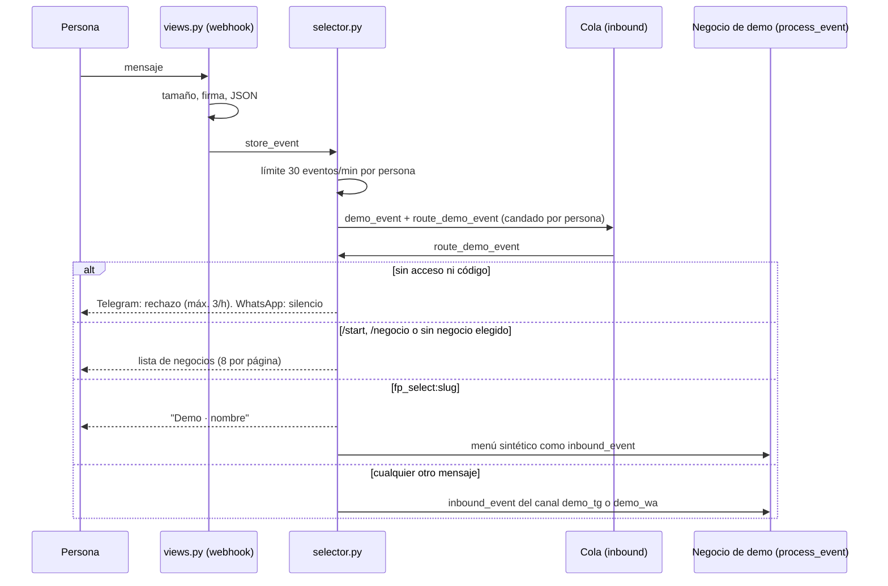

# Bot de demo

El bot de demo sirve para enseñar la plataforma a quien aún no es cliente: dos puertas (Telegram y WhatsApp) de la plataforma, no de ningún negocio, con un selector que deja elegir entre negocios de demostración que corren la lógica real de sus packs. Lee esta página para saber cómo entra un mensaje, quién puede usar la demo, de dónde salen los negocios de demo y cuánto tiempo se guardan sus datos. La decisión y su motivo están en [ADR-006](adr/ADR-006-bot-de-demo.md). El uso operativo (dar acceso, crear invitaciones) está en [Demo](../procedimientos/demo.md).

## Piezas

Todo está en `apps/backend/src/autobot/channels/demo/`:

| Fichero | Responsabilidad |
|---|---|
| `doors.py` | Las dos puertas (`Door`): canal, adaptador, secretos y lista cerrada de personas. `door(canal)` devuelve `None` si la puerta está apagada. |
| `views.py` | Los webhooks `POST /webhooks/telegram-demo` y `GET\|POST /webhooks/whatsapp-demo`. |
| `selector.py` | Guarda cada evento (`store_event`) y decide qué hacer con él (`route_demo_event`). |
| `invites.py` | Códigos de invitación: canje, límite de intentos y concesiones de acceso. |

Cada puerta se enciende con variables de entorno (`DEMO_TELEGRAM_*`, `DEMO_WHATSAPP_*`; ver [Variables de entorno](../referencia/variables-entorno.md)). Sin credenciales, el webhook responde 404. En local, la puerta de Telegram se alimenta con `telegram_poll` en lugar de webhook.

## Flujo de un mensaje

El selector no conoce el negocio hasta que la persona lo elige, así que sus tablas (`demo_event`, `demo_session`, `demo_invite`, `demo_access_grant`) **no llevan RLS** por diseño (ADR-006). Un mensaje que llega por una puerta pasa por estas fases:

Los puntos importantes:

- **Webhook** (`views.py`): mismas comprobaciones que el de un negocio (tamaño, firma o secreto antes de parsear, JSON, límite de firmas inválidas por IP y puerta), pero solo escribe `demo_event`.
- **`store_event`**: aplica un límite de 30 eventos por minuto y persona (`EVENTS_PER_MINUTE`, en memoria del proceso web) y otro global por puerta de 60 eventos por minuto de personas sin acceso (`STRANGER_EVENTS_PER_MINUTE`); lo que los supera se descarta sin guardar y el webhook responde 200. En WhatsApp, una persona sin acceso y sin código que canjear ni siquiera se guarda: Meta cobra cada mensaje y no hay nada que conservar. Inserta con `ON CONFLICT DO NOTHING` (idempotente ante reintentos del proveedor) y encola `route_demo_event` con un candado por puerta y persona (`demo_user_lock`, que usa un hash, nunca el id).
- **`route_demo_event`** decide, por este orden: puerta apagada → termina; acceso (`_gate_access`); `fp_page:<n>` → otra página de la lista; `fp_select:<slug>` → elige negocio; `/start`, `/negocio` o `negocio` → lista; cualquier otra cosa → se reenvía al negocio elegido como un `inbound_event` del canal de la puerta, y lo procesa `process_event` como cualquier otro ([Vida de un mensaje](vida-de-un-mensaje.md)).
- **Lista de negocios** (`business_list`): solo negocios de demo `active`, sin degradar ni ambiguos, ordenados por nombre, con su descripción (`demo.description`). Se pagina de 8 en 8 con `core.ui.paginate` (8 filas más «Ver más» y «Volver» = 10, el límite de lista). Un slug de más de 54 caracteres no cabe en el id de 64 bytes y se omite con un aviso.
- **Elegir negocio** (`_pick`): guarda `DemoSession` (una por puerta y persona), envía el aviso «Demo · nombre. Escribe /negocio para cambiar.» y a continuación un `menu` sintético al negocio, para que su pack conteste con su menú. El aviso va primero y un reintento puede repetirlo, nunca repetir el menú.
- **Mensajes propios del selector** (lista, rechazo, aviso) no pertenecen a ningún negocio y se envían directamente, una sola vez, después de marcar el evento como hecho. La excepción es un envío que seguro no salió (el proveedor pidió esperar o no hubo conexión) sin que nada más se hubiera enviado: se reabre el evento y se reintenta (`TransientError`).
- **Estados de entrega de WhatsApp** (`route_demo_status`): se asignan al negocio dueño del mensaje saliente; si no se recuerda, se busca en cada negocio de demo con su propio `tenant_tx`, nunca saltando la RLS.

## Quién puede usar la demo

El acceso es cerrado. `doors.allowed` admite a una persona si está en la **lista cerrada** de su puerta (`DEMO_TELEGRAM_USERS`, `DEMO_WHATSAPP_USERS`: acceso permanente) o si tiene una **concesión vigente** de una invitación.

- **Invitación** (`invites.py`, enmienda del 2026-11-16 de ADR-006): el panel crea un código (con nota, número de usos y caducidad opcional; `autobot/panel/services/demo_invites.py`) y entrega un enlace o QR. Se canjea con `/start <código>` en Telegram, o enviando el código como mensaje completo en WhatsApp (su enlace precarga el cuerpo). El canje es idempotente por identidad y no gasta otro uso al repetirse.
- **Códigos difíciles de adivinar**: 12 caracteres de un alfabeto sin ambiguos (unos 59 bits). Una persona que falla `MAX_FAILED_REDEEMS` (5) veces en una hora no se vuelve a comprobar hasta que pase la hora.
- **Sin acceso**: en Telegram se contesta «No tienes acceso a esta demo.» como mucho 3 veces por hora y persona; en WhatsApp, nunca. En ambos casos se vacía el `payload` del evento guardado: no se conserva nada de un desconocido.
- **Canje y revocación**: tras un canje correcto el evento que llevaba el código también se vacía (y no se reenvía a ningún negocio: la persona recibe la lista de negocios). Revocar una invitación desde el panel borra las concesiones que dio, y además `has_grant` ignora las de una invitación revocada, de modo que el acceso se retira de inmediato.

## Negocios de demo y plantillas

Un negocio de demo es un negocio normal con `demo: {description}` en lugar de `channel`, sin testers y con estado `active` o `paused` ([Config y registro](config-y-registro.md)). Cada pack trae su plantilla (`apps/backend/src/packs/<pack>/template/`, ver [Packs](packs.md#plantilla-y-negocio-de-demo)).

`manage.py seed_demos` (`apps/backend/src/autobot/management/commands/seed_demos.py`) crea el negocio de demo de cada pack **una sola vez**: si el negocio ya tiene versiones, escribe `exists <slug>` y no toca nada, de modo que los cambios posteriores del operador se conservan. Para un pack con datasets, sube el de la plantilla a la biblioteca como entrada `demo` y el negocio copia de ella, como cualquier cliente ([biblioteca de datasets](config-y-registro.md#biblioteca-de-datasets)). Para `salon`, sustituye el calendario de relleno por `DEMO_SALON_CALENDAR_ID`; si está vacío avisa de que esa demo no podrá reservar.

**Aviso de primera capa.** La primera vez que una persona escribe a un negocio de demo recibe, antes de la respuesta, un aviso redactado en `channels/demo/notice.py` donde la responsable es la plataforma: «Esto es una demo de Autobot ({negocio}): soy un asistente automático, no una persona. Uso tus datos solo para enseñarte cómo funciona. Responsable: la plataforma Autobot. …». El enlace a la política viene de `PLATFORM_PRIVACY_URL` (opcional; sin ella se remite a quien dio acceso a la demo). `PERSONA` responde con el `support.human_contact` del negocio de demo.

El dueño de un negocio de demo también puede enlazar su chat para recibir avisos y resúmenes ([Bot de dueños](bot-de-duenos.md)); los negocios de demo son los únicos que pueden compartir chat.

## Retención

Los datos de demo se conservan menos que los de un cliente real (`apps/backend/src/autobot/runtime/retention.py`):

| Dato | Plazo |
|---|---|
| `demo_event` | 7 días |
| `demo_session` | 30 días desde la última elección |
| Contactos, conversaciones y avisos de un negocio de demo | 30 días (`DEMO_RETENTION_DAYS`); un cliente real, un año |
| Concesiones con caducidad | al caducar |
| Invitaciones revocadas o caducadas | 30 días después (`INVITE_RETENTION_DAYS`) |

La limpieza solo actúa con `RETENTION_CLEANUP_ENABLED=true`, que sigue en `false` hasta que la persona lo apruebe a mano en el `.env` del servidor (nunca lo activa `install-vm.sh`). Ver [Retención y RGPD](../procedimientos/retencion-rgpd.md).

## Dónde está el código

- `apps/backend/src/autobot/channels/demo/` (`doors.py`, `selector.py`, `invites.py`, `views.py`).
- `apps/backend/src/autobot/runtime/models.py` (`DemoEvent`, `DemoSession`, `DemoInvite`, `DemoAccessGrant`).
- `apps/backend/src/autobot/management/commands/seed_demos.py`, `telegram_poll.py`.
- `apps/backend/src/autobot/panel/services/demo_invites.py` y `routers/demo_invites.py`.
- Tests: `apps/backend/tests/platform/channels/test_demo.py`, `test_demo_whatsapp.py`, `test_demo_invites.py`.

## Relacionado

- [ADR-006: bot de demo](adr/ADR-006-bot-de-demo.md).
- [Canales](canales.md): los adaptadores de Telegram y WhatsApp que usan las puertas.
- [Demo en local](../desarrollo/demo-local.md) y [Demo](../procedimientos/demo.md).
