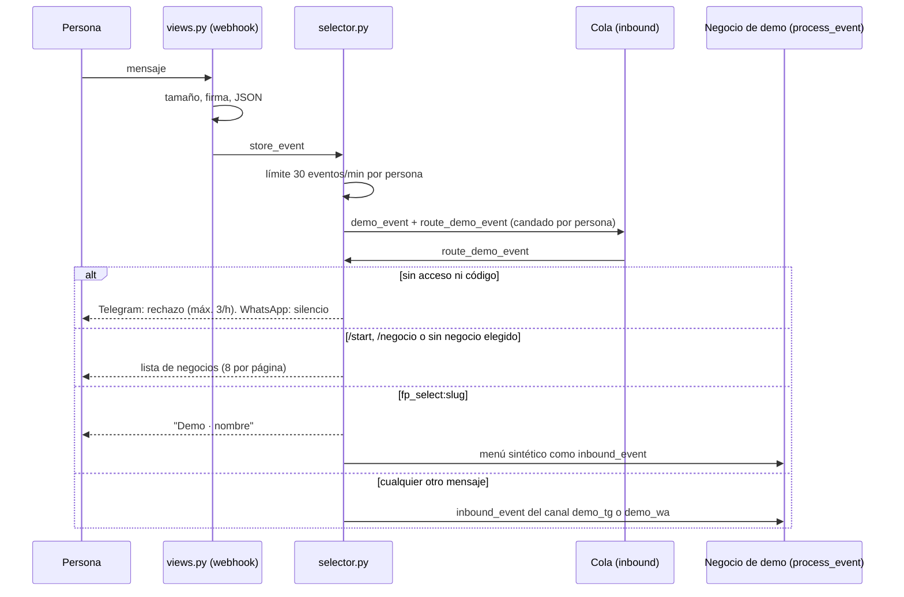
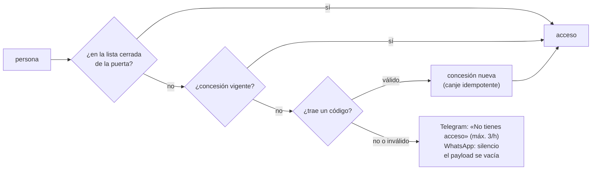

# Bot de demo

El bot de demo sirve para enseñar la plataforma a quien aún no es cliente: dos puertas (Telegram y WhatsApp) de la plataforma, no de ningún negocio, con un selector que deja elegir entre negocios de demostración que corren la lógica real de sus packs. Lee esta página para saber cómo entra un mensaje, quién puede usar la demo, de dónde salen los negocios de demo y cuánto tiempo se guardan sus datos. La decisión y su motivo están en [ADR-006](adr/ADR-006-bot-de-demo.md). El uso operativo (dar acceso, crear invitaciones) está en [Demo](../procedimientos/demo.md).

## Piezas

Todo está en `apps/backend/src/autobot/channels/demo/`:

| Fichero | Responsabilidad |
|---|---|
| `doors.py` | Las dos puertas (`Door`): canal, adaptador, secretos y lista cerrada de personas. `door(canal)` devuelve `None` si la puerta está apagada. |
| `views.py` | Los webhooks `POST /webhooks/telegram-demo` y `GET\|POST /webhooks/whatsapp-demo`. |
| `selector.py` | Guarda cada evento (`store_event`) y decide qué hacer con él (`route_demo_event`). |
| `invites.py` | Códigos de invitación: canje, límite de intentos y concesiones de acceso. |

Cada puerta se enciende con variables de entorno (`DEMO_TELEGRAM_*`, `DEMO_WHATSAPP_*`; ver [Variables de entorno](../referencia/variables-entorno.md)). Sin credenciales, el webhook responde 404. En local, la puerta de Telegram se alimenta con `telegram_poll` en lugar de webhook.

## Flujo de un mensaje

El selector no conoce el negocio hasta que la persona lo elige, así que sus tablas (`demo_event`, `demo_session`, `demo_invite`, `demo_access_grant`) **no llevan RLS** por diseño (ADR-006). Un mensaje que llega por una puerta pasa por estas fases:

Los puntos importantes:

- **Webhook** (`views.py`): las mismas defensas que el de un negocio, pero solo escribe `demo_event`.
- **Límites** (`store_event`): 30 eventos por minuto y persona, y 60 por minuto y puerta de personas sin acceso; lo que los supera se descarta. En WhatsApp, un desconocido sin código ni se guarda (Meta cobra cada mensaje). La inserción es idempotente y el trabajo lleva un candado por persona (un hash, nunca el id).
- **Lista de negocios**: solo demos `active` y sanos, de 8 en 8 (8 filas más «Ver más» y «Volver» = 10, el límite de lista).
- **Elegir negocio** guarda la `DemoSession` y manda un `menu` sintético al negocio, para que conteste su pack. Un reintento puede repetir el aviso «Demo · nombre», nunca el menú.
- **Mensajes del selector** (lista, rechazo, aviso) se envían una sola vez, después de marcar el evento como hecho; solo se reintentan si seguro que no salieron.
- **Estados de entrega de WhatsApp** se asignan al negocio dueño del mensaje, cada uno con su `tenant_tx`, nunca saltando la RLS.

## Quién puede usar la demo

El acceso es cerrado. `doors.allowed` admite a una persona si está en la **lista cerrada** de su puerta (`DEMO_TELEGRAM_USERS`, `DEMO_WHATSAPP_USERS`: acceso permanente) o si tiene una **concesión vigente** de una invitación.

- **Invitación** (`invites.py`, enmienda del 2026-11-16 de ADR-006): el panel crea un código (con nota, número de usos y caducidad opcional; `autobot/panel/services/demo_invites.py`) y entrega un enlace o QR. Se canjea con `/start <código>` en Telegram, o enviando el código como mensaje completo en WhatsApp (su enlace precarga el cuerpo). El canje es idempotente por identidad y no gasta otro uso al repetirse.
- **Códigos difíciles de adivinar**: 12 caracteres de un alfabeto sin ambiguos (unos 59 bits). Una persona que falla `MAX_FAILED_REDEEMS` (5) veces en una hora no se vuelve a comprobar hasta que pase la hora.
- **Sin acceso**: en Telegram se contesta «No tienes acceso a esta demo.» como mucho 3 veces por hora y persona; en WhatsApp, nunca. En ambos casos se vacía el `payload` del evento guardado: no se conserva nada de un desconocido.
- **Canje y revocación**: tras un canje correcto el evento que llevaba el código también se vacía (y no se reenvía a ningún negocio: la persona recibe la lista de negocios). Revocar una invitación desde el panel borra las concesiones que dio, y además `has_grant` ignora las de una invitación revocada, de modo que el acceso se retira de inmediato.

## Negocios de demo y plantillas

Un negocio de demo es un negocio normal con `demo: {description}` en lugar de `channel`, sin testers y con estado `active` o `paused` ([Config y registro](config-y-registro.md)). Cada pack trae su plantilla (`apps/backend/src/packs/<pack>/template/`, ver [Packs](packs.md#plantilla-y-negocio-de-demo)).

`manage.py seed_demos` (`apps/backend/src/autobot/management/commands/seed_demos.py`) crea el negocio de demo de cada pack **una sola vez**: si el negocio ya tiene versiones, escribe `exists <slug>` y no toca nada, de modo que los cambios posteriores del operador se conservan. Para un pack con datasets, sube el de la plantilla a la biblioteca como entrada `demo` y el negocio copia de ella, como cualquier cliente ([biblioteca de datasets](config-y-registro.md#biblioteca-de-datasets)). Para `salon`, sustituye el calendario de relleno por `DEMO_SALON_CALENDAR_ID`; si está vacío avisa de que esa demo no podrá reservar.

**Línea de privacidad.** Cada vez que un negocio de demo muestra su menú (y en la primera respuesta a una persona) va, como última línea, un aviso de la plataforma, redactado en `channels/demo/notice.py`: «_🤖 Demo de Autobot · Privacidad:_ {enlace}». El enlace viene de `PLATFORM_PRIVACY_URL`; sin ella queda «_🤖 Demo de Autobot_».

El dueño de un negocio de demo también puede enlazar su chat para recibir avisos y resúmenes ([Bot de dueños](bot-de-duenos.md)); los negocios de demo son los únicos que pueden compartir chat.

## Retención

Los datos de demo se conservan menos que los de un cliente real (`apps/backend/src/autobot/runtime/retention.py`):

| Dato | Plazo |
|---|---|
| `demo_event` | 7 días |
| `demo_session` | 30 días desde la última elección |
| Contactos, conversaciones y avisos de un negocio de demo | 30 días (`DEMO_RETENTION_DAYS`); un cliente real, un año |
| Concesiones con caducidad | al caducar |
| Invitaciones revocadas o caducadas | 30 días después (`INVITE_RETENTION_DAYS`) |

La limpieza solo actúa con `RETENTION_CLEANUP_ENABLED=true`: en producción `compose.prod.yaml` lo activa por defecto; en local vale `false`. Ver [Retención y RGPD](../procedimientos/retencion-rgpd.md).

## Dónde está el código

- `apps/backend/src/autobot/channels/demo/` (`doors.py`, `selector.py`, `invites.py`, `views.py`).
- `apps/backend/src/autobot/runtime/models.py` (`DemoEvent`, `DemoSession`, `DemoInvite`, `DemoAccessGrant`).
- `apps/backend/src/autobot/management/commands/seed_demos.py`, `telegram_poll.py`.
- `apps/backend/src/autobot/panel/services/demo_invites.py` y `routers/demo_invites.py`.
- Tests: `apps/backend/tests/platform/channels/test_demo.py`, `test_demo_whatsapp.py`, `test_demo_invites.py`.

## Relacionado

- [ADR-006: bot de demo](adr/ADR-006-bot-de-demo.md).
- [Canales](canales.md): los adaptadores de Telegram y WhatsApp que usan las puertas.
- [Demo en local](../desarrollo/demo-local.md) y [Demo](../procedimientos/demo.md).
