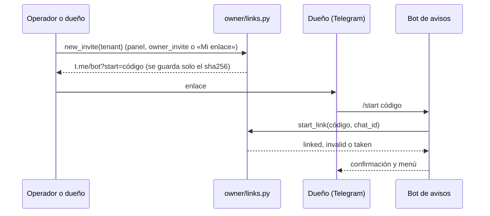

# Bot de dueños

El bot de dueños es un bot de Telegram de la plataforma (el «bot de avisos», `NOTIFY_BOT_TOKEN`) con dos funciones: avisar al dueño de un negocio de lo que pasa (una cita nueva, el resumen del mes) y atenderle cuando escribe, con un pequeño menú. Lee esta página para saber cómo se vincula un chat a un negocio, qué responde el bot y cómo se generan y entregan los avisos y resúmenes. La decisión está en [ADR-007](adr/ADR-007-bot-de-duenos.md).

El mismo bot envía las alertas de operación al chat del operador (`OPS_TELEGRAM_CHAT_ID`): ver [Observabilidad](observabilidad.md#avisos-al-operador).

## Vinculación de un chat

El `chat_id` del dueño vive en `owner_link` (modelo `OwnerLink` en `apps/backend/src/autobot/runtime/models.py`), una tabla de plataforma **sin RLS**: cuando llega un mensaje solo se conoce el chat y hay que buscar el negocio a partir de él.

- **Invitación** (`owner/links.py` `new_invite`, `owner/invites.py` `create_invite_link`): código aleatorio de un solo uso que caduca a los 7 días (`OWNER_INVITE_DAYS`). Solo se guarda su sha256 (`invite_hash`); el código en claro aparece únicamente en el enlace que ve quien lo pide, nunca en logs ni auditoría. Generar otro sustituye al pendiente. Se crea desde el panel («Invitar al dueño»), con `manage.py owner_invite <slug>` o desde el propio bot («Mi enlace»).
- **Canje** (`start_link`): el código es de un solo uso; vincular borra la invitación, así que repetirlo da `invalid`. Un negocio dado de baja no se puede vincular.
- **Un chat, un negocio real**: un chat se conecta como mucho a un negocio real (`taken` en otro caso); solo los negocios de demo pueden compartir chat. La comprobación está en código (`_chat_taken_by_another_real_tenant`), no en una restricción de base de datos, porque la demo la rompe a propósito.
- **Desvincular**: `manage.py owner_unlink` (cambio de dueño, petición RGPD). Los vínculos no dependen de los secretos del bot, así que rotarlos no los rompe.

## Cómo llega un mensaje

El webhook `POST /webhooks/telegram-notify` (`autobot/owner/views.py`) lleva `secret_token` (`NOTIFY_BOT_WEBHOOK_SECRET`); sin él responde 404, como la puerta de demo. Solo escribe `owner_event` (sin RLS). El tratamiento (`autobot/owner/inbox.py`) sigue el patrón del [selector de demo](bot-de-demo.md):

1. `store_owner_event` inserta con `ON CONFLICT DO NOTHING` (idempotente por `update_id`) y encola `handle_owner_event` con un candado por chat (`owner_chat_lock`, solo un hash).
2. `handle_owner_event` marca el evento como hecho **antes** de responder (`finish_and_send`), de modo que un reintento nunca repite una respuesta.
3. Si el texto es `/start <código>`, canjea el código. Si el chat no está vinculado a ningún negocio utilizable, contesta «no vinculado» como mucho 3 veces por hora y chat; pasado eso, silencio.
4. Si no, responde según el botón pulsado y adjunta el menú.

Los logs solo llevan el id del evento, nunca el chat ni el código.

## El menú

`autobot/owner/menu.py` declara `MENU` como una lista de `MenuOption` (id `owner:<nombre>`, título, respuesta, disponibilidad), de modo que una opción nueva es una entrada más:

| Id | Título | Respuesta |
|---|---|---|
| `owner:status` | Cómo va el mes | El resumen del mes en curso (`status_text`). |
| `owner:contact` | Contacto | El email del operador; solo aparece si `OWNER_SUPPORT_EMAIL` está definido. |
| `owner:reconnect` | Mi enlace | Un enlace nuevo por negocio del chat para conectar otro dispositivo; avisa si sustituirá al chat conectado. |

Con tres opciones o menos van como botones; de cuatro a diez, como lista (`menu_reply`, límites de [Packs](packs.md#limites-comunes-de-los-canales)). Un chat con varios negocios (solo demos) ve un bloque por negocio. Un negocio real solo responde si está `active` y sin degradar; uno de demo responde incluso en pausa (`_usable`).

## Resúmenes y avisos

Hay dos tipos de mensaje al dueño, ambos como filas de `Notification` entregadas por el trabajo `send_notification`.

### Avisos por evento

Un pack pide un aviso con la acción `NotifyOwner(kind, text, idem_key)`. El runtime (`_notify_owner` en `autobot/runtime/process.py`) lo encola solo si el tipo está en `owner.notify` del documento del negocio; si no, lo registra y nada más. Los tipos que puede emitir cada pack los declara `Pack.owner_notices` y un negocio nuevo nace con todos activados. `Notification` tiene clave de idempotencia (`idem_key`), de modo que repetir la acción no duplica el aviso.

### Resumen mensual y a demanda

`autobot/runtime/summary.py` genera el resumen con **dos periodos**, siempre en la zona horaria del negocio:

- **Automático**: el mes anterior completo. El periódico `dispatch_owner_summaries` corre cada hora y encola `send_owner_summary` para los negocios que tocan: `active`, sin degradar, con `owner.summary_monthly` y chat vinculado, a partir del día 1 a las 12:00 locales. Un envío perdido se recupera cualquier día posterior del mes, y la clave `summary:<tenant>:<año-mes>` impide duplicados.
- **A demanda** (opción «Cómo va el mes»): desde el día 1 a las 00:00 hasta ahora.

Cada resumen mezcla métricas de la plataforma (clientes atendidos, mensajes enviados, coste aproximado de WhatsApp si aplica) con las líneas del pack (`Pack.summary`, que devuelve `SummaryLine`; los totales de `RecordMetric` llegan como `recorded`). El gancho del pack se ejecuta con ninguna transacción abierta, porque `salon` llama a Calendar desde él. Si el gancho falla, el automático lanza `TransientError` para que la cola reintente: enviar un resumen sin citas sería engañoso.

### Entrega

`send_notification` (`autobot/runtime/notifications.py`) reclama la fila como `failed` **antes** de llamar a Telegram y solo la pasa a `sent` o la devuelve a `pending` (si el proveedor pide esperar y quedan intentos) después. Un resultado ambiguo se queda en `failed`: un aviso no tiene estado `unknown` y no se reenvía a ciegas. Un aviso del que no hay chat vinculado o bot configurado solo se registra. `owner.notify` filtra los avisos por evento; el resumen tiene su propio interruptor (`owner.summary_monthly`).

Un aviso fallido en las últimas 24 horas, con bot y chat configurados, genera la alerta `notification_failed` ([Observabilidad](observabilidad.md)).

## Dónde está el código

- `apps/backend/src/autobot/owner/`: `views.py`, `inbox.py`, `links.py`, `invites.py`, `menu.py`, `texts.py`.
- `apps/backend/src/autobot/runtime/notifications.py` (`send_notification`, `bot_secrets`, `deliver`) y `summary.py`.
- `apps/backend/src/autobot/runtime/models.py` (`OwnerLink`, `OwnerEvent`, `Notification`).
- `apps/backend/src/autobot/management/commands/owner_invite.py`, `owner_unlink.py`, `telegram_set_webhook.py`.
- Tests: `apps/backend/tests/platform/owner/test_owner_bot.py`, `runtime/test_summary.py`, `runtime/test_notifications.py`.

## Relacionado

- [ADR-007: bot de dueños](adr/ADR-007-bot-de-duenos.md).
- [Packs](packs.md): `NotifyOwner`, `OwnerNotice`, `SummaryLine`.
- [Cola y workers](cola-y-workers.md) y [Efectos e idempotencia](efectos-e-idempotencia.md): por qué se marca antes de enviar.
- [Rotar secretos](../procedimientos/rotar-secretos.md): secretos del bot de avisos.
