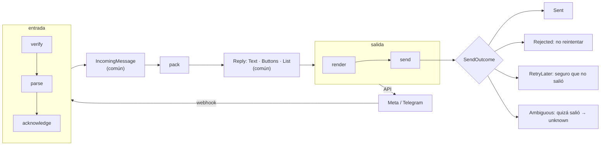

# Canales

Cómo habla la plataforma con WhatsApp y Telegram. Un canal es un adaptador con un contrato común: ni los packs ni el motor ven el formato del proveedor. Léelo si vas a tocar un webhook, un envío o añadir un canal. Cómo viaja un mensaje de punta a punta está en [vida de un mensaje](vida-de-un-mensaje.md).

## El contrato de adaptador

`apps/backend/src/autobot/channels/base.py` define `ChannelAdapter`, un `Protocol` con seis operaciones:

| Operación | Qué hace |
|---|---|
| `verify` | Comprueba la autenticidad de la petición, en tiempo constante, antes de nada |
| `parse` | Convierte el cuerpo del webhook en `ParsedItem`; lo malformado o ajeno se descarta |
| `acknowledge` | Efectos inmediatos al tomar un ítem (Telegram: `answerCallbackQuery`) |
| `synthetic_text` | Convierte un ítem guardado en un mensaje de texto de la misma persona (lo usa el selector de demo) |
| `render` | Traduce una respuesta común (`core.replies`) al cuerpo de petición del proveedor |
| `send` | Envía y devuelve un `SendOutcome` |

Un envío acaba siempre en uno de cuatro resultados: `Sent`, `Rejected` (el proveedor lo rechazó; reenviarlo igual fallaría), `RetryLater` (seguro que no salió; se puede reintentar) o `Ambiguous` (puede haber salido; nunca se reenvía a ciegas, ver [efectos e idempotencia](efectos-e-idempotencia.md)). Los ítems entrantes son `InboundItem` (mensaje de un contacto) y `StatusItem` (estado de entrega, solo WhatsApp).

`apps/backend/src/autobot/channels/adapters.py` elige el adaptador: `endpoint(tenant, channel)` devuelve el adaptador, la descripción del canal y los secretos. El canal `main` es el del negocio; `demo_tg` y `demo_wa` son las puertas de demo de la plataforma, que siempre usan credenciales propias, nunca las de un negocio.

## WhatsApp

`apps/backend/src/autobot/channels/whatsapp/adapter.py` (`WhatsAppAdapter`) usa la Graph API de Meta.

- **Firma.** `X-Hub-Signature-256` es el HMAC-SHA256 del cuerpo crudo con el secreto de la app, comparado con `hmac.compare_digest`. El `GET` de suscripción de Meta se resuelve con `verify_subscription` (token de verificación).
- **Plantillas.** Un `ProactiveMessage` (aviso que inicia el bot) se envía como mensaje de plantilla con parámetros y botones de respuesta rápida; fuera de la ventana de 24 h solo se pueden enviar plantillas.
- **Límites de tasa.** `classify` traduce la respuesta de Meta: los errores de límite de tasa, incluso con HTTP 4xx, son `RetryLater` (se reintenta con espera, respetando `Retry-After` acotado); un 5xx con error de Meta también; un 5xx sin cuerpo de Meta (típico de un proxy) es `Ambiguous`. Los códigos concretos están en `RATE_LIMIT_ERRORS` y `RECIPIENT_ERRORS` del adaptador.
- **Registro.** `whatsapp/registration.py` hace las llamadas del alta del panel (sección «Canal» de «Configuración») (webhook de la app, registro del número, suscripción a la WABA, [ADR-027](adr/ADR-027-alta-y-configuracion-en-una-pestana.md)). Nunca se llama en bucle ni desde un trabajo, y una escritura dudosa se informa como `unknown`.

## Telegram

`apps/backend/src/autobot/channels/telegram/adapter.py` (`TelegramAdapter`) usa la Bot API. El mismo adaptador sirve al bot de un negocio, a la puerta de demo y al bot de avisos; solo cambian el token y el enrutado.

- **Webhook con secreto.** Al llamar a `setWebhook` se registra un `secret_token`; Telegram lo devuelve en la cabecera `X-Telegram-Bot-Api-Secret-Token` y `verify` lo compara en tiempo constante. `telegram/registration.py` registra, borra y consulta el webhook (`register_webhook`, `remove_webhook`, `is_webhook_registered`); el comando es `telegram_set_webhook`.
- **`polling.py`, solo en local.** Hace `getUpdates` en vez de usar un webhook, para no necesitar túnel ni dominio. Cada actualización entra igual que por el webhook, ya autenticada. Un bot con webhook no se puede sondear (Telegram responde 409); el comando `telegram_poll` lo usa.
- Solo se atienden chats privados con personas: grupos, canales, bots y otros tipos de actualización se ignoran.

## Defensas del webhook

Las aplica `apps/backend/src/autobot/channels/views.py` (`receive`), igual para la ruta de cada negocio (`/webhooks/whatsapp/<id>`, `/webhooks/telegram/<id>`), la puerta de demo y el bot de avisos. Orden:

1. **Negocio o puerta** (404 si no existe o el canal está apagado).
2. **Tamaño del cuerpo**: 256 KB como máximo (`MAX_BODY`); Caddy aplica el mismo límite. Si se supera, 400.
3. **Firma, antes de leer el JSON.** Si es inválida, 401. El aviso en el log solo se escribe mientras el limitador de esa IP y ruta no esté ya bloqueando, para que un ataque no inunde los logs.
4. **JSON**: si el cuerpo no es un objeto, 400.
5. **Guardado**: negocio dado de baja (`offboarded`) se responde 200 sin guardar; en otro caso cada ítem se guarda y se encola (200).

Además:

- **Límite de firmas inválidas** (`channels/ratelimit.py`, `WindowLimiter`): 20 por minuto, contadas por (IP, ruta). La ruta es el negocio en la ruta de cada negocio y el bot en la puerta de demo y en el bot de avisos. Las IPs de Meta y Telegram son compartidas, así que un negocio con el secreto mal configurado nunca bloquea a otro. Alcanzado el límite, se responde 429, pero **solo a peticiones con firma inválida**: una firma válida nunca recibe 429. La IP es la última entrada de `X-Forwarded-For`, la que añade Caddy. El contador es en memoria y por proceso.
- **Antigüedad en WhatsApp.** El adaptador (`MAX_AGE`, 48 horas) descarta al interpretar los mensajes y los estados cuyo `timestamp` sea más antiguo: la firma no cubre la frescura, y sin esto una repetición de un cuerpo capturado se aceptaría cuando ya haya caducado la retención de los eventos de deduplicación. El log no lleva identificadores. La verificación de la firma no cambia.
- **Texto que la base no puede guardar.** `channels/payload.py` (`clean_payload`) elimina NUL y sustitutos UTF-16 sueltos de todos los textos al interpretar el cuerpo. Sin eso, un mensaje firmado con un NUL se reintentaría para siempre.
- **Errores al guardar** (`storage_failure`): si la base rechaza un cuerpo firmado (`DataError`) se responde 200 y se descarta con un log sin datos; los fallos de conexión o de cola dan 503 para que el proveedor reintente. Mientras guarda el evento, la petición web trabaja con `statement_timeout` de 5 s y `lock_timeout` de 2 s (`webhook_db_limits`, a nivel de sesión y deshecho al salir; el rol `fp_app` tiene 60 s, igual que el `--timeout` de gunicorn, y un hilo colgado así agotaría `web`); un timeout también es un `DatabaseError` y responde 503. Los workers y `telegram_poll` no pasan por ahí y conservan el timeout del rol. Todas las conexiones llevan además `connect_timeout` (`DB_CONNECT_TIMEOUT`, 5 s) y keepalives TCP.
- **Qué se ignora sin responder:** reacciones, `request_welcome` y avisos de sistema de WhatsApp; mensajes de servicio de Telegram. Los medios no soportados sí se contestan (el pack dice que no puede leerlos).
- **Sin llamadas externas** en el webhook: solo el registro en memoria y la base de datos.
- **Logs sin datos.** Nada de identificadores, textos ni cuerpos de respuesta del proveedor: solo estado y códigos de error. `channels/http_outcome.py` reúne lo que comparten ambos adaptadores al leer una respuesta HTTP (`Retry-After` acotado a una hora, JSON seguro).

## Límites comunes

Toda respuesta respeta a la vez los límites de ambos canales (botones ≤ 3, filas de lista ≤ 10, texto ≤ 4.096, ids ≤ 64 bytes). Se definen en `apps/backend/src/core/limits.py`. En los tests y el arnés, superar un límite es un error; en producción se trunca y se registra. Los escenarios de cada pack lo comprueban.

## Cómo se aíslan las diferencias de canal

Las diferencias viven solo en `channels/whatsapp/` y `channels/telegram/`: formato de mensajes interactivos (botones y listas de WhatsApp frente a teclados en línea de Telegram), firma, ids de contacto (BSUID o teléfono frente a id de usuario), códigos de error y tratamiento de un 5xx (`RetryLater` en Meta, `Ambiguous` en Telegram). El resto del sistema trabaja con `InboundItem`, `Outbound` y `SendOutcome`. El selector del bot de demo vive solo en `channels/demo/` ([bot de demo](bot-de-demo.md)).

## Dónde está el código

- `apps/backend/src/autobot/channels/` (`base.py`, `adapters.py`, `views.py`, `payload.py`, `ratelimit.py`, `http_outcome.py`).
- `apps/backend/src/autobot/channels/whatsapp/`, `.../telegram/`, `.../demo/`.
- Rutas: `apps/backend/src/config/urls.py`.
- Tests: `apps/backend/tests/contract/` y `apps/backend/tests/platform/channels/`.

## Relacionado

- [Vida de un mensaje](vida-de-un-mensaje.md), [efectos e idempotencia](efectos-e-idempotencia.md), [seguridad y secretos](seguridad-y-secretos.md).
