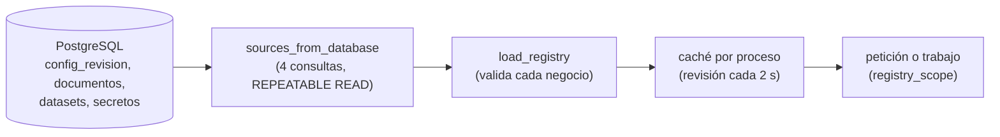

# Config y registro

La configuración de cada negocio (documento, datasets y secretos de canal) vive en PostgreSQL, versionada, y la plataforma la carga en memoria como un registro. Lee esta página para saber cómo se escribe esa configuración, cómo se valida, cómo la lee cada proceso y cómo se importa o exporta. La decisión está en [ADR-009](adr/ADR-009-config-en-bd.md) y la de la biblioteca de datasets en [ADR-013](adr/ADR-013-biblioteca-de-conjuntos-de-datos.md).

## Qué se guarda y dónde

Nada de la configuración de un negocio está en git ni en la imagen. Cada pieza tiene su tabla (modelos en `apps/backend/src/autobot/tenancy/models.py`):

| Tabla | Contenido |
|---|---|
| `tenant` | Espejo de la identidad (slug, nombre, pack, estado, zona horaria). Solo escribe `fp_owner`. |
| `tenant_document_version` | Una fila por versión del documento del negocio (YAML como JSON). Las versiones nunca se modifican. |
| `tenant_dataset_version` | Una fila por versión de cada dataset del negocio (`files`, `sha256`, procedencia). |
| `tenant_secret` | Secretos del canal, cifrados (ver [Seguridad y secretos](seguridad-y-secretos.md)). |
| `config_revision` | Una sola fila (`id=1`) con un contador que sube con cada escritura. |
| `dataset_library_version` | La biblioteca de datasets, independiente de cualquier negocio. |

Estas tablas llevan `tenant_id` pero sin RLS por diseño: son configuración de la plataforma, no datos de cliente. `fp_app` solo las lee; escribe `fp_owner` (ver [Tenants y RLS](tenants-y-rls.md) y `autobot/db/grants.py`, listas `CONFIG_TABLES` y `SENSITIVE_TABLES`).

## El documento

`TenantDocument` (`apps/backend/src/autobot/tenancy/schema.py`) es la parte común. El bloque `config` lo valida el `config_schema` del pack ([Packs](packs.md)). Campos:

- Identidad: `id` (UUIDv7), `slug`, `name`, `status` (`onboarding`, `active`, `paused`, `offboarded`), `timezone` (nombre IANA), `pack`.
- `channel`: `whatsapp` (ids de Meta, teléfono público, umbral mensual) o `telegram` (usuario del bot), con un `public_id` que forma la URL del webhook.
- `testers.main`: los únicos ids que pueden escribir por el canal principal durante el alta.
- `owner`: tipos de aviso (`notify`) y `summary_monthly` ([Bot de dueños](bot-de-duenos.md)).
- `demo`: marca un negocio de demo. Un demo no tiene canal ni testers y su estado es `active`, `paused` u `offboarded` ([Bot de demo](bot-de-demo.md)). Un negocio que no es demo necesita canal.

Los secretos de canal no van en el documento: `WhatsAppSecrets` (`app_secret`, `access_token`, `verify_token`) o `TelegramSecrets` (`bot_token`, `webhook_secret`).

## El registro en memoria

`apps/backend/src/autobot/tenancy/registry.py` convierte las fuentes (`TenantSource`) en un `Registry` con índices por id, slug, `public_id` y `phone_number_id`. `load_registry` valida cada negocio por separado y **un negocio roto nunca afecta a los demás**:

- Documento ilegible, YAML inválido o parte común inválida: el negocio no se puede identificar y se anota en `Registry.errors`.
- Pack desconocido, `config` inválida, `load_data` que falla o un id repetido: el negocio queda `degraded` (sus contactos reciben un texto genérico). Un id repetido lo marca además `ambiguous`: no se enruta ni se sincroniza.
- Faltan secretos o ids de canal: solo se desactiva su canal principal (`main_disabled`). Un demo siempre tiene el principal desactivado, sin que sea un aviso.

Los mensajes de error llevan rutas y tipos, nunca valores (podrían ser secretos). Los datasets se escriben a un directorio temporal solo durante `Pack.load_data`; las rutas absolutas, con `..` o de contenido que no es texto degradan solo ese negocio.

### Cómo se lee y se cachea

`sources_from_database` lee revisión, documentos, datasets y secretos con cuatro consultas, sin una por negocio. Fuera de una transacción usa una instantánea `REPEATABLE READ READ ONLY`, y los secretos se descifran después de cerrar la lectura.

`get_registry` mantiene una caché por proceso: comprueba la revisión (`config_revision`) como máximo cada dos segundos, bajo un candado, y solo publica la instantánea nueva cuando termina de construirla. Si la base falla conserva la anterior, salvo en la primera carga, que propaga el error (los webhooks responden entonces 503 para que el proveedor reintente). `get_registry(force=True)` salta la ventana de dos segundos: lo usan los servicios del panel cuando buscan un negocio recién creado por otro worker de gunicorn.

`registry_scope` fija el primer registro leído durante una petición o trabajo (incluidos ámbitos anidados), de modo que una unidad de trabajo ve una sola versión de la configuración. `loaded_registry` devuelve el registro ya cargado sin consultas; lo usa la redacción de logs.

## Escribir configuración: `tenancy/store/`

`autobot.tenancy.store` es el **único camino** para escribir configuración: serializado, validado y auditado. Es un paquete (`apps/backend/src/autobot/tenancy/store/`) con una fachada en `__init__.py`:

| Módulo | Responsabilidad |
|---|---|
| `documents.py` | `new_document`, `create_tenant`, `publish`, `rollback`, `change_status`. |
| `datasets.py` | `import_dataset`, `write_dataset` (copias, nunca referencias). |
| `channel_secrets.py` | `set_secrets`: valida, cifra y sustituye los secretos. |
| `imports.py` | `import_source`: importa documento, datasets y secretos juntos. |
| `validate.py` | `lock`, `current_sources`, `validate_candidate`. |
| `revision.py` | `write_document` y `bump` del contador de revisión. |
| `errors.py` | `StoreError` y la lista `IDENTITY`. |

Cada escritura sigue el mismo patrón, en una transacción con la conexión `owner`:

1. `validate.lock()` toma la fila de `config_revision` con `SELECT FOR UPDATE`: las escrituras se serializan.
2. Se construye un candidato y `validate_candidate` carga el registro **como quedaría** con él; si el candidato sale degradado, ambiguo o rechazado, la escritura falla con el motivo real.
3. Se crea una versión nueva (las anteriores no se tocan), se actualiza el espejo `tenant`, se incrementa la revisión y se registra una auditoría, todo en la misma transacción.

Otras reglas de validación: un conflicto de versión (`base_version`) se rechaza, y dos negocios no pueden compartir `config.calendar_id` (los dados de baja no cuentan). Un pack que necesita datasets (`load_data`) exige elegir uno explícitamente al crear el negocio.

### Campos protegidos

Seis campos forman la identidad (`IDENTITY` en `store/errors.py`) y ni publicar ni importar pueden cambiarlos: `id`, `slug`, `pack`, `status`, `channel.type` y `channel.public_id`. El estado solo cambia con `change_status`, que aplica las transiciones `activate`, `pause`, `resume` y `offboard`. Pausar y dar de baja no revalidan la configuración, para poder sacar de servicio un negocio degradado.

### Volver atrás

`rollback` no restaura el documento entero: crea una versión nueva con solo el contenido editable (`name`, `timezone`, `config`; `CONTENT_KEYS`) y conserva lo vigente de la identidad, el estado, el canal completo, los testers, el dueño y la demo. Así, volver a una versión anterior a conectar WhatsApp no desconecta el número.

### Activar un negocio

`activate` solo se permite desde `onboarding` y exige que `activation.checklist(slug)` no tenga bloqueos (`apps/backend/src/autobot/tenancy/activation.py`). La lista comprueba: documento válido y sin degradación, ids de canal completos, secretos legibles, salud del canal sin problemas críticos, plantillas de WhatsApp aprobadas y que algún tester haya escrito por el canal principal. «Dueño enlazado» aparece pero no bloquea. La salud se fuerza **fuera** de la transacción de escritura (nunca hay una transacción abierta durante llamadas a Meta, Google o Telegram) y la lectura del panel (`refresh=False`) solo mira la caché. La lista alimenta la pestaña «Alta» ([ADR-014](adr/ADR-014-pestana-de-alta.md)).

Los estados de salud que ve el operador (`ok`, `notice`, `warning`, `critical`, `unknown`) los centraliza `autobot/ops/status.py` (`tenant_status`); ver [Estados de negocio](../referencia/estados-de-negocio.md).

## Biblioteca de datasets

Un dataset es un conjunto de ficheros de texto que un pack necesita además de su `config` (hoy, el `timetable` de `bus`). La biblioteca (`apps/backend/src/autobot/tenancy/dataset_library.py`, ADR-013) guarda datasets con nombre y versión **independientes de cualquier negocio**:

- Se sube por terminal con `manage.py dataset_library push <pack> <dataset> <nombre> <directorio> --comment ...`; también hay `pull`, `list` y `current-sha` y `push --dry-run`.
- `push` valida el contenido con el `dataset_summary` del propio pack, toma un candado consultivo por entrada y crea una versión nueva, salvo que el contenido sea idéntico. `--base-sha` evita pisar una subida ajena.
- Un negocio **copia** la entrada elegida a su propio `tenant_dataset_version` (al darlo de alta o con «Aplicar» desde su ficha); nunca queda una referencia viva. La copia guarda su procedencia (`source_name`, `source_version`, `source_sha`) solo como información.
- La biblioteca no la lee el registro: `fp_app` no tiene acceso a `dataset_library_version`; solo lo usan `tenancy.store` y los servicios del panel, como `fp_owner`.
- `seed_demos` sube el dataset de la plantilla como una entrada más, llamada `demo` ([Bot de demo](bot-de-demo.md)).

Cómo se suben horarios de `bus` en la práctica: [Horarios de bus](../procedimientos/horarios-bus.md).

## Importar y exportar: `tenant_config`

`manage.py tenant_config` (`apps/backend/src/autobot/management/commands/tenant_config.py`) trabaja con directorios portables, o con un `tar.gz` por `-` (stdin/stdout); la lógica está en `apps/backend/src/autobot/tenancy/archive.py`.

- `export <slug> <destino>`: escribe `document.yaml` y `datasets/<nombre>/...`. La procedencia de cada dataset viaja como `datasets/<nombre>.origin.json` y se conserva al importar. **No exporta secretos.**
- `import <origen> [--secrets fichero] [--comment ...]`: valida documento y datasets juntos antes de publicar. Si el slug no existe lo crea; si existe, publica una versión nueva (sin poder cambiar los campos protegidos). Los secretos solo se importan si se pasan en un fichero (`--secrets`) o hay un `secrets.yaml` en el directorio, y sustituyen a los anteriores completos. Importar el mismo contenido no crea versiones ni auditorías.
- `validate --all`: carga el registro con todo lo que hay en la base y falla si algún negocio está degradado o es ilegible.

`source_from_dir` exige `document.yaml`; el nombre de la carpeta no condiciona el slug del documento. Los enlaces simbólicos en datasets se rechazan.

`seed_demos` y la creación desde el panel usan las mismas funciones del `store`, así que pasan por la misma validación.

## Dónde está el código

- `apps/backend/src/autobot/tenancy/`: `registry.py`, `schema.py`, `activation.py`, `archive.py`, `dataset_library.py`, `crypto.py`, `models.py`, `store/`.
- `apps/backend/src/autobot/management/commands/`: `tenant_config.py`, `dataset_library.py`, `seed_demos.py`.
- `apps/backend/src/autobot/ops/status.py`: salud agregada por negocio.

## Relacionado

- [Tenants y RLS](tenants-y-rls.md): qué tablas llevan RLS y cuáles no.
- [Seguridad y secretos](seguridad-y-secretos.md): cifrado de `tenant_secret`.
- [Packs](packs.md): `config_schema`, `load_data` y `dataset_summary`.
- [Alta y baja de un negocio](../procedimientos/alta-baja-negocio.md) y [Comandos](../referencia/comandos.md).
