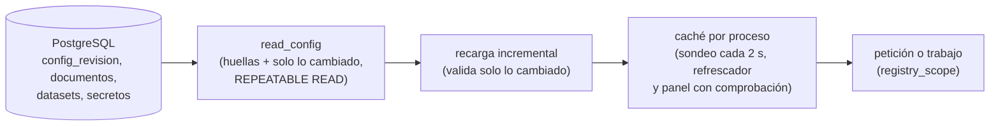

# Config y registro

La configuración de cada negocio (documento, datasets y secretos de canal) vive en PostgreSQL, versionada, y la plataforma la carga en memoria como un registro. Lee esta página para saber cómo se escribe esa configuración, cómo se valida, cómo la lee cada proceso y cómo se importa o exporta. La decisión está en [ADR-009](adr/ADR-009-config-en-bd.md) y la de la biblioteca de datasets en [ADR-013](adr/ADR-013-biblioteca-de-conjuntos-de-datos.md).

## Qué se guarda y dónde

Nada de la configuración de un negocio está en git ni en la imagen. Cada pieza tiene su tabla (modelos en `apps/backend/src/autobot/tenancy/models.py`):

| Tabla | Contenido |
|---|---|
| `tenant` | Espejo de la identidad (slug, nombre, pack, estado, zona horaria). Solo escribe `fp_owner`. |
| `tenant_document_version` | Una fila por versión del documento del negocio (YAML como JSON). Las versiones nunca se modifican. |
| `tenant_dataset_version` | Una fila por versión de cada dataset del negocio (`files`, `sha256`, procedencia). |
| `tenant_secret` | Secretos del canal, cifrados (ver [Seguridad y secretos](seguridad-y-secretos.md)). |
| `config_revision` | Una sola fila (`id=1`) con un contador que sube con cada escritura. |
| `config_follower` | Una fila por proceso vivo con la revisión que ha cargado (ver [Confirmación](#confirmacion-de-que-un-cambio-esta-aplicado)). Datos de operación: sin `tenant_id` ni RLS. |
| `dataset_library_version` | La biblioteca de datasets, independiente de cualquier negocio. |

Estas tablas llevan `tenant_id` pero sin RLS por diseño: son configuración de la plataforma, no datos de cliente. `fp_app` solo las lee; escribe `fp_owner` (ver [Tenants y RLS](tenants-y-rls.md) y `autobot/db/grants.py`, listas `CONFIG_TABLES` y `SENSITIVE_TABLES`).

## El documento

`TenantDocument` (`apps/backend/src/autobot/tenancy/schema.py`) es la parte común. El bloque `config` lo valida el `config_schema` del pack ([Packs](packs.md)). Campos:

- Identidad: `id` (UUIDv7), `slug`, `name`, `status` (`onboarding`, `active`, `paused`, `offboarded`), `timezone` (nombre IANA), `pack`.
- `channel`: `whatsapp` (ids de Meta, teléfono público, umbral mensual) o `telegram` (usuario del bot), con un `public_id` que forma la URL del webhook.
- `testers.main`: los únicos ids que pueden escribir por el canal principal durante el alta.
- `owner`: tipos de aviso (`notify`) y `summary_monthly` ([Bot de dueños](bot-de-duenos.md)).
- `privacy` (opcional): `policy_url` (`https://…`), el enlace a la política de privacidad que cita la línea de privacidad del bot ([Aviso inicial](packs.md#aviso-inicial)).
- `demo`: marca un negocio de demo. Un demo no tiene canal ni testers y su estado es `active`, `paused` u `offboarded` ([Bot de demo](bot-de-demo.md)). Un negocio que no es demo necesita canal.

El campo `privacy` es opcional para no romper negocios existentes: si falta, el aviso solo nombra al negocio; nunca se inventa un dato. La lista de activación (siguiente sección) exige `privacy.policy_url` antes de abrir el canal real. El antiguo bloque `support` (el contacto de la orden `PERSONA`, retirada en el [ADR-028](adr/ADR-028-aviso-en-una-linea-sin-persona-ni-baja.md)) ya no existe, ni `privacy.controller_name`: si una versión guardada antes los trae, se descartan al cargarla.

Los secretos de canal no van en el documento: `WhatsAppSecrets` (`app_secret`, `access_token`, `verify_token`) o `TelegramSecrets` (`bot_token`, `webhook_secret`).

## El registro en memoria

`apps/backend/src/autobot/tenancy/registry.py` convierte las fuentes (`TenantSource`) en un `Registry` con índices por id, slug, `public_id` y `phone_number_id`. `load_registry` valida cada negocio por separado y **un negocio roto nunca afecta a los demás**:

- Documento ilegible, YAML inválido o parte común inválida: el negocio no se puede identificar y se anota en `Registry.errors`.
- Pack desconocido, `config` inválida, `load_data` que falla o un id repetido: el negocio queda `degraded` (sus contactos reciben un texto genérico). Un id repetido lo marca además `ambiguous`: no se enruta ni se sincroniza.
- Faltan secretos o ids de canal: solo se desactiva su canal principal (`main_disabled`). Un demo siempre tiene el principal desactivado, sin que sea un aviso.

Los mensajes de error llevan rutas y tipos, nunca valores (podrían ser secretos). Los datasets se escriben a un directorio temporal solo durante `Pack.load_data`; las rutas absolutas, con `..` o de contenido que no es texto degradan solo ese negocio.

### Cómo se lee y se cachea

`read_config` lee la revisión y la huella de cada negocio con cuatro consultas, y los documentos, datasets y secretos solo de los negocios que cambiaron (sin una consulta por negocio). Fuera de una transacción usa una instantánea `REPEATABLE READ READ ONLY`, y los secretos se descifran después de cerrar la lectura. `sources_from_database` es la lectura completa, sin huellas (validación y comandos).

`get_registry` mantiene una caché por proceso. Cada proceso tiene un **único hilo refrescador** (persistente, daemon, recreado tras un `fork` con `os.register_at_fork`) que lee la revisión (`config_revision`) y, si cambió, reconstruye el registro. Hay cuatro formas de que se entere de un cambio ([ADR-030](adr/ADR-030-registro-siempre-al-dia.md)):

- **Sondeo propio (*refresh-ahead*).** En un proceso arrancado de verdad (un worker de gunicorn o un `procrastinate worker`) el refrescador comprueba la revisión cada `POLL_SECONDS` (2 s) **aunque nadie lo llame**; un proceso inactivo durante horas no se queda con una instantánea vieja. Entre comprobaciones conserva su propia conexión a la base de datos (no se conecta ni autentica cada 2 s, aunque `DB_CONN_MAX_AGE` sea 0) y solo la cierra si la comprobación falló o la conexión no es utilizable; nunca deja una transacción abierta. Mientras reconstruye, las peticiones y los trabajos siguen con la instantánea anterior y la nueva se publica de golpe, ya completa.
- **Camino caliente.** `get_registry()` es una lectura en memoria. Si pasaron 2 s desde la última comprobación, el llamante despierta al refrescador (sin esperar) y sigue con la instantánea que tiene. Esto es la red de seguridad de los procesos sin sondeo (tests, comandos de `manage.py`, chat de desarrollo).
- **Búsquedas que no se rinden ante un fallo.** `tenant_by_id`, `tenant_by_slug` y `tenant_by_public_id` buscan en la instantánea; si no encuentran el negocio, el llamante lee la revisión (una consulta) y, si difiere de la cargada, pide una comprobación al refrescador y **espera como mucho 1 s** (`MISS_WAIT_SECONDS`) a que publique, y busca otra vez en la instantánea más nueva. **Nunca reconstruye en el hilo del llamante ni toma `_registry_lock`**: una petición de internet no puede quedarse esperando una reconstrucción. Hay un cubo de límite por segundo y proceso para las búsquedas públicas (`tenant_by_public_id`: webhooks y sondeo de Telegram) y otro para las internas (`tenant_by_id`, `tenant_by_slug`), de modo que un chorro de identificadores inventados no gasta el hueco que necesitan los trabajos. Un fallo que llega mientras el cubo ya tiene una comprobación en curso espera a esa comprobación (acotado) y busca de nuevo en vez de contestar «no existe» de inmediato. Dentro de una transacción abierta (p. ej. `ops/actions`, que resuelve el negocio con un candado de fila) un fallo no espera ni lee la revisión: avisa al refrescador y contesta con la instantánea más nueva que haya. Si se pasa de la ventana sin comprobación libre, contesta «no existe»: el proveedor reintenta y el sondeo de 2 s cierra el hueco. Dentro de un `registry_scope` se devuelve el negocio encontrado, pero **no** se sustituye la instantánea fijada. Si la búsqueda encuentra el negocio así, se registra en INFO su id (nunca datos personales). Las usan todos los caminos de ejecución (webhooks, `process_event`, `apply_status`, `send_message`, avisos, resumen, barridas, enlaces de dueño, acciones de operación, selector de demo y sondeo de Telegram).
- **Cada petición del panel.** `PanelFreshConfigMiddleware` hace una comprobación síncrona (`get_registry(force=True)`) al empezar cualquier petición a `/api/panel/` y fija esa instantánea para la petición (`RegistryScopeMiddleware`): tras guardar a través de un worker, el otro `web-panel` no responde con datos viejos. Espera a la recarga porque el panel está autenticado, solo es accesible por el túnel y la recarga es incremental. Los caminos públicos (webhooks) nunca pasan por aquí.

### Recarga incremental

Reconstruir el registro entero cuesta unos 13 ms de CPU y unos 114 KB por negocio (3,8 s con 300, 40 s con 3.000), y cada guardado lo provocaba en unos 8 procesos a la vez. Ahora cada proceso guarda por negocio una **huella** y su resultado ya cargado (antes de las pasadas entre negocios):

- La huella es (última versión del documento y su fila, versión y fila más recientes de cada dataset, fila e *hash* de los secretos). Se lee con tres consultas agregadas sin carga útil, en la **misma instantánea** que la revisión; las filas crecen con cada escritura, así que un negocio purgado y creado de nuevo con el mismo id no repite huella.
- Con la revisión nueva solo se leen y se cargan los negocios nuevos o con otra huella; los quitados se descartan y los demás se reutilizan tal cual. Después se reconstruye el `Registry` (lista de negocios en el mismo orden que una carga completa, errores, `_mark_duplicates` sobre copias nuevas e índices), de modo que ni una degradación ni un `ambiguous` se acumulan sobre los objetos en caché de una ronda a otra, y una instantánea fijada por un trabajo no cambia.
- Los negocios cargados se comparten entre instantáneas: la memoria ya no se duplica durante la reconstrucción.
- La primera carga y cualquier incoherencia o error de la vía incremental caen a la reconstrucción completa; se mantienen las garantías: nunca se publica un registro a medias y, si falla, se conserva la instantánea anterior.

Coste de un guardado: unos 13 ms de CPU por cada negocio que cambió (normalmente uno) en cada proceso, más unos milisegundos de ensamblado, en lugar de 13 ms por negocio de la plataforma. Un test de propiedades (`tests/platform/tenancy/test_registry_incremental.py`) comprueba que tras secuencias aleatorias de escrituras (documentos válidos e inválidos, duplicados, demos, datasets, secretos y purgas) el registro incremental es igual al de una carga completa.

Más reglas:

- Si la reconstrucción falla conserva la anterior y lo registra en el log (`Configuration reload failed` o `rebuild failed`); nunca se publica un registro a medias. Un fallo que se repite en cada sondeo (la base de datos caída al arrancar) se registra la primera vez con su traza y después como mucho una vez por minuto, hasta que se recupera. La primera carga, que no tiene nada que conservar, propaga el error (los webhooks responden entonces 503 para que el proveedor reintente). Una comprobación fallida del sondeo cierra la conexión del hilo; la siguiente abre una nueva.
- `get_registry(force=True)` es la vía **síncrona**: salta la ventana, comprueba la revisión ahora y, si cambió, reconstruye en el propio llamante (esperando a la reconstrucción de fondo si hay una). Solo se usa fuera de los caminos públicos: el panel (middleware de arriba, y tras escribir) y los tests.
- **Arranque**: `config/wsgi.py` llama a `warm_up_in_background(poll=True)` al arrancar cada worker de gunicorn (no se usa `--preload`), y `procrastinate worker` hace lo mismo desde `runtime/worker_pool.py` (`configure`): precarga el registro y después `start_polling()`. Es idempotente y solo vale para el proceso que lo llama; un hijo tras un `fork` empieza sin sondeo. Los tests, los comandos de `manage.py` y el chat de desarrollo siguen siendo perezosos; `stop_polling()` detiene y espera al hilo (tests y apagado) y `wait_for_refresh()` espera a que el refrescador quede libre. Una petición que llega mientras el refrescador comprueba no se pierde: se anota y sigue otra comprobación; y una que llega mientras `stop_polling` detiene al hilo arranca uno nuevo.
- **Conexiones**: cada proceso que sondea conserva una conexión `fp_app` fija (ver [capacidad y crecimiento](capacidad-y-crecimiento.md)).

Efecto en la visibilidad: un negocio nuevo se encuentra casi al instante en cualquier camino de ejecución (como mucho 1 s de espera si el refrescador tenía que recargar); un cambio en un negocio que ya estaba (estado, configuración, secretos) llega a los procesos arrancados en unos 2 s más la recarga incremental, y al panel en la propia petición. Cada proceso informa de la revisión que ha cargado y el panel lo muestra como confirmación (sección siguiente).

### Confirmación de que un cambio está aplicado

Cada proceso que sondea (el mismo hilo refrescador) escribe en `config_follower` (`autobot/tenancy/models.py`) una fila con su `service` (`SERVICE_NAME`: `web`, `web-panel`, `worker-inbound`…), su `host` (el contenedor), su `pid`, la `revision` cargada (0 si todavía no cargó ninguna), `started_at` (cuándo empezó a sondear), `seen_at` y `last_error_at`; la clave única es (`host`, `pid`). Es un *upsert* de una fila **tras cada ronda de sondeo, con éxito o sin él**, que solo escribe cuando cambia la revisión cargada o el estado de error, o han pasado 15 s desde la última escritura (`HEARTBEAT_SECONDS`): un proceso vivo nunca se queda en silencio. `last_error_at` es el momento en que empezó la racha de comprobaciones o recargas fallidas (se conserva mientras dura y se borra con la primera que funciona). Siempre desde el hilo refrescador con su propia conexión, nunca en la ruta caliente ni dentro de la transacción de una petición o un trabajo. Si falla se registra un aviso (con la misma limitación de ruido que el resto) y se reintenta a los 15 s; nunca rompe al refrescador. Al parar el sondeo a propósito (`stop_polling`) y en una salida limpia (`atexit`) el proceso borra su fila con una conexión propia y de vida corta, con `connect_timeout` de 2 s y `statement_timeout` de 2 s, para que el apagado nunca espere a una base de datos enferma; si muere sin avisar, su fila queda y deja de contar como viva a los 35 s. `ops_check` borra las filas con más de un día sin latir. Sin índice en `seen_at` (la tabla tiene menos de 50 filas) y con `fillfactor` 70, para que cada latido pueda ser una actualización HOT. Escritura: `fp_app` (los permisos están en `autobot/db/grants.py`; la tabla no es sensible y la consola SQL la lee).

Los lectores (`autobot/tenancy/followers.py`) consideran **viva** una fila vista en los últimos 35 s (`ALIVE_SECONDS`) y **atrasada** la que tiene una revisión **distinta** de la de `config_revision` (también si la base volvió a una anterior tras una restauración); devuelven como mucho 200 filas. Los usan tres cosas:

- `GET /api/panel/system/config`: la revisión de la base de datos, su `updated_at` y los procesos vivos con `behind` y `last_error_at`. El panel marca «atrasado» o «error al recargar».
- La confirmación del panel: tras cualquier escritura de un cliente (`useApiMutation({ tenant })`, el formulario de secretos), el panel lee la revisión que dejó el guardado y consulta ese endpoint cada 0,5 s, hasta unos 10 s, hasta que todos los procesos vivos la hayan cargado. Muestra «Aplicado en N procesos» o «Aplicado en X de N; siguen con la versión anterior: <servicio>». La escritura ya está confirmada en la base de datos; es solo información.
- La alerta `config_stale` de `ops_check`: un proceso vivo con una revisión distinta de la de la base durante más de un minuto **contado desde que ese proceso se vio así por primera vez** (la marca se guarda en la caché de Django por `host:pid:revisión`, así que un segundo cambio de la base no la reinicia), o un proceso vivo con `last_error_at` de hace más de un minuto. No cubre un servicio cuyos contenedores corren pero no tienen ningún proceso vivo en `config_follower`: lo cubren las alertas de contenedores ([observabilidad](observabilidad.md)).

`registry_scope` fija el primer registro leído durante una petición o trabajo (incluidos ámbitos anidados), de modo que una unidad de trabajo ve una sola versión de la configuración. `loaded_registry` devuelve el registro ya cargado sin consultas; lo usa la redacción de logs.

## Escribir configuración: `tenancy/store/`

`autobot.tenancy.store` es el **único camino** para escribir configuración: serializado, validado y auditado. Es un paquete (`apps/backend/src/autobot/tenancy/store/`) con una fachada en `__init__.py`:

| Módulo | Responsabilidad |
|---|---|
| `documents.py` | `new_document`, `create_tenant`, `publish`, `rollback`, `change_status`. |
| `datasets.py` | `import_dataset`, `write_dataset` (copias, nunca referencias). |
| `channel_secrets.py` | `set_secrets`: valida, cifra y sustituye los secretos. |
| `imports.py` | `import_source`: importa documento, datasets y secretos juntos. |
| `validate.py` | `lock`, `current_sources`, `validate_candidate`. |
| `revision.py` | `write_document` y `bump` del contador de revisión. |
| `errors.py` | `StoreError` y la lista `IDENTITY`. |

Cada escritura sigue el mismo patrón, en una transacción con la conexión `owner`:

1. `validate.lock()` toma la fila de `config_revision` con `SELECT FOR UPDATE`: las escrituras se serializan.
2. Se construye un candidato y `validate_candidate` carga el registro **como quedaría** con él; si el candidato sale degradado, ambiguo o rechazado, la escritura falla con el motivo real.
3. Se crea una versión nueva (las anteriores no se tocan), se actualiza el espejo `tenant`, se incrementa la revisión y se registra una auditoría, todo en la misma transacción.

Otras reglas de validación: un conflicto de versión (`base_version`) se rechaza, y dos negocios no pueden compartir `config.calendar_id` (los dados de baja no cuentan). Un pack que necesita datasets (`load_data`) exige elegir uno explícitamente al crear el negocio.

### Campos protegidos

Seis campos forman la identidad (`IDENTITY` en `store/errors.py`) y ni publicar ni importar pueden cambiarlos: `id`, `slug`, `pack`, `status`, `channel.type` y `channel.public_id`. El estado solo cambia con `change_status`, que aplica las transiciones `activate`, `pause`, `resume` y `offboard`. Pausar y dar de baja no revalidan la configuración, para poder sacar de servicio un negocio degradado.

### Volver atrás

`rollback` no restaura el documento entero: crea una versión nueva con solo el contenido editable (`name`, `timezone`, `config`; `CONTENT_KEYS`) y conserva lo vigente de la identidad, el estado, el canal completo, los testers, el dueño y la demo. Así, volver a una versión anterior a conectar WhatsApp no desconecta el número.

### Activar un negocio

`activate` solo se permite desde `onboarding` y exige que `activation.checklist(slug)` no tenga bloqueos (`apps/backend/src/autobot/tenancy/activation.py`). La lista comprueba: documento válido y sin degradación, ids de canal completos, secretos legibles, salud del canal sin problemas críticos, plantillas de WhatsApp aprobadas, enlace a la política de privacidad (`privacy.policy_url`) y que algún tester haya escrito por el canal principal. «Dueño enlazado» aparece pero no bloquea. La salud se fuerza **fuera** de la transacción de escritura (nunca hay una transacción abierta durante llamadas a Meta, Google o Telegram) y la lectura del panel (`refresh=False`) solo mira la caché. La lista alimenta los pasos del alta de la pestaña «Configuración» ([ADR-014](adr/ADR-014-pestana-de-alta.md), [ADR-027](adr/ADR-027-alta-y-configuracion-en-una-pestana.md)).

Los estados de salud que ve el operador (`ok`, `notice`, `warning`, `critical`, `unknown`) los centraliza `autobot/ops/status.py` (`tenant_status`); ver [Estados de negocio](../referencia/estados-de-negocio.md).

## Biblioteca de datasets

Un dataset es un conjunto de ficheros de texto que un pack necesita además de su `config` (hoy, el `timetable` de `bus`). La biblioteca (`apps/backend/src/autobot/tenancy/dataset_library.py`, ADR-013) guarda datasets con nombre y versión **independientes de cualquier negocio**:

- Se sube por terminal con `manage.py dataset_library push <pack> <dataset> <nombre> <directorio> --comment ...`; también hay `pull`, `list` y `current-sha` y `push --dry-run`.
- `push` valida el contenido con el `dataset_summary` del propio pack, toma un candado consultivo por entrada y crea una versión nueva, salvo que el contenido sea idéntico. `--base-sha` evita pisar una subida ajena.
- Un negocio **copia** la entrada elegida a su propio `tenant_dataset_version` (al darlo de alta o con «Aplicar» desde su ficha); nunca queda una referencia viva. La copia guarda su procedencia (`source_name`, `source_version`, `source_sha`) solo como información.
- La biblioteca no la lee el registro: `fp_app` no tiene acceso a `dataset_library_version`; solo lo usan `tenancy.store` y los servicios del panel, como `fp_owner`.
- `seed_demos` sube el dataset de la plantilla como una entrada más, llamada `demo` ([Bot de demo](bot-de-demo.md)).

Cómo se suben horarios de `bus` en la práctica: [Horarios de bus](../procedimientos/horarios-bus.md).

## Importar y exportar: `tenant_config`

`manage.py tenant_config` (`apps/backend/src/autobot/management/commands/tenant_config.py`) trabaja con directorios portables, o con un `tar.gz` por `-` (stdin/stdout); la lógica está en `apps/backend/src/autobot/tenancy/archive.py`.

- `export <slug> <destino>`: escribe `document.yaml` y `datasets/<nombre>/...`. La procedencia de cada dataset viaja como `datasets/<nombre>.origin.json` y se conserva al importar. **No exporta secretos.**
- `import <origen> [--secrets fichero] [--comment ...]`: valida documento y datasets juntos antes de publicar. Si el slug no existe lo crea; si existe, publica una versión nueva (sin poder cambiar los campos protegidos). Los secretos solo se importan si se pasan en un fichero (`--secrets`) o hay un `secrets.yaml` en el directorio, y sustituyen a los anteriores completos. Importar el mismo contenido no crea versiones ni auditorías.
- `validate --all`: carga el registro con todo lo que hay en la base y falla si algún negocio está degradado o es ilegible.

`source_from_dir` exige `document.yaml`; el nombre de la carpeta no condiciona el slug del documento. Los enlaces simbólicos en datasets se rechazan.

`seed_demos` y la creación desde el panel usan las mismas funciones del `store`, así que pasan por la misma validación.

## Dónde está el código

- `apps/backend/src/autobot/tenancy/`: `registry.py`, `schema.py`, `activation.py`, `archive.py`, `dataset_library.py`, `crypto.py`, `models.py`, `store/`.
- `apps/backend/src/autobot/management/commands/`: `tenant_config.py`, `dataset_library.py`, `seed_demos.py`.
- `apps/backend/src/autobot/ops/status.py`: salud agregada por negocio.

## Relacionado

- [Tenants y RLS](tenants-y-rls.md): qué tablas llevan RLS y cuáles no.
- [Seguridad y secretos](seguridad-y-secretos.md): cifrado de `tenant_secret`.
- [Packs](packs.md): `config_schema`, `load_data` y `dataset_summary`.
- [Alta y baja de un negocio](../procedimientos/alta-baja-negocio.md) y [Comandos](../referencia/comandos.md).
