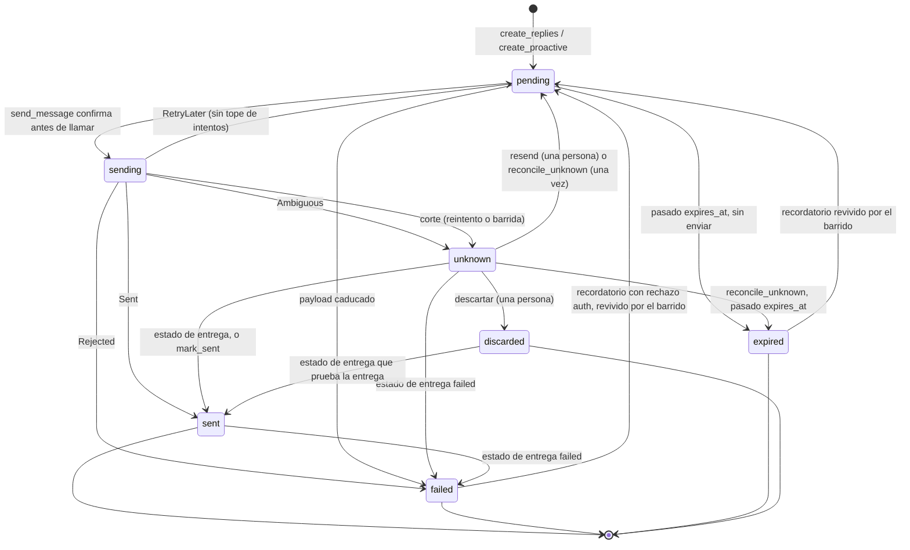

# Efectos e idempotencia

Un efecto es todo lo que sale de la base de datos y no se puede deshacer: un mensaje por WhatsApp o Telegram, una cita en Google Calendar, un aviso al dueño. Esta página explica cómo la plataforma se asegura de que cada efecto ocurre **una sola vez** aunque un trabajo se reintente, un worker muera a mitad o el proveedor conteste mal. Léela antes de tocar el envío, un pack que llame a servicios externos o cualquier trabajo de la cola. Es la regla más crítica del proyecto.

## Las reglas

Vienen de `CLAUDE.md` y todo el código las sigue:

- **Todo efecto externo es idempotente.** Repetir la operación con la misma clave no repite el efecto.
- **Un envío ambiguo no se reintenta a ciegas.** Si no sabemos si salió, el estado es `unknown`: primero se concilia con el estado del proveedor y, si pasado el plazo no hay evidencia, se reenvía **una sola vez** y solo si su clase declara que un duplicado es inocuo; si no, decide una persona ([ADR-026](adr/ADR-026-conciliacion-de-envios-ambiguos.md)).
- **Ninguna transacción abierta durante una llamada a Meta, Google o Telegram.** Una transacción abierta retiene una conexión y bloqueos mientras un tercero tarda segundos.

De las dos primeras sale un patrón único: **apuntar la intención en la base de datos y confirmarla antes de actuar, y apuntar el resultado después**. Si el proceso muere entre medias, el rastro dice qué pudo pasar.

## Estados de un envío

Cada mensaje saliente es una fila de `outbound_message` (`apps/backend/src/autobot/runtime/models.py`, `OutboundMessage`), con un estado y una clave de idempotencia única por negocio (`outbound_idem_key_uniq`).



| Estado | Significado |
|---|---|
| `pending` | Creado, con su trabajo `send_message` encolado. También tras un `RetryLater`, hasta `expires_at`. |
| `sending` | Se ha **confirmado** el intento y se está llamando (o se llamó) al proveedor. |
| `sent` | El proveedor aceptó el mensaje (o un estado de entrega lo demuestra). |
| `failed` | Rechazado de forma definitiva. No se reintenta. |
| `expired` | Pasó su `expires_at` sin que el proveedor lo aceptara: **no se envió** (y no saldrá más tarde). Una respuesta caducada se sustituye por una disculpa; un recordatorio puede revivirse. Ver [ADR-024](adr/ADR-024-envio-saliente-por-caducidad.md). |
| `discarded` | Una persona decidió no enviarlo ([ADR-031](adr/ADR-031-incidencias-como-bandeja.md)). Estado final: no se reenvía, la conciliación y las barridas lo ignoran y un recordatorio no lo revive. Solo un estado de entrega del proveedor que **demuestre** la entrega lo pasa a `sent`; un `failed` posterior lo deja como está. No es un fallo: no cuenta en las cifras de fallos. |
| `unknown` | Pudo salir o no. Se concilia (estado de entrega) y, sin evidencia tras 10 minutos, se reenvía una sola vez si la clase admite duplicados; si no, decide una persona. |

### Por qué existe `sending`

`send_message` (`apps/backend/src/autobot/runtime/outbound.py`) hace tres pasos:

1. Una transacción corta: bloquea la fila, traduce la respuesta (`render`), pasa a `sending`, suma un intento y **confirma**.
2. Sin transacción: `adapter.send(...)`.
3. Otra transacción corta: guarda el resultado.

Si el proceso muere entre 1 y 3, no sabemos si el proveedor llegó a recibir la petición. La fila se queda en `sending`, y cuando alguien la vuelve a encontrar (el reintento del trabajo, o una barrida) la pasa a `unknown` en lugar de enviarla otra vez. Si el estado confirmado fuese `pending`, el reintento reenviaría y el cliente recibiría el mensaje duplicado.

Todo lo que puede fallar antes de la llamada (traducir el mensaje, resolver el canal) ocurre aún en `pending`: un error ahí deshace la transacción y deja el mensaje como estaba.

### Qué resultado da cada adaptador

`ChannelAdapter.send` (`apps/backend/src/autobot/channels/base.py`) devuelve uno de cuatro resultados cerrados, y `_record` los traduce a estados:

| Resultado | Cuándo | Estado |
|---|---|---|
| `Sent` | El proveedor aceptó y dio un id. | `sent` |
| `Rejected` | El proveedor lo rechaza; reenviar fallaría igual. `kind`: `auth` (token rechazado, avisa ops), `recipient` (marca al contacto `unreachable`), `other`. | `failed` |
| `RetryLater` | Seguro que no salió: no hubo conexión, límite de tasa, o un 5xx de Meta con su cuerpo de error. Puede traer `after_s`; su `kind` es `rate`, `server` o `network`. | `pending` y se reintenta hasta `expires_at`, sin tope de intentos |
| `Ambiguous` | Pudo salir: tiempo agotado tras conectar, 2xx sin id, 5xx de Telegram... Lleva `transport` si fue un fallo del proveedor o de la red (alimenta el cortacircuitos, no cambia el estado). | `unknown` |

La clasificación vive en cada adaptador (`autobot/channels/whatsapp/adapter.py` y `autobot/channels/telegram/adapter.py`, función `classify`), porque difiere: un 5xx es `RetryLater` para Meta y `Ambiguous` para Telegram. Cada adaptador también traduce el `last_error` guardado a una **clase de error** (`outside_window`, `undeliverable`, `blocked`, `auth`, `rate`, `marketing_declined`, `spam_limit`, `other`; función `error_class`, que lee los dos formatos de WhatsApp y el de Telegram), y `ops/send_errors.py` le da el título y el consejo en español. Telegram guarda, además del código, una frase corta de una lista fija (p. ej. `chat not found`), nunca el texto libre de la descripción. Solo un fallo de conexión (`ConnectError`, `ConnectTimeout`, `PoolTimeout`) es `RetryLater` seguro; cualquier otro error de red después de conectar es `Ambiguous`.

Cada paso a `failed` (rechazo síncrono, `status failed` asíncrono, contenido caducado) guarda `failed_at`, y cada paso a `unknown` guarda `unknown_at`; en `notification`, `failed_at` se guarda al pasar a `failed` o `expired`. Es la hora del **caso** en Incidencias (ADR-031): cuenta cuándo se convirtió en fallo, no cuándo se creó la fila, así que un reenvío de un `unknown` antiguo que luego falla es un caso nuevo tras la marca de revisión. Las filas anteriores a la columna usan `created_at`.

### Cómo sale un mensaje de `unknown`

1. **Prueba del proveedor.** WhatsApp devuelve estados de entrega por el webhook, con nuestro id en `biz_opaque_callback_data`. `apply_status` (`runtime/process.py`) convierte `sent`/`delivered`/`read` en `sent` para un `unknown`, y `failed` en `failed`.
2. **Conciliación automática** (`reconcile_unknown`, `runtime/reconcile.py`, cada 5 minutos, por negocio y en lotes de 100). Un `unknown` de más de `RECONCILE_WAIT` (10 minutos), sin `provider_message_id` y con `ambiguous_resends = 0`, se reenvía **una vez** por la vía normal de `send_message` (candados, cortacircuitos, `expires_at`) si su clase es `safe` en `DUP_POLICY` (`runtime/outbound.py`: respuestas, menús, disculpas y recordatorios; lo no declarado es `unsafe`). Si ya pasó `expires_at`, pasa a `expired` sin reenviar. Si el reenvío vuelve a ser ambiguo, queda `unknown` para una persona. Duplicado máximo: uno por mensaje.
3. **Una persona.** Con las acciones de `apps/backend/src/autobot/ops/actions.py`, que usan el panel y el comando `outbound_resolve`:
    - `mark_sent`: confirma que llegó (revisado en el panel del proveedor o con el destinatario). Pasa a `sent`.
    - `resend`: autoriza un reenvío **sabiendo que puede duplicarse**. Pasa a `pending` y encola `send_message` en la misma transacción.
    - `discard`: la persona decide no enviarlo (ni confirmarlo). Pasa a `discarded`, sin espera mínima.
    - `mark_sent` y `resend` exigen estado `unknown` y que lleve más de 10 minutos (`unknown_at`), porque uno reciente aún puede resolverse solo con un estado de entrega. `resend` exige además que el contenido siga disponible (el payload se vacía a los 30 días), que el negocio se resuelva sin ambigüedad, no esté dado de baja y su canal esté activo. Las tres acciones dejan registro de auditoría (`outbound.mark_sent`, `outbound.resend`, `outbound.discard`).
    - Ya no hay reenvío en bloque (retirado por el [ADR-031](adr/ADR-031-incidencias-como-bandeja.md)). Un reenvío de una persona fija `ambiguous_resends = 1`: la plataforma no añade el suyo.
    - `discard_all` («Descartar todos», en la incidencia `outbound_ambiguous`): descarta de una vez todos los `unknown` sin decidir del negocio (los que la incidencia muestra como casos). No envía nada, a diferencia del reenvío en bloque retirado; un solo registro `outbound.discard_all` con el número.
    - Tras cada decisión (`mark_sent`, `resend`, `discard`, `discard_all`) se reevalúa en el acto la incidencia `outbound_ambiguous` del negocio: si no queda ningún caso sin decidir, se cierra sin esperar a la siguiente pasada de `ops_check`.
4. Los trabajos `send_message` y `send_notification` **nunca** se reintentan desde Incidencias (`failed_job:<tarea>`) ni con `job_retry` (`NOT_RETRYABLE_TASKS`): en el panel el botón «Reintentar» sale desactivado con el motivo.

El procedimiento para el operador está en [envíos unknown](../incidencias/envios-unknown.md).

## Reintentos que sí son seguros

`send_message` reintenta **por tiempo, no por número** (decisión en [ADR-024](adr/ADR-024-envio-saliente-por-caducidad.md)). Cada mensaje lleva `expires_at`: 30 minutos desde su creación una respuesta; el menor de 24 h y el `not_after` que fije el pack un recordatorio (`salon`: 30 minutos antes de la cita). Mientras no llegue:

- `RetryLater` deja el mensaje en `pending` y lanza `SendRetry` con la espera: el `Retry-After` del proveedor, o un retroceso exponencial con jitter (5 s, 10 s... hasta 300 s) que nunca pasa de la caducidad. `SendRetryStrategy` (`apps/backend/src/autobot/runtime/jobs.py`) lo reintenta siempre. Los errores transitorios de base de datos (`RETRYABLE`) siguen con un máximo de 5 reintentos (`DB_ERROR_RETRIES`); un `pending` que se quede sin trabajo lo reencola la barrida.
- Lo ambiguo no cambia: `unknown`, nunca reenviado a ciegas.
- Con el **cortacircuitos del proveedor** abierto, el mensaje se aplaza sin llamar a Meta o Telegram (ver [cola y workers](cola-y-workers.md#cortacircuitos-del-proveedor)).

Pasado `expires_at`, el siguiente run lo marca `expired` en lugar de enviarlo. Si era una **respuesta**, no se entrega (sus botones pueden estar obsoletos): se crea **una** disculpa (`APOLOGY_TEXT`, `core/conversation.py`), como mucho una por contacto cada 6 horas, idempotente por `apology:<id del mensaje caducado>`, que caduca a las 6 horas y no genera otra disculpa. Si era un **recordatorio**, queda `expired` sin disculpa; cuando el barrido del pack vuelve a ofrecer esa misma clave `reminder:*` y la cita sigue por delante, `create_proactive` lo revive (`pending`, `expires_at` nuevo, intentos a cero). Un `failed` por rechazo de credenciales (`last_error` que empieza por `auth:`, un token revocado) también se revive igual, con la misma comprobación de `not_after`: tras arreglar el token, el barrido vuelve a ofrecer el recordatorio y sale. Un `failed` por otro motivo (`recipient`, `other`), un `sent` o un `unknown` no se reviven. Mientras el cortacircuitos está abierto, la espera de un mensaje nunca pasa de su `expires_at` (como en `RetryLater`).

Las respuestas de un contacto salen en orden con el candado `out:<h>`; los envíos proactivos usan `outp:<h>`, así que un recordatorio atascado no bloquea una respuesta (y entre ambos tipos no hay orden). Un `resend` manual (`ops/actions.py`) da al mensaje un `expires_at` nuevo.

Si el trabajo se reintenta porque murió un worker con el mensaje en `sending`, el reintento lo ve y lo deja `unknown`. Nunca reenvía.

`send_notification` (avisos al dueño) también reintenta por tiempo, con `NotificationRetryStrategy`: un aviso de más de 2 h (`NOTICE_TTL`) pasa a `expired` sin enviarse. Ver [Avisos al dueño en ADR-024](adr/ADR-024-envio-saliente-por-caducidad.md#avisos-al-dueno).

## Idempotencia en cada capa

La misma idea se repite en cada punto donde algo puede ejecutarse dos veces.

| Dónde | Mecanismo |
|---|---|
| Entrada | `inbound_event` único por `(tenant_id, channel, provider_event_id)`: un reintento del proveedor no crea un segundo evento. |
| Procesar un evento | tx2 de `process_event` no hace nada si el evento ya no está `pending`; las respuestas solo se crean ahí. |
| Respuestas | `idem_key = reply:<event_id>:<seq>`. |
| Mensajes proactivos | El pack pone la clave (`SendProactive.idem_key`). `create_proactive` usa `ignore_conflicts`: una clave repetida no crea otra fila y devuelve `None`. |
| Avisos al dueño y métricas | `NotifyOwner.idem_key`, `RecordMetric.idem_key`: mismo `ignore_conflicts`. |
| Cola | Los trabajos se encolan en la misma transacción que su fila (ver [cola y workers](cola-y-workers.md)); `queueing_lock` evita duplicados vivos. |
| Llamadas del pack | Claves y diario de efectos, abajo. |

### `core/idem.py`: claves

`apps/backend/src/core/idem.py` (`IdemKeys`) da dos tipos de clave, y el runtime lo pone en `ctx.idem`:

- `event(name)` devuelve `name:<event_id>`: ligada al evento que se procesa, así que reprocesarlo da **la misma clave**. Falla si no hay evento (en tareas periódicas).
- `stable(name)` identifica una entidad entre ejecuciones, para las barridas: por ejemplo `reminder:<gcal_id>:<inicio>` evita recordar dos veces la misma cita.

Un pack usa la clave para que el efecto sea determinista. El pack `salon` deriva el id de la cita en Google Calendar a partir de `ctx.idem.event(...)` (`packs/salon/booking.py`, `event_id`): si el trabajo se reintenta tras crear la cita, el segundo intento encuentra el evento con ese id y lo devuelve en lugar de crear otro. Si el id existe pero su clave o dueño no coinciden, lanza un error permanente.

### `core/effects.py` y `runtime/effects.py`: el diario de efectos

Algunos efectos no se pueden hacer idempotentes solo con un id determinista. Cancelar una cita borra el evento; en un reintento ya no existe y no hay forma de saber si lo cancelamos nosotros o nunca fue del contacto. Para esto el pack guarda **evidencia** antes de actuar.

El contrato es mínimo (`apps/backend/src/core/effects.py`):

```python
--8<-- "apps/backend/src/core/effects.py:6:8"
```

`StoredEffects` (`apps/backend/src/autobot/runtime/effects.py`) lo implementa sobre la columna `effect_state` de `inbound_event`:

- La clave se guarda con un ámbito: un hash de negocio, evento, contacto, canal y calendario. Un valor no se puede usar desde otro contexto.
- Cada `get`/`put` abre su propia `tenant_tx` **corta** y la confirma: la evidencia queda guardada antes de la llamada externa y sobrevive si el worker muere.
- Solo es escribible mientras el evento está `pending` y en su canal (si no, `PermanentError`).
- `put` con la misma clave y distinto valor lanza `PermanentError` («Conflicting effect authorization»): evita que un reintento «cambie de opinión».
- La retención vacía `effect_state` a los 30 días junto con el `payload`.

El uso real es `Conversation.cancel` del pack `salon` (`packs/salon/conversation.py`): consulta la evidencia previa, comprueba que la cita es del contacto, **guarda la autorización** en una transacción aparte y solo entonces borra el evento. Si un reintento encuentra la cita ya borrada, la autorización guardada demuestra que la cancelación era legítima, y responde «cancelada» en vez de «no existe».

## Avisos al dueño

`send_notification` (`apps/backend/src/autobot/runtime/notifications.py`) aplica el mismo principio con una versión más estricta: antes de llamar a Telegram **reclama** la fila marcándola `failed` (confirmado) y solo después envía. Un corte o un resultado ambiguo se queda en `failed` y nunca se reenvía: `Notification` no tiene estado `unknown`. Solo se devuelve a `pending` ante un `RetryLater` seguro y mientras queden intentos. Por eso no sigue la conciliación de `unknown` de arriba: caducan a las 2 horas y no compensa un estado nuevo.

Si el dueño **no tiene chat conectado**, el aviso queda `held` en lugar de `failed`. Al conectar el chat (`owner/links.py`), los `held` de menos de 2 horas se encolan y los más viejos caducan (`release_held`); `reconcile_unknown` caduca los que nadie reclama. Un `held` no cuenta como fallo.

## Barridas: la red de seguridad

Los trabajos se encolan atómicamente con su fila, así que no debería haber trabajo perdido. Aun así, cada cinco minutos `ops_check` ejecuta las barridas de `apps/backend/src/autobot/runtime/sweeps.py` para el día que un worker muera en mal sitio. Solo actúan sobre filas **sin trabajo vivo** (`todo` o `doing`) en `procrastinate_jobs`:

| Situación | Acción |
|---|---|
| Saliente `sending` de más de 10 min | Pasa a `unknown`. Nunca se reenvía solo. |
| Saliente `pending` de más de 10 min, de menos de 24 h | Se reencola `send_message` (idempotente por estado). |
| Saliente `pending` de más de 24 h | No se toca; se cuenta como atascado y decide una persona. |
| Evento entrante `pending` de más de 5 min | Alerta `inbound_stuck`; se reencola si tiene menos de 1 hora. |

El límite de una hora evita un bucle con un evento que fallase siempre. Cada barrida procesa como máximo 200 filas. Detalle de operación en [cola y workers](cola-y-workers.md#barridas-de-ops_check).

## Ninguna transacción durante una llamada externa

Es la tercera regla, y explica la forma de casi todo el código de trabajos:

- `process_event`: tx1, **sin transacción** (acuse, pack, Calendar), tx2.
- `send_message`: tx (a `sending`), **sin transacción** (proveedor), tx.
- `run_periodic` (`runtime/periodic.py`): el manejador del pack corre sin transacción; solo sus acciones se aplican en una.
- `ctx.lock` (`runtime/context.py`, `advisory_lock`): el candado consultivo de PostgreSQL es de sesión y se toma **fuera** de una transacción; si se intenta dentro de una, lanza `RuntimeError`.
- El diario de efectos abre transacciones propias, cortas.
- `send_notification` y las alertas de ops (`send_ops_alert`) confirman antes de llamar a Telegram.

### Cómo se prueba

`apps/backend/src/core/testing/` ofrece lo necesario para que un pack pueda comprobarlo sin base de datos:

- `harness.py` (`Conversation`): simula `process_event` turno a turno, con el estado efectivo, las órdenes globales, `plan_sends` en modo estricto y las acciones. `replay()` reprocesa el último mensaje con el **mismo id de evento**, como un reintento tras morir el worker entre tx1 y tx2: deshace todo lo que el primer intento guardó y deja solo los efectos propios del pack (un calendario falso). Con `attempts=N`, un `TransientError` se reintenta como haría el trabajo.
- `effects.py` (`MemoryEffects`): diario de efectos en memoria que **sobrevive al replay**, igual que el diario confirmado aparte en producción, con el mismo conflicto de autorización.
- `clock.py`: reloj fijo.

Con esto los escenarios de cada pack (`apps/backend/tests/packs/<pack>/`) verifican que repetir un evento no duplica citas ni avisos. El calendario falso del pack `salon` (`packs/salon/testing.py`, `FakeCalendar`) permite programar fallos y contar llamadas.

La regla de las transacciones se comprueba en los tests de plataforma con aserciones como `assert not connections["default"].in_atomic_block` dentro de la llamada externa simulada (por ejemplo `tests/platform/channels/test_send.py` y `tests/platform/runtime/test_actions.py`).

!!! warning "Al añadir un efecto nuevo"
    Pregúntate tres cosas. ¿Qué clave lo hace repetible (`ctx.idem`)? ¿Qué evidencia guardo **antes** de actuar si no puedo reconstruirlo después (`ctx.effects`)? ¿Hay alguna transacción abierta cuando llamo al exterior? Si el efecto es un envío, usa `SendProactive` o `NotifyOwner` y deja que el runtime lo guarde y lo encole; no llames al proveedor desde el pack.

## Dónde está el código

- `apps/backend/src/core/effects.py` (`EffectJournal`), `apps/backend/src/core/idem.py` (`IdemKeys`).
- `apps/backend/src/autobot/runtime/effects.py` (`StoredEffects`), `outbound.py` (`send_message`, `_record`, `DUP_POLICY`), `reconcile.py`, `sweeps.py`, `notifications.py`.
- `apps/backend/src/autobot/ops/actions.py` (`mark_sent`, `resend`, `retry_job`).
- `apps/backend/src/core/testing/` (`harness.py`, `effects.py`, `clock.py`).

## Relacionado

[Vida de un mensaje](vida-de-un-mensaje.md) · [Cola y workers](cola-y-workers.md) · [Packs](packs.md) · [Envíos unknown](../incidencias/envios-unknown.md) · [ADR-004](adr/ADR-004-entrada-idempotente.md) · [ADR-026](adr/ADR-026-conciliacion-de-envios-ambiguos.md)
