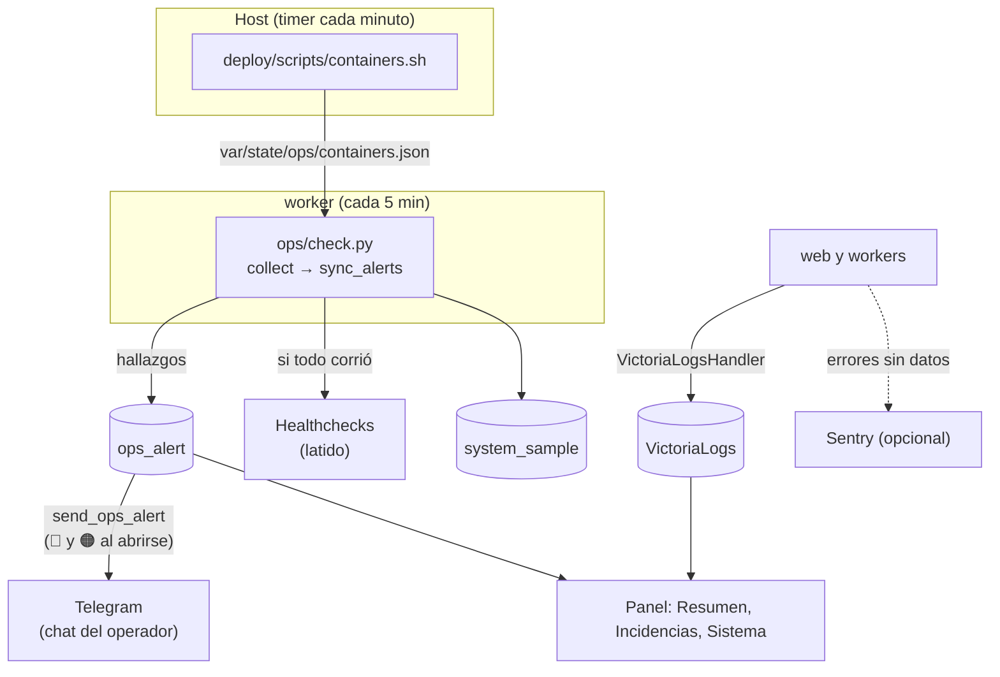

# Observabilidad

Cómo se entera la persona que opera de que algo va mal, sin instalar un sistema de monitorización aparte: una comprobación periódica dentro de la propia aplicación que convierte hallazgos en incidencias persistentes, logs técnicos enviados a VictoriaLogs, un latido a Healthchecks y avisos por Telegram. Lee esta página para entender qué mira cada pieza y dónde ver el resultado. Las decisiones están en [ADR-008](adr/ADR-008-panel.md) y [ADR-005](adr/ADR-005-vps-docker-compose.md). El catálogo de claves de alerta está en [Alertas](../referencia/alertas.md) y el significado de cada estado de un negocio en [Estados de negocio](../referencia/estados-de-negocio.md); aquí no se repiten.

## Visión de conjunto

El principio de ADR-008, ajustado por el [ADR-031](adr/ADR-031-incidencias-como-bandeja.md): **el panel es la bandeja completa y el bot avisa de lo urgente**. Toda incidencia se persiste antes en `ops_alert` y se ve en el panel; el bot solo empuja las 🔴 y 🟠 al abrirse (las 🟡 quedan en el panel y en el resumen diario), así que el bot muestra menos que el panel, nunca más.

## La comprobación periódica (`ops/check.py`)

El trabajo `ops_check` (`autobot/runtime/jobs.py`) corre cada 5 minutos en la cola `ops` (solo la escucha `worker-periodic`), con un candado para que no haya dos a la vez. Ejecuta `autobot.ops.check.run`:

1. `collect()` reúne los **hallazgos** (`Finding`: clave, negocio opcional y texto).
   - **Salud diaria acotada y repartida.** Las comprobaciones de salud de cada negocio (Graph de Meta, `getWebhookInfo`, Calendar) son llamadas HTTP en serie. Cada negocio tiene un desfase estable dentro de una ventana de 2 h (hash de su id) que se resta al día de validez de un resultado correcto, y cada pasada gasta como mucho `HEALTH_BUDGET_S` (60 s) en ellas: los vencidos que no caben se comprueban en las pasadas siguientes, el más atrasado primero. Con 700 negocios, el arranque en frío pasó de 581 s a unos 60 s por pasada, y todos quedan comprobados en menos de una hora. Un resultado con problemas se reintenta a los 15 minutos como antes.
   - **Caídas de proveedor.** Con una caída conocida de Meta o Telegram (señal del cortacircuitos de salida) o de Google (`calendar_outage`, derivada: al menos 5 negocios con calendario y el 30 % con problemas de Calendar en la misma pasada), se levanta una sola alerta de plataforma y se marcan como `suppressed` los hallazgos por negocio que esa caída explica; mientras dura y 20 minutos después, `sync_alerts()` no los crea y resuelve sin mensaje los que ya estaban abiertos.
2. `sync_alerts()` registra cada uno con `send_ops_alert`, cierra las **condiciones** abiertas que ya no aparecen, deja abiertos los **eventos** hasta que una persona los revise (solo recalcula sus casos) y reintenta, como mucho una vez por hora, los avisos que no llegaron (`retry_undelivered`).
3. `take_sample()` guarda una muestra de máquina (`system_sample`, 62 días) y borra las filas de `config_follower` de procesos que llevan un día sin latir.
4. Si no se lanzó ninguna excepción, envía el latido a Healthchecks.

`collect()` consulta como `fp_app`, con RLS: nada de datos de cliente ni saltos de permisos. Mira, entre otras cosas:

- La cola, con una sola consulta de edades por cola (`ops/queues.py`): la edad del trabajo listo más antiguo y del trabajo en curso más antiguo. De ahí salen `inbound_delay` (🔴, colas `inbound` e `inbound_ext`, 2 minutos: se mantiene porque es lo que el cliente final nota, y se alimenta de la misma consulta para no duplicar el cálculo), `queue_lag:<cola>` (🟠, `outbound` 5 min, `ops` 10 min, `periodic` 20 min, y trabajos en curso de más de 15 minutos, 1 hora en `periodic`) y los trabajos fallidos por tarea (`failed_job:<tarea>`, posteriores a su marca de revisión). La espera se mide desde `scheduled_at` (los `run_periodic` se reparten a propósito en 15 minutos), no desde la creación. La consulta solo lee filas `todo` y `doing`, que sirven los índices parciales de Procrastinate, así que no crece con el historial de trabajos terminados.
- El registro: configuraciones ilegibles, negocios degradados o con el canal sin configurar.
- La configuración cargada por cada proceso vivo (`config_follower`, [Config y registro](config-y-registro.md#confirmacion-de-que-un-cambio-esta-aplicado)): `config_stale` salta si alguno tiene una revisión distinta de la de la base más de un minuto desde que ese proceso se vio así, o si lleva más de un minuto fallando al comprobar o recargar la configuración (`last_error_at`).
- Por negocio: barridos de trabajo atascado (`runtime/sweeps.py`), envíos ambiguos sin decidir y envíos rechazados por clase de error, avisos al dueño fallidos o retenidos, rechazos de autenticación, umbral mensual de mensajes facturables de WhatsApp, errores seguidos y estado de Calendar (`ops/state.py`), y barridos periódicos que no se completan.
- La salud diaria de cada negocio y de los bots de plataforma (`ops/health.py`).
- Disco por encima del 80 % o el 95 %.
- Más de 10 días sin purgar las copias de seguridad (`backup_prune_overdue`).
- Los contenedores (`ops/containers.py`), salvo en local.

La lista completa y su significado: [Alertas](../referencia/alertas.md).

### Incidencias (`ops_alert`)

Cada incidencia es una fila de `OpsAlert` (`autobot/ops/models.py`) única por clave y negocio mientras esté abierta ([ADR-031](adr/ADR-031-incidencias-como-bandeja.md)). El registro `autobot/ops/incidents.py` declara la **naturaleza** de cada clave: una **condición** («está mal ahora») se cierra sola cuando `ops_check` deja de encontrarla (`auto_resolves`), y entonces se avisa del «Resuelta» solo si era crítica; un **evento** («pasó algo») se cierra con «Lo he revisado» desde el panel, que guarda una marca de revisión: solo cuentan los casos posteriores, y uno nuevo abre una fila nueva que hereda la marca. Los casos (envíos, trabajos, avisos) se calculan en vivo desde sus tablas (`autobot/ops/cases.py`) y no se copian a `ops_alert`, que no tiene RLS.

`send_ops_alert` (`autobot/runtime/notifications.py`) crea o actualiza la incidencia (contador, texto, severidad, casos) y solo empuja a Telegram una 🔴 o 🟠 que se abre, una reapertura de evento como mucho una vez por hora, o una subida de severidad; el envío ocurre fuera de la transacción. No hay repetición periódica. `open_incidents` (en el registro) es la única lista de incidencias abiertas: la usan Incidencias, la barra lateral, el Resumen, el nivel de cada negocio y el menú y el resumen diario del bot. Las filas se conservan un año. Detalle y claves: [Alertas](../referencia/alertas.md).

### Estados de salud y estado del negocio

Las comprobaciones de canal, plantillas y pack de cada negocio (`ops/health.py`, `tenant_health`) se cachean: un éxito 24 horas y un fallo solo 15 minutos, para que un fallo puntual no se quede un día entero. `ops/status.py` (`tenant_status`) las combina con las incidencias abiertas del negocio y la configuración en un único nivel por negocio (`ok`, `notice`, `warning`, `critical`, `unknown`), que usan todas las vistas. Ver [Estados de negocio](../referencia/estados-de-negocio.md).

### Estado de contenedores y máquina

Los contenedores no tocan `docker.sock`. Un temporizador del host (`deploy/systemd/autobot-containers.timer`, cada minuto) ejecuta `deploy/scripts/containers.sh`, que escribe una instantánea acotada en `var/state/ops/`, montada en solo lectura en `web` y los workers. `ops/containers.py` (`assess`) la evalúa: servicios esperados (`caddy`, `web`, `web-panel`, `worker-inbound`, `worker-calendar`, `worker-periodic`, `worker-outbound`, `panel`, `db`, `victorialogs`), reinicios, OOM, salud, imagen desplegada frente a `RELEASE_SHA` y, si la instantánea tiene más de 3 minutos, `containers_stale`. Durante un despliegue o una restauración se silencian los hallazgos. `victorialogs` nunca es crítico.

La máquina se lee de `/proc` dentro del contenedor (`ops/system.py`: CPU, memoria, swap, carga; disco e inodos con `statvfs`, contando solo lo que un proceso sin privilegios puede aún usar, porque ext4 reserva bloques para root y PostgreSQL no es root), sin agente externo. El estado de backups y despliegues sale de ficheros de estado del mismo directorio. Todo ello alimenta la pantalla Sistema (`panel/services/system.py`).

## Logs

La aplicación emite logs JSON estructurados por consola y, si `VICTORIALOGS_URL` está definida, los envía también a VictoriaLogs (31 días, solo red interna, sin puerto publicado). El panel los consulta con consultas acotadas (`panel/services/logs.py`), nunca directamente.

- `ops/logging.py`: `PrivacyFilter` redacta cada registro (`redact`: secretos configurados, cabeceras de autorización, tokens de bot, teléfonos) y `bind`/`contextual` fijan identificadores seguros (`tenant`, `channel`, `event_id`, `job`) en el contexto del trabajo. `JsonFormatter` da formato a la salida. Los secretos de todos los negocios se indexan una sola vez por registro cargado (una consulta de diccionario por posición del texto, sin recorrer los secretos), y el índice se reconstruye solo cuando cambia el registro o los secretos configurados; un registro ya filtrado no se vuelve a redactar. Los secretos solapados se funden y se tapan juntos.
- `ops/logship.py` (`VictoriaLogsHandler`): envía lotes en un hilo, **nunca bloquea ni lanza** y no se registra a sí mismo (evita recursión). Si la cola se llena descarta; si VictoriaLogs no responde, avisa por `stderr` como mucho una vez por minuto. Los logs no son críticos: perderlos no detiene nada.
- Sentry es opcional (`SENTRY_DSN`) y sus eventos van **vacíos de datos**: `before_send` solo deja pasar identificadores, ubicaciones de pila y un mensaje redactado, sin cuerpos de petición, variables locales ni texto de excepciones.

Qué nunca va a un log y por qué: [Seguridad y secretos](seguridad-y-secretos.md#datos-personales-fuera-de-logs-y-trabajos).

## Salud de la plataforma (`ops/views.py`)

Dos rutas sin autenticación, sin llamadas externas y sin nombres de negocio:

- `GET /health`: sonda de vida pública. Responde 200 mientras el proceso contesta, sin tocar la base de datos. Es la única ruta de salud que reenvía el Caddy público.
- `GET /health/internal`: estado de la base de datos y número de negocios cargados, degradados e ilegibles. Responde 503 si la base o la primera carga del registro fallan. El Caddy público no la reenvía y, si llega con la cabecera `X-Autobot-Edge`, devuelve 404. La usa `deploy.sh` para dar por bueno un despliegue.

## Healthchecks

`ops_check` pide `HEALTHCHECKS_PING_URL` al terminar, y **solo** si no ha fallado ninguna comprobación global ni de base de datos (sin `finally`): un `ops_check` caído deja de dar latido y es Healthchecks, desde fuera, quien avisa de que el worker o la cola no corren, algo que ninguna alerta interna puede detectar. El backup tiene su propio latido (`HEALTHCHECKS_BACKUP_PING_URL`, en `deploy/scripts/backup.sh`). Qué hacer cuando salta: [Cola y latido](../incidencias/cola-y-latido.md).

**Vigilar el propio canal de avisos.** Un latido verde no demuestra que las alertas lleguen: con el token del bot revocado o un `OPS_TELEGRAM_CHAT_ID` erróneo, `ops_check` termina bien y nadie se entera de nada. Por eso, si hay una alerta crítica abierta cuyo `last_delivery` es `failed` o `unconfigured` desde hace más de 15 minutos (`ALERT_CHANNEL_GRACE`), `ops_check` envía `HEALTHCHECKS_PING_URL` + `/fail` en lugar del ping de éxito y healthchecks.io avisa por su canal (correo o SMS). Un aviso que no llegó se reintenta como mucho una vez por hora mientras siga abierta la incidencia (`retry_undelivered`), sin contar como aviso nuevo: en cuanto Telegram lo acepta, `last_delivery` pasa a `sent` y el latido vuelve a ser de éxito sin tocar nada. Si no hay ninguna incidencia crítica abierta, el fallo del canal no se ve hasta que la haya.

**Configurar el monitor externo.** En healthchecks.io (o equivalente) crea un check con periodo de 5 minutos (el de `ops_check`) y gracia de 10, con aviso por un canal distinto del bot de avisos (correo o SMS: si cae la VPS, el bot de avisos cae con ella), y copia su URL en `HEALTHCHECKS_PING_URL` del `.env`. El ping no lleva datos: es un GET a esa URL. Para cubrir además que el proxy público contesta, añade un monitor HTTP externo (UptimeRobot o similar) contra `https://<dominio>/health`. Un fallo del ping solo se registra en el log; no rompe `ops_check`.

## Avisos al operador

Las incidencias 🔴 y 🟠 llegan al chat de Telegram indicado en `OPS_TELEGRAM_CHAT_ID` a través del bot de avisos (el mismo que atiende a los dueños, [Bot de dueños](bot-de-duenos.md)) al abrirse. Cada mensaje empieza por un emoji de gravedad (🔴 crítica, 🟠 aviso, 🟡 atención, 🟢 informativa) que fija `severity`; las 🟡 no se empujan (`last_delivery = panel`). Si el bot o el chat no están configurados, la incidencia solo se registra: la fila `ops_alert` y el panel siguen mostrándola (`last_delivery` queda `unconfigured`). Una informativa (por ejemplo, «desplegado correctamente») nace ya cerrada y siempre avisa.

En ese mismo chat, el operador puede preguntar el estado con un menú de solo consulta (Estado, Incidencias, Hoy, Clientes, Backups) y recibe cada día, desde las 09:00 de Madrid, un resumen con el estado y las cifras de ayer ([Bot de dueños](bot-de-duenos.md#menu-de-operador), [ADR-029](adr/ADR-029-menu-de-operador.md)).

## Dónde está el código

- `apps/backend/src/autobot/ops/`: `check.py`, `incidents.py`, `cases.py`, `send_errors.py`, `report.py`, `report_text.py`, `daily.py`, `health.py`, `status.py`, `state.py`, `containers.py`, `system.py`, `logging.py`, `logship.py`, `views.py`, `models.py`, `audit.py`.
- `apps/backend/src/autobot/runtime/notifications.py` (`send_ops_alert`, `retry_undelivered`, `resolve_alert`) y `jobs.py` (`ops_check`).
- `deploy/scripts/containers.sh`, `deploy/systemd/autobot-containers.timer`.
- `apps/backend/src/config/settings.py` (`LOGGING`, `VICTORIALOGS_URL`, `OPS_*`, `HEALTHCHECKS_PING_URL`, `SENTRY_DSN`).
- Tests: `apps/backend/tests/platform/ops/`.

## Relacionado

- [Alertas](../referencia/alertas.md) y [Estados de negocio](../referencia/estados-de-negocio.md).
- [Incidencias](../incidencias/README.md): qué hacer ante cada alerta.
- [Panel](panel.md): dónde se ven las alertas, los logs y el sistema.
- [Servidor](../procedimientos/servidor.md): variables y servicios externos.
