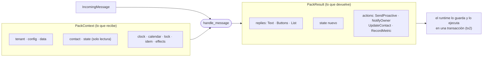
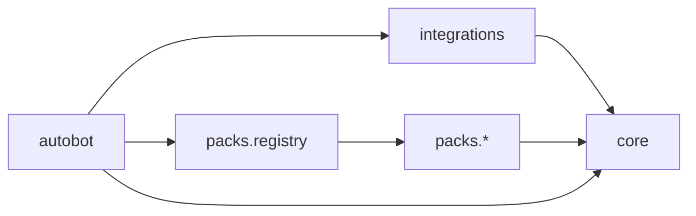
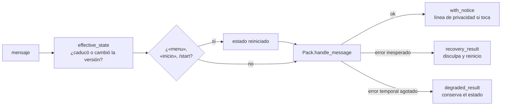

# Packs

Un pack es el código de un tipo de negocio: sabe qué es una cita o un horario de autobús, y no sabe nada del canal por el que habla ni de la base de datos. Lee esta página para entender el contrato que el pack cumple con la plataforma, qué reglas de import lo aíslan y qué trae cada pack. La decisión original está en [ADR-003](adr/ADR-003-packs.md); aquí se describe el estado actual.

## Qué es un pack

Un pack vive en `apps/backend/src/packs/<nombre>/` y se declara con una instancia de `Pack`. La plataforma no importa el pack directamente: lo obtiene de `PACKS`, un diccionario `{nombre: Pack}` construido en `packs/registry.py`. Los packs actuales son `bus` y `salon`.

Lo que el pack aporta:

- El **esquema de su configuración** (`config_schema`, un modelo Pydantic). El bloque `config` del documento de cada negocio se valida con él.
- La **conversación** (`handle_message`): recibe un mensaje y devuelve respuestas, el nuevo estado y acciones.
- Opcionalmente, los **datos** del negocio (`load_data`), tareas **periódicas**, una **comprobación de salud**, el **resumen** del dueño, las **plantillas** de WhatsApp y los **tipos de aviso** al dueño.

Lo que la plataforma aporta al pack: el canal, la cola, la base de datos, las claves de idempotencia, el calendario ya enlazado y el reloj. El pack nunca ve qué canal usa; solo recibe `can_contact_by_phone`.

## El contrato (`core/pack.py`)



El pack es casi una función pura: no abre transacciones, no llama a la base de datos y no sabe qué canal se usa. Lo que pide, lo hace la plataforma.

El contrato entero cabe en `apps/backend/src/core/pack.py`. Estos son los tipos, en el orden en que se usan:

| Tipo | Para qué sirve |
|---|---|
| `TenantInfo`, `ContactInfo` | Datos mínimos del negocio y del contacto que ve el pack. |
| `PackContext` | Todo lo que recibe en cada llamada: `tenant`, `config` validada, `data` (lo que devolvió `load_data`), `contact`, `state` (solo lectura), `clock`, `calendar`, `lock`, `idem`, `log`, `effects`. En los trabajos periódicos `contact` es `None`. |
| `PackResult` | Lo que devuelve `handle_message`: `replies`, `state` (`None` = sin cambios, `{}` = reiniciar) y `actions`. |
| `Periodic` | Un trabajo periódico: `name`, `every_min`, `handler` y `max_delay_min`. |
| `HealthIssue` | Un problema detectado por `Pack.health` (`code`, `message`). |
| `SummaryLine` | Una línea del resumen del dueño (`icon`, `label`, `value`, `unit`, `note`). |
| `OwnerNotice` | Un tipo de `NotifyOwner` que el pack puede emitir y la etiqueta que muestra el panel. |

Las acciones que un pack puede pedir están en `apps/backend/src/core/actions.py` (`Action`): `SendProactive`, `NotifyOwner`, `UpdateContact` y `RecordMetric`. El pack las devuelve; la plataforma las ejecuta de forma idempotente.

La definición de `Pack`:

```python
--8<-- "apps/backend/src/core/pack.py:115:143"
```

Notas sobre los campos:

- `state_version` y `conversation_timeout_min`: si cambia la forma del estado tras un despliegue, o pasa más del plazo sin mensajes, `core/conversation.py` (`effective_state`) reinicia el estado antes de llamar al pack.
- `load_data` y `dataset_summary`: el primero carga los datasets del negocio desde un directorio temporal; el segundo valida un dataset suelto para la biblioteca ([Config y registro](config-y-registro.md#biblioteca-de-datasets)).
- `template` y `template_blank`: la plantilla de la demo, ver más abajo.
- `needs_calendar` y `test_calendar`: solo `salon` usa calendario; `test_calendar` da un doble en memoria a `manage.py chat`.

## Reglas de import

Las comprueba `import-linter` con los contratos de `apps/backend/pyproject.toml` (`[tool.importlinter]`):



- `core` no importa nada del proyecto ni Django.
- `integrations` solo importa `core`, sin Django.
- `packs` solo importan `core`: nunca Django, `integrations`, `autobot` ni otro pack.
- Un pack solo lo importa `packs.registry`; `autobot` llega a los packs únicamente a través del registro.

Por eso el calendario llega al pack como un `Protocol` definido dentro del pack (`packs/salon/ports.py`) y no como un tipo de `integrations`.

## Límites comunes de los canales

Un pack construye respuestas que caben en **los dos** canales, así que se aplica el valor más estricto de cada límite. Viven en `apps/backend/src/core/limits.py`:

| Límite | Valor |
|---|---|
| Texto (`MAX_TEXT`) | 4.096 caracteres |
| Cuerpo interactivo (`MAX_INTERACTIVE_BODY`) | 1.024 |
| Botones (`MAX_BUTTONS`) | 3 |
| Filas de lista (`MAX_LIST_ROWS`) | 10 en total |
| Título de botón / fila / sección | 20 / 24 / 24 (unidades UTF-16) |
| Id de botón o fila (`MAX_ID_BYTES`) | 64 bytes |

`plan_sends` convierte las respuestas del pack en los mensajes finales: une textos consecutivos, mete un texto en el cuerpo del mensaje interactivo que le sigue si caben y aplica los límites. Con `strict=True` (tests y arnés) un exceso lanza `LimitError`; en producción se trunca y se registra. Los problemas que truncar no arregla (ids vacíos, repetidos o de más de 64 bytes) lanzan siempre.

`core/replies.py` define las respuestas comunes (`Text`, `Buttons`, `List`) y `core/ui.py` ofrece constructores que ya respetan los límites (`button`, `row`, `buttons_msg`, `list_msg`) y `paginate`, que reparte filas en páginas de 8 más «Ver más» y «Volver» (10 en total).

## Reglas de conversación compartidas

`apps/backend/src/core/conversation.py` agrupa funciones puras que el runtime y el arnés de tests llaman en el mismo orden, de modo que un escenario ejecuta el pack igual que producción:



- `effective_state`: reinicio por caducidad (silencioso) o por cambio de `state_version` (con aviso «he tenido que empezar de nuevo»).
- `is_menu_command`: `menu`, `menú`, `inicio` y `/start` abren el menú. Es la única orden que la plataforma atiende antes que el pack; cualquier otra palabra (también `persona` o `baja`) llega al pack como texto ([ADR-028](adr/ADR-028-aviso-en-una-linea-sin-persona-ni-baja.md)).
- `recovery_result` y `degraded_result`: disculpa tras un error inesperado o tras agotar los reintentos de un error temporal.
- `first_contact_notice` y `with_notice`: la línea de privacidad (ver abajo).

### Aviso inicial

El aviso es igual para todos los packs; por eso vive en la plataforma y no en cada pack.

El runtime añade **una línea en cursiva al final** de la respuesta cada vez que el pack muestra su menú principal (`PackResult(menu=True)`) y en la primera respuesta que recibe un contacto (`Contact.notice_sent_at` nulo):

> _🤖 Asistente automático de {negocio} · Privacidad:_ {enlace}

Sin `privacy.policy_url` no hay enlace. Va al final para que lo primero que se lea sea la respuesta; si no cabe en la última (1.024 caracteres en un interactivo), sale como texto aparte. La primera vez se marca en la misma transacción que las respuestas, así que un reintento no lo duplica. En el bot de demo lo redacta `channels/demo/notice.py` con `PLATFORM_PRIVACY_URL`.

No hay órdenes de atención («persona», «baja»): la atención humana la cubre el teléfono del negocio que muestra el pack, y quien no quiere recordatorios lo pide al negocio, que lo olvida desde el panel ([ADR-028](adr/ADR-028-aviso-en-una-linea-sin-persona-ni-baja.md)).

El bot nunca adivina en silencio: o hay una respuesta única, o pregunta.

## Plantilla y negocio de demo

Cada pack lleva su plantilla en `apps/backend/src/packs/<pack>/template/`: un `document.yaml` (el documento de un negocio de demo) y, si el pack usa datasets, una carpeta `datasets/`. `Pack.template` apunta a ella y `Pack.template_blank` lista los campos de `config` que se vacían cuando la plantilla sirve para inicializar un cliente nuevo desde el panel (nombre, teléfono, calendario…). De ahí sale el negocio de demo: ver [Bot de demo](bot-de-demo.md#negocios-de-demo-y-plantillas).

## Escenarios de conversación

Son obligatorios para cada pack y cada cambio de su flujo. Usan el arnés `core/testing/harness.py` (`Conversation`): cada turno sigue `process_event` sin base de datos, con estado efectivo, comandos globales, el pack, `plan_sends` en modo estricto y las acciones; respuestas y estado pasan por JSON como en producción. Además cada respuesta se renderiza con los dos adaptadores de canal, de modo que un exceso de límites o un id inválido rompe el test. Los escenarios están en `apps/backend/tests/packs/<pack>/` (por ejemplo `test_escenarios.py` en `bus` y `test_booking.py` en `salon`) y se parametrizan para WhatsApp y Telegram. Cómo escribirlos: [Desarrollo: tests](../desarrollo/tests.md).

## Los dos packs

**`salon`** (peluquería) gestiona reservas sobre Google Calendar: pedir, mover y cancelar citas, con huecos libres comprobados de nuevo antes de escribir e ids deterministas para que reintentar no duplique. Declara un periódico `calendar_sweep` (cada 15 minutos: recordatorios y avisos de citas manuales), una comprobación de salud del calendario, dos plantillas de WhatsApp (confirmación y recordatorio), cuatro tipos de aviso al dueño y un resumen con citas e ingresos. Su configuración: [Pack salon](../referencia/packs/salon.md).

**`bus`** (autobuses) responde consultas de horarios por origen, destino y día con un dataset versionado (`timetable`) que se sube a la biblioteca de datasets. No usa calendario ni tiene periódicos ni plantillas. Su configuración: [Pack bus](../referencia/packs/bus.md). Es la excepción a la regla de idioma del código: conserva identificadores en español (`Localidad`, `Viaje`).

Para crear un pack nuevo: [Añadir un pack](../desarrollo/anadir-un-pack.md).

## Dónde está el código

- `apps/backend/src/core/pack.py`, `actions.py`, `conversation.py`, `replies.py`, `limits.py`, `ui.py`, `proactive.py`.
- `apps/backend/src/packs/registry.py` (`PACKS`) y `apps/backend/src/packs/<pack>/pack.py` (la instancia `pack`).
- `apps/backend/pyproject.toml`, sección `[tool.importlinter]`.
- `apps/backend/src/core/testing/harness.py` y `apps/backend/tests/packs/`.

## Relacionado

- [ADR-003: packs](adr/ADR-003-packs.md) y [ADR-015: varios peluqueros](adr/ADR-015-varios-peluqueros.md).
- [Vida de un mensaje](vida-de-un-mensaje.md): cuándo llama el runtime al pack.
- [Canales](canales.md): qué adapta cada canal de lo que devuelve el pack.
- [Config y registro](config-y-registro.md): cómo se valida y se carga la configuración de cada negocio.
