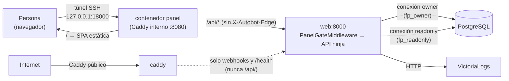

# Panel

El panel es la herramienta interna de la persona que opera Autobot: ver de un vistazo si todo va bien, dar de alta y configurar negocios, resolver incidencias y consultar datos y logs sin entrar por SSH. Esta página describe cómo está construido y por qué es seguro; para usarlo, ver [Panel (uso)](../procedimientos/panel.md), y para desarrollarlo, [Panel (desarrollo)](../desarrollo/panel.md). Las decisiones están en [ADR-008](adr/ADR-008-panel.md), [ADR-014](adr/ADR-014-pestana-de-alta.md) y [ADR-016](adr/ADR-016-acciones-de-alta-whatsapp.md).

## Visión de conjunto

El panel son dos piezas que comparten origen:

- Un **frontend** (`apps/panel/`): una SPA estática (React, TypeScript, Vite).
- Una **API** (`apps/backend/src/autobot/panel/`): django-ninja, dentro del mismo proceso `web` que los webhooks, montada en `/api/panel/`.

El contenedor `panel` (`apps/panel/Caddyfile`) sirve la SPA y hace de proxy de `/api/*` hacia `web:8000`, quitando la cabecera `X-Autobot-Edge`. No hay CORS: la SPA y la API comparten origen y las cookies de sesión de Django funcionan tal cual.

## Acceso solo por túnel SSH

Nada del panel está expuesto a internet:

- El contenedor `panel` escucha en `127.0.0.1:8080` del servidor. Se llega con `make panel-tunnel HOST=<servidor>`, que abre un túnel SSH hacia el puerto local 18000 ([Panel (uso)](../procedimientos/panel.md)).
- El Caddy público (`deploy/caddy/Caddyfile`) solo reenvía una lista cerrada de rutas (los webhooks y `/health`) y les añade `X-Autobot-Edge: public`. Todo lo demás, incluido `/api/`, responde 404.
- `PanelGateMiddleware` (`autobot/panel/middleware.py`) es la segunda barrera: cualquier petición a `/api/panel/` que llegue con `X-Autobot-Edge` recibe 404, y en un proceso sin alias de base de datos `owner` (el worker) la API responde 503. Corre antes de `SessionMiddleware`, así que una petición rechazada ni siquiera toca la sesión.
- Como el tráfico va por el túnel a `127.0.0.1`, las cookies usan `Secure=False` (ADR-008).

## Frontend (`apps/panel/`)

Stack: React 19, TanStack Router (rutas por ficheros) y TanStack Query, `openapi-fetch` para llamar a la API, componentes shadcn sobre Radix y Tailwind, Biome y Vitest. Estructura de `apps/panel/src/`:

| Carpeta | Contenido |
|---|---|
| `routes/` | Rutas por ficheros. `_app.tsx` es el marco autenticado: si `auth/me` falla redirige a `/login`. Secciones: resumen, clientes (lista, ficha `$slug`, alta `nuevo`), demo, incidencias, logs, datos y sistema. |
| `features/` | Una carpeta por área (`tenants`, `onboarding`, `incidents`, `logs`, `data`, `demo-invites`, `overview`, `system`, `auth`, `activity`) con sus páginas, componentes y hooks. |
| `components/` | Componentes compartidos (`app-shell`, `status-dot`, `confirm-dialog`, `json-diff`, `code-editor`…); `components/ui/` es shadcn sin podar. |
| `api/` | `client.ts` (cliente tipado) y `schema.d.ts`, **generado** desde la API. |
| `lib/` | `queries.ts` (claves de react-query), `use-api-mutation.ts`, `status-levels.ts`, utilidades. |

El tipado entre ambas capas sale de OpenAPI: `make api` exporta `apps/panel/openapi.json` desde el backend y regenera `schema.d.ts`, así que un cambio de la API que rompa el frontend falla en `tsc`. `client.ts` añade la cabecera `X-CSRFToken` a las peticiones que escriben (leyendo la cookie `autobot_panel_csrftoken`) y, si la API contesta 403 por un CSRF caducado, pide uno nuevo y reenvía una vez. Un 401 en cualquier ruta salvo `auth/me` y `auth/login` devuelve a la pantalla de login.

!!! note "El frontend no es una barrera"
    La SPA oculta o desactiva botones por comodidad, pero toda validación y todo permiso se aplican en la API. Un cambio de interfaz nunca sustituye a una comprobación en el servidor.

## API (`autobot/panel/`)

`api.py` crea el `NinjaAPI` (`auth=PanelAuth()`, sin Swagger expuesto) y monta los routers. Todos los errores tienen la forma `{"code", "message", "details"}`: `ApiError` y `StoreError` se traducen con `CODE_STATUS` (`panel/errors.py`), y los fallos de validación, 404, datos que la base rechaza y peticiones demasiado grandes tienen su manejador. Un fallo de autenticación o CSRF conserva la forma `{"detail": ...}` de django-ninja. Un router final captura cualquier ruta desconocida y devuelve un 404 JSON.

La API sigue una separación en dos capas:

- `panel/routers/`: un fichero por área (`tenants`, `incidents`, `contacts`, `demo_invites`, `data`, `logs`, `audit`, `overview`, `system`, `packs`, `activity`, `calendar`). Declaran rutas y esquemas Pydantic y delegan.
- `panel/services/`: la lógica (`tenants`, `setup`, `overview`, `query`, `catalog`, `logs`, `system`, `demo_invites`…). Aquí viven las consultas.

La referencia completa de endpoints, generada del esquema OpenAPI, está en [API del panel](../referencia/api-panel.md).

### Sesión y TOTP (`panel/auth.py`)

- Un único rol: el operador. `manage.py panel_user create <usuario>` crea un usuario con `is_staff` y un `TOTPDevice` confirmado.
- `POST /auth/login` pide usuario, contraseña **y** código TOTP. `PanelAuth` solo acepta una sesión con usuario autenticado, `is_staff` y `is_verified()` (OTP superado). Todas las rutas lo exigen salvo `auth/csrf` y `auth/login` (que solo exige CSRF).
- Límite de intentos: 5 por usuario y 20 por dirección en 15 minutos. Se reserva un hueco **antes** de comprobar (`cache.add` atómico), de modo que intentos concurrentes no pasan juntos el límite. Cada bloqueo, fallo y acceso queda auditado. El mensaje de error es siempre el mismo.
- Sesión de 12 horas, cookies con nombre propio (`autobot_panel_session`, `autobot_panel_csrftoken`), `HttpOnly` y `SameSite=Strict`.

### Dos conexiones de base de datos

La API usa tres roles de PostgreSQL ([Seguridad y secretos](seguridad-y-secretos.md#roles-de-base-de-datos)):

- **`default`** (`fp_app`, con RLS): lo que corre igual que en el worker. Cuando el panel llama a código de la plataforma (`build_summary`, `ops.health`, `tenant_tx`…), ese código usa `default` y RLS, así que nunca mezcla datos de dos negocios.
- **`owner`** (`fp_owner`, `BYPASSRLS`): solo para lo que cruza negocios, y **siempre explícito** con `.using("owner")` en los servicios. `AuthDatabaseRouter` (`autobot/db/router.py`) manda a `owner` los modelos de `auth`, `contenttypes`, `sessions` y OTP, y `fp_app` pierde acceso a esas tablas. Escribir configuración pasa por `tenancy.store` ([Config y registro](config-y-registro.md)).
- **`readonly`** (`fp_readonly`): solo la consola SQL.

### Consola SQL

`panel/services/query.py` ejecuta consultas del operador con el rol `fp_readonly` (`NOBYPASSRLS`, solo `SELECT`). Las garantías no dependen solo del código:

- Admite una única sentencia `SELECT`, `WITH … SELECT` o `VALUES` (hasta 20.000 caracteres); rechaza varias sentencias y cualquier otra cosa.
- Corre en una transacción `READ ONLY` con `statement_timeout` de 10 s, `idle_in_transaction_session_timeout` de 15 s y rollback forzado, con un cursor con nombre. La conexión se cierra tras cada petición (`CONN_MAX_AGE=0`).
- Elige el ámbito con `app.tenant_id` (un cliente) o `app.readonly_all` (todos): cada tabla con RLS tiene una política `readonly_all` además de `tenant_isolation`.
- Límites de salida: 1.000 filas, 10.000 caracteres por celda, 5 MB por resultado y 2 consultas concurrentes.
- Las tablas sensibles (`SENSITIVE_TABLES` en `autobot/db/grants.py`: secretos, sesiones, TOTP, invitaciones, eventos de demo y de dueños…) están revocadas para `fp_readonly`: la consola no puede leerlas.
- La consulta se **audita antes** de ejecutarse (`data.query`), para que un fallo no deje una consulta sin rastro.

### Auditoría

Toda escritura del panel y de los comandos de operación deja una fila en `audit_event` (`autobot/ops/audit.py`, `record` y `record_tenant`): quién (`actor`), qué (`action`), sobre qué negocio y un resumen. Los `details` rechazan claves con forma de secreto (`token`, `password`, `otp`…). Se escribe con la conexión `owner` y `fp_app` no tiene ningún permiso sobre la tabla (`autobot/db/grants.py`). La pantalla Logs la muestra (`GET /audit`).

## Cómo se organiza el trabajo por pantallas

| Pantalla | Apoyo en el backend |
|---|---|
| Resumen | `services/overview.py`: estado global, indicadores del mes, alertas ([Observabilidad](observabilidad.md)). |
| Clientes | `services/tenants.py`: lista, ficha, versiones y vuelta atrás, secretos, exportación. Escribe con `tenancy.store`. |
| Alta | `services/setup.py` (`tenant_setup`): pasos con estado, «Comprobar» y acciones de WhatsApp. `GET` solo lee la caché; `POST` hace la llamada real, fuera de cualquier transacción y auditada. |
| Incidencias | `routers/incidents.py`: envíos `unknown`, trabajos fallidos y alertas ([Envíos unknown](../incidencias/envios-unknown.md)). |
| Logs | `services/logs.py` (consultas acotadas a VictoriaLogs), auditoría y conversaciones. |
| Datos | `services/catalog.py` y `query.py`: catálogo de tablas y consola SQL. |
| Sistema | `services/system.py`: contenedores, máquina, backups y despliegues. |
| Demo | `services/demo_invites.py` ([Bot de demo](bot-de-demo.md)). |

## Dónde está el código

- `apps/panel/src/` (`routes/`, `features/`, `components/`, `api/`, `lib/`), `apps/panel/Caddyfile`, `apps/panel/openapi.json`.
- `apps/backend/src/autobot/panel/` (`api.py`, `auth.py`, `errors.py`, `middleware.py`, `routers/`, `services/`).
- `apps/backend/src/autobot/db/router.py` y `grants.py`.
- `apps/backend/src/autobot/ops/audit.py`.
- Tests: `apps/backend/tests/platform/panel/`, `apps/backend/tests/platform/ops/test_db_roles.py`.

## Relacionado

- [ADR-008](adr/ADR-008-panel.md), [ADR-014](adr/ADR-014-pestana-de-alta.md), [ADR-016](adr/ADR-016-acciones-de-alta-whatsapp.md).
- [Panel (uso)](../procedimientos/panel.md), [Panel (desarrollo)](../desarrollo/panel.md), [API del panel](../referencia/api-panel.md).
- [Tenants y RLS](tenants-y-rls.md) y [Seguridad y secretos](seguridad-y-secretos.md).
