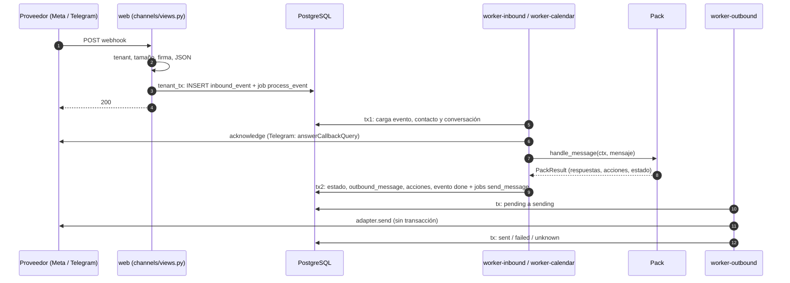

# Vida de un mensaje

Recorrido de un mensaje de un cliente, desde que el proveedor (Meta o Telegram) llama al webhook hasta que la respuesta sale por el mismo canal. Léelo para saber qué pasa en cada paso, dónde se defiende la plataforma y por qué ninguna fase deja una transacción abierta durante una llamada externa. Dos ideas que lo sostienen se explican aparte: [efectos e idempotencia](efectos-e-idempotencia.md) y [cola y workers](cola-y-workers.md).

## Visión de conjunto

El camino tiene dos mitades, separadas por la cola. El webhook solo guarda y encola; el trabajo de verdad lo hace un worker.

## 1. El webhook

`apps/backend/src/autobot/channels/views.py` tiene una vista por canal (`whatsapp`, `telegram`), con ruta `…/<public_id>`. No hace ninguna llamada externa: solo usa el registro de negocios en memoria y la base de datos. El orden es fijo (`receive`):

1. **Negocio.** `main_channel_tenant` busca el negocio por `(tipo de canal, public_id)`. Si no existe, su canal principal no está activo o no tiene secretos: `404`. Si el registro no se puede leer: `503`.
2. **Tamaño.** `body_too_large` rechaza con `400` un cuerpo de más de 256 KiB (`MAX_BODY`), según la cabecera `Content-Length` o el cuerpo real.
3. **Firma.** El adaptador del canal comprueba la autenticidad (`verify`) **antes** de interpretar el cuerpo. WhatsApp: HMAC-SHA256 del cuerpo en `X-Hub-Signature-256` con el secreto de la app. Telegram: el `secret_token` de `setWebhook` que vuelve en una cabecera. Ambas comparaciones son en tiempo constante (`hmac.compare_digest`). Una firma mala da `401`.
4. **Limitación de tasa.** Cada `401` se cuenta por (IP, ruta) en un `WindowLimiter` en memoria (`autobot/channels/ratelimit.py`): 20 fallos por minuto. Pasado el límite, una petición con firma inválida recibe `429`. Una petición con firma válida **nunca** se bloquea, y el contador es por negocio: las IP de Meta y Telegram son compartidas, así que un negocio con el secreto mal puesto no puede bloquear a los demás. La IP es la última entrada de `X-Forwarded-For` (la que pone Caddy). Cada proceso `web` cuenta por su cuenta.
5. **JSON.** `json_object` exige un objeto JSON; si no, `400`.
6. **Baja.** Si el negocio está `offboarded`, se responde `200` sin guardar nada (`accept`).
7. **Guardar y encolar.** `inbound.store` (ver abajo). Si falla con un error de base de datos o de cola, `storage_failure` responde `503` y el proveedor reintenta; si es un `DataError` (la base se niega a guardar ese cuerpo) es permanente: se descarta con `200` y se anota sin contenido.

El `GET` de WhatsApp es el saludo de suscripción de Meta (`handle_meta_handshake`): devuelve el reto, o `403` contando como fallo de firma.

Las peticiones del bot de demo y del bot de dueños entran por sus propias vistas; ver [el desvío](#desvio-eventos-de-plataforma-sin-negocio).

!!! note "Limpieza del cuerpo"
    Los adaptadores pasan lo que guardan por `clean_payload` (`autobot/channels/payload.py`): `jsonb` no admite NUL ni sustitutos UTF-16 sueltos, y como el proveedor reintenta el mismo cuerpo para siempre, un solo mensaje firmado bloquearía el webhook.

## 2. Guardar y encolar

`apps/backend/src/autobot/runtime/inbound.py` (`store`) convierte cada elemento del cuerpo (`ParsedItem`) en una fila de `inbound_event`:

- **Idempotente.** `INSERT … ON CONFLICT (tenant_id, channel, provider_event_id) DO NOTHING`. Si el proveedor reintenta, la fila ya existe y no se vuelve a encolar nada.
- **Estado inicial.** `pending`, salvo `ignored` (se guarda, no se procesa) cuando el canal principal no debe contestar: el negocio está pausado, o en alta y el remitente no está en `testers.main`. Los estados de entrega de nuestros propios mensajes nunca se ignoran: describen envíos ya hechos.
- **Mismo commit.** El trabajo se encola en la misma transacción (`runtime/queue.py`, `enqueue`): existe solo si la fila se confirmó. Un mensaje va a `process_event` con el candado `conv:<h>`; un estado de entrega va a `apply_status` sin candado. `apply_status` va siempre a la cola `inbound`; `process_event` va a `inbound_ext` si el pack del negocio llama a Google Calendar (`needs_calendar`, como `salon`) y a `inbound` si no (como `bus`). Un único helper decide la cola (`process_event_queue`), así que los mensajes de un contacto caen siempre en la misma y el candado los mantiene en orden ([ADR-023](adr/ADR-023-colas-aisladas-y-degradacion.md)).

Esta entrada la comparten los webhooks, el sondeo de Telegram (`telegram_poll`) y el selector del bot de demo, así que todos siguen el mismo camino. La [ADR-004](adr/ADR-004-entrada-idempotente.md) recoge la decisión.

## 3. `process_event`: tres fases

`apps/backend/src/autobot/runtime/process.py` (`process_event`) lo ejecuta un worker (`worker-calendar` para los packs que usan Calendar, `worker-inbound` para el resto). Está partido en tres para que no haya transacción abierta mientras el pack llama a Google Calendar ni mientras el adaptador habla con el proveedor.

**tx1: cargar.** Con `tenant_tx` (ver [tenants y RLS](tenants-y-rls.md)): lee el evento (si ya no está `pending`, termina: es un reintento tras un tx2 confirmado), reconstruye el mensaje desde el `payload` guardado, crea o actualiza el contacto y carga su conversación con el estado efectivo (caducidad y versión del estado).

**Sin transacción.**

- `acknowledge` del adaptador (Telegram responde al `callback_query`). Si falla, no detiene el mensaje.
- Limite por contacto: más de 20 mensajes en 60 s se guardan y no se contestan (`contact_limiter`; solo cuenta en el primer intento).
- Orden `menu` (`is_menu_command`): `menu`, `menú`, `inicio` y `/start` reinician el estado antes de llamar al pack. Es la única orden de la plataforma; `persona` o `baja` llegan al pack como texto ([ADR-028](adr/ADR-028-aviso-en-una-linea-sin-persona-ni-baja.md)).
- Línea de privacidad: si la respuesta es el menú del pack (`PackResult.menu`) o el contacto aún no lo ha recibido (y el negocio puede contestar), se añade como última línea de las respuestas (`with_notice`; [Aviso inicial](packs.md#aviso-inicial)).
- Si el negocio no tiene pack o está degradado, el contacto recibe un texto genérico (`UNAVAILABLE_TEXT`) y su conversación no se toca.
- En el caso normal, `_run_pack` construye el `PackContext` y llama a `Pack.handle_message` dentro de un **presupuesto de tiempo de 8 s** para todo lo que haga con Google Calendar: el cliente no empieza un intento cuando se ha agotado, y un cortacircuitos por proceso hace fallar al instante las llamadas mientras Google no contesta.

**tx2: persistir** (`_persist`). En una sola transacción: guarda el estado de la conversación, planifica las respuestas con `plan_sends` (límites comunes de los dos canales), crea las filas `outbound_message` (`create_replies`), aplica las acciones del pack (`apply_actions`), marca el evento `done` (o `failed`) y encola un `send_message` por mensaje (`defer_sends`). Los trabajos solo existen si todo se confirma. Si otra ejecución ya terminó el evento, tx2 no hace nada: nunca se contesta dos veces.

### Errores y reintentos

- `TransientError` del pack (un proveedor que puede contestar luego): el trabajo se reintenta (una sola vez en `inbound_ext`, tres en `inbound`); en el último intento el contacto recibe un texto genérico de servicio degradado («Ahora mismo no puedo completar tu consulta. Prueba de nuevo en unos minutos.») y **su conversación conserva el estado**, de modo que al repetir la última acción sigue donde iba. El evento queda `failed`.
- Cualquier otra excepción del pack: texto de recuperación (que se disculpa) y estado reiniciado, evento `failed`. Se registra con `log.exception`.
- Fallo determinista al persistir (por ejemplo `LimitError`): se persiste el texto de recuperación en su lugar.
- Errores de base de datos de conexión o concurrencia: se propaga y el trabajo se reintenta (ver [cola y workers](cola-y-workers.md#reintentos)).

## 4. El contexto del pack

`apps/backend/src/autobot/runtime/context.py` (`build_context`) construye el `PackContext` (`apps/backend/src/core/pack.py`). Es lo único con lo que el pack toca el exterior:

| Campo | Qué da |
|---|---|
| `tenant`, `config`, `data` | Negocio, su configuración validada y su dataset. |
| `contact`, `state` | El contacto y el estado de la conversación (copia: lo que el pack mute no cambia lo que guarda tx2). |
| `clock` | Reloj en la zona del negocio (en tests, uno fijo). |
| `calendar` | Solo si el pack lo necesita; el runtime lo ata al calendario del negocio. El pack no elige calendario ni sabe si es una demo. |
| `lock(key)` | Candado consultivo de sesión de PostgreSQL (`advisory_lock`), sin transacción abierta, con espera máxima de 10 s (si no, `TransientError`). Va prefijado con negocio y calendario. |
| `idem` | Claves de idempotencia ligadas al evento (`IdemKeys`). |
| `effects` | Diario de efectos (`StoredEffects`). |

Cómo se usan `idem` y `effects` está en [efectos e idempotencia](efectos-e-idempotencia.md). El contrato del pack (`handle_message`, `Periodic`, estado) se explica en [packs](packs.md).

El pack devuelve un `PackResult`: respuestas (`Reply`), estado nuevo y acciones (`SendProactive`, `NotifyOwner`, `UpdateContact`, `RecordMetric`, en `core/actions.py`). El pack no sabe qué canal usa.

## 5. Envío

`apps/backend/src/autobot/runtime/outbound.py` (`send_message`), en `worker-outbound`:

1. **tx:** bloquea la fila (`select_for_update`). Si ya pasó su `expires_at` (30 minutos una respuesta; hasta 24 h un recordatorio), la deja `expired` sin enviarla (una respuesta caducada se sustituye por una disculpa). Si no, traduce la respuesta al formato del proveedor con el adaptador (`render`) y la pasa de `pending` a `sending` **confirmándolo antes de llamar**. Con el cortacircuitos del proveedor abierto, no llega a llamar: se aplaza.
2. **Sin transacción:** `adapter.send(...)`.
3. **tx:** guarda el resultado: `sent`, `failed`, `unknown` o vuelve a `pending` si el proveedor pidió reintentar (se reintenta hasta que caduque, sin tope de intentos).

Las respuestas a un contacto salen de una en una y en orden gracias al candado `out:<h>`; los recordatorios y demás envíos proactivos usan `outp:<h>`, así que no se ordenan respecto a las respuestas ni las bloquean. El detalle de estados y por qué `unknown` no se reenvía está en [efectos e idempotencia](efectos-e-idempotencia.md#estados-de-un-envio).

Si el canal es WhatsApp, Meta devuelve después estados de entrega (`sent`, `delivered`, `read`, `failed`) por el mismo webhook. Entran como eventos de tipo estado y los procesa `apply_status`: localiza el mensaje por `outbound_ref` (nuestro id, que viajó en `biz_opaque_callback_data`) o por el id del proveedor, y actualiza su estado, precio y facturación. Un estado de entrega demuestra que un `unknown` sí salió.

## Los adaptadores

Los adaptadores de canal implementan el protocolo `ChannelAdapter` (`apps/backend/src/autobot/channels/base.py`): `verify`, `parse`, `acknowledge`, `render`, `send` y `synthetic_text`. `send` devuelve un resultado cerrado: `Sent`, `Rejected` (el proveedor lo rechazó; reenviar fallaría igual), `RetryLater` (seguro que no salió) o `Ambiguous` (quizá salió). Las diferencias entre WhatsApp y Telegram viven solo en `autobot/channels/whatsapp/` y `autobot/channels/telegram/`; `autobot/channels/adapters.py` (`endpoint`) elige adaptador, descripción del canal y secretos. Ver [canales](canales.md).

## Desvío: eventos de plataforma sin negocio

Dos entradas no pertenecen a ningún negocio y no pasan por `process_event`:

- **Bot de demo:** sus puertas guardan un `demo_event` y encolan `route_demo_event` (candado `demo:<h>`); el selector decide con qué negocio habla la persona y entonces sí crea un `inbound_event` normal. Ver [bot de demo](bot-de-demo.md).
- **Bot de dueños:** guarda un `owner_event` y encola `handle_owner_event` (candado `ownerchat:<h>`). Ver [bot de dueños](bot-de-duenos.md).

Como no hay negocio, no hay RLS ni `tenant_tx`. `apps/backend/src/autobot/runtime/event_flow.py` comparte sus pasos: el evento se marca hecho **antes** de contestar, para que un reintento no repita la respuesta; la única excepción es una respuesta que seguro no salió (`finish_and_send` devuelve `True`), que reabre el evento y reintenta el trabajo. `finish_limited` añade un límite por persona.

## Dónde está el código

- Webhooks: `apps/backend/src/autobot/channels/views.py`, `payload.py`, `ratelimit.py`.
- Registro y cola: `apps/backend/src/autobot/runtime/inbound.py`, `queue.py`, `jobs.py`, `locks.py`.
- Proceso: `apps/backend/src/autobot/runtime/process.py`, `context.py`.
- Envío: `apps/backend/src/autobot/runtime/outbound.py`; adaptadores en `apps/backend/src/autobot/channels/`.
- Contrato del pack: `apps/backend/src/core/pack.py`.

## Relacionado

[Efectos e idempotencia](efectos-e-idempotencia.md) · [Cola y workers](cola-y-workers.md) · [Tenants y RLS](tenants-y-rls.md) · [Canales](canales.md) · [Packs](packs.md) · [Bot de demo](bot-de-demo.md) · [Bot de dueños](bot-de-duenos.md)
