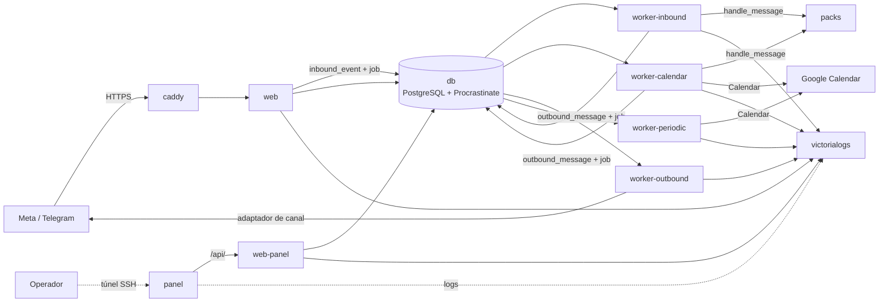

# Visión general

Esta página es la puerta de entrada a la arquitectura: qué es Autobot, qué contenedores lo componen, cómo se organiza el código en capas y qué reglas de import se cumplen. Léela primero; cada concepto tiene su propia página, enlazada abajo. Para encontrar un fichero concreto, usa el [mapa del código](mapa-del-codigo.md).

## Qué es

Autobot es una plataforma multi-negocio. Atiende a los clientes de pequeños negocios por un canal por negocio (WhatsApp o Telegram) con un bot. La lógica de cada tipo de negocio vive en un **pack**; hoy hay dos: `salon` (peluquería, reservas sobre Google Calendar) y `bus` (horarios de autobús). La plataforma no sabe qué es una cita ni un autobús, y los packs no saben qué canal se usa.

Además hay un **bot de demo** (para enseñar los packs a posibles clientes), un **bot de avisos** (notificaciones y asistente para el dueño del negocio) y un **panel** interno para operar la plataforma.

## Contenedores

Es un monolito modular Django 5.2 con PostgreSQL 18 y Procrastinate, en una VPS con Docker Compose ([ADR-001](adr/ADR-001-monolito-modular.md), [ADR-005](adr/ADR-005-vps-docker-compose.md)). El compose base está en `deploy/compose/compose.yaml`; `compose.local.yaml` y `compose.prod.yaml` lo completan. Esta es la lista de referencia de contenedores:

| Contenedor | Qué hace |
|---|---|
| `caddy` | Solo en producción. HTTPS automático; expone únicamente los webhooks (negocio, demo y bot de avisos) y `/health` |
| `web` | Público, detrás de `caddy`: sirve los webhooks (verifica, guarda, encola). Solo usa `fp_app`, sin credenciales `owner` ni `readonly` |
| `web-panel` | Misma imagen que `web`, solo en producción: sirve la API del panel (`/api/panel/`) con `fp_owner` y `fp_readonly`. Sin puerto publicado; solo lo alcanza `panel` ([ADR-020](adr/ADR-020-api-del-panel-aparte.md)). En local, un único `web` hace las dos cosas |
| `worker-inbound` | Procrastinate: cola `inbound` (4 huecos) |
| `worker-calendar` | Procrastinate: cola `inbound_ext`, los mensajes de los packs que llaman a Google Calendar (8 huecos) |
| `worker-periodic` | Procrastinate: colas `periodic` y `ops` (tareas periódicas y barridas, 2 huecos) |
| `worker-outbound` | Procrastinate: cola `outbound` (8 huecos) |
| `db` | PostgreSQL 18 con Row-Level Security forzada |
| `panel` | SPA estática con su propia Caddy interna, proxy de `/api/` hacia `web-panel`; solo accesible por túnel SSH ([ADR-008](adr/ADR-008-panel.md), [ADR-020](adr/ADR-020-api-del-panel-aparte.md)) |
| `victorialogs` | Almacén de logs técnicos (31 días), sin puerto publicado |

En producción los contenedores se reparten en redes de Compose separadas (`edge`, `panel`, `egress`, `data` y `logs`; ver [ADR-020](adr/ADR-020-api-del-panel-aparte.md)): `caddy` solo alcanza `web`, y ni `caddy` ni `victorialogs` tienen camino hasta la base de datos, que además no tiene salida a internet. Todos los contenedores de la aplicación descartan todas las capacidades de Linux y no pueden ganar privilegios.

Hay cuatro workers, cada uno con sus colas, para que un servicio lento no frene a quien no depende de él: una caída de Google Calendar (que llaman los packs desde `inbound_ext` y `periodic`) no frena los envíos, las conversaciones de los packs sin Calendar ni las tareas periódicas ([ADR-023](adr/ADR-023-colas-aisladas-y-degradacion.md)). Los detalles están en [cola y workers](cola-y-workers.md).

## Capas y reglas de import

El código del backend (`apps/backend/src/`) tiene cuatro capas. `import-linter` comprueba en CI estas reglas (contratos en `apps/backend/pyproject.toml`):

- **`core/`**: contratos y utilidades genéricas sin lógica de negocio. No importa Django ni nada del resto del proyecto.
- **`integrations/`**: puertos hacia servicios externos (`google_calendar`). Solo importa `core`, sin Django.
- **`packs/<pack>/`**: la lógica de cada negocio. Solo importa `core`: nunca Django, `integrations`, `autobot` ni otro pack. No toca la base de datos ni las APIs directamente ([ADR-003](adr/ADR-003-packs.md)).
- **`autobot/`**: el único paquete que usa Django. Resuelve lo común (webhooks, cola, multitenancy, panel, observabilidad) y llama a cada pack solo a través de `packs.registry`.

`config/` contiene los settings de Django y las URLs, y `tools/` los scripts de operación. A `core/` solo sube lo que usan los dos packs.

## Los conceptos

**Vida de un mensaje.** Del webhook a la respuesta: se verifica, se guarda en `inbound_event`, se encola, un worker llama al pack y la respuesta sale por la cola de envíos. El webhook guarda primero y contesta 200 después ([ADR-004](adr/ADR-004-entrada-idempotente.md)). Ver [vida de un mensaje](vida-de-un-mensaje.md).

**Efectos e idempotencia.** Todo efecto externo (enviar un mensaje, crear una cita) es idempotente y nunca se reintenta a ciegas un resultado ambiguo (`unknown`). Ver [efectos e idempotencia](efectos-e-idempotencia.md).

**Cola y workers.** Las colas corren sobre PostgreSQL con Procrastinate; los trabajos reciben solo ids. Ver [cola y workers](cola-y-workers.md).

**Tenants y RLS.** Cada dato de cliente lleva `tenant_id` y Row-Level Security; el tenant se fija con `tenant_tx`. Ver [tenants y RLS](tenants-y-rls.md).

**Canales.** WhatsApp y Telegram se aíslan tras un adaptador común; sus diferencias, y las defensas de los webhooks, viven ahí. Ver [canales](canales.md).

**Packs.** Cada pack trae su máquina de estados, su config y su plantilla de demo, y responde con un `PackResult`. Ver [packs](packs.md).

**Config y registro.** La config y los datasets de cada negocio viven en PostgreSQL, versionados e inmutables ([ADR-009](adr/ADR-009-config-en-bd.md)); cada proceso mantiene un registro en memoria que recarga cuando cambia la revisión. Ver [config y registro](config-y-registro.md).

**Bot de demo.** Dos puertas (un bot de Telegram y un número de WhatsApp de la plataforma) con un selector de negocios de demo; después la conversación es la del pack real ([ADR-006](adr/ADR-006-bot-de-demo.md)). Ver [bot de demo](bot-de-demo.md).

**Bot de dueños.** El bot de avisos envía las notificaciones de cada negocio y atiende al dueño, vinculado con un enlace de un solo uso ([ADR-007](adr/ADR-007-bot-de-duenos.md)). Ver [bot de dueños](bot-de-duenos.md).

**Panel.** Frontend en TypeScript más API `/api/panel/`, solo por túnel SSH. Ver [panel](panel.md).

**Observabilidad.** Logs estructurados hacia VictoriaLogs, alertas de operación y comprobaciones periódicas. Ver [observabilidad](observabilidad.md).

**Seguridad y secretos.** Secretos de canal cifrados en la base; secretos de la plataforma en el `.env` del servidor. Ver [seguridad y secretos](seguridad-y-secretos.md).

## Relacionado

- Decisiones y su motivo: [índice de ADR](adr/README.md).
- Dónde está cada cosa: [mapa del código](mapa-del-codigo.md).
