# Visión general de la arquitectura

Resumen de cómo encajan las piezas. Para el motivo de cada decisión, ver las ADR
enlazadas; para el detalle de la config y el registro, ver
[config-y-registro.md](config-y-registro.md).

## Flujo de un mensaje entrante

```mermaid
flowchart LR
    W[Webhook<br/>WhatsApp/Telegram] -->|verifica firma, guarda| IE[inbound_event]
    IE -->|misma transacción| Q[Cola Procrastinate<br/>inbound]
    Q --> PE[process_event]
    PE --> PK[Pack.handle_message<br/>ctx, msg → PackResult]
    PK --> OM[outbound_message]
    OM -->|cola outbound| SM[send_message]
    SM -->|adaptador de canal| ENV[Envío al proveedor]
```

El webhook guarda primero y contesta 200 después; el procesamiento ocurre en un
worker, fuera de la petición HTTP ([ADR-004](adr/ADR-004-entrada-idempotente.md)).
Las tres colas corren sobre PostgreSQL/Procrastinate
([ADR-001](adr/ADR-001-monolito-modular.md)) en dos workers: `worker-inbound`
(`inbound` y `periodic`) y `worker-outbound` (`outbound`), para que una caída de
Google Calendar (la llaman los packs desde `inbound` y la barrida de `salon` desde
`periodic`) no frene los envíos.

## Capas y sus reglas

`import-linter` vigila estas reglas en CI:

- **`core/` e `integrations/`**: no importan Django ni nada del resto del proyecto.
  Utilidades y contratos genéricos sin lógica de negocio (`core/ui`, `core/text`,
  `core/dates`, `core/limits`, `core/pack`) y los puertos externos (`integrations/google_calendar`).
- **`packs/<pack>/`**: solo importan `core`. Cada pack trae su propia máquina de
  estados (`handle_message(ctx, msg) -> PackResult`), su config (pydantic), su
  plantilla de demo (`packs/<pack>/template/`) y nunca toca la BD ni las APIs
  directamente ([ADR-003](adr/ADR-003-packs.md)).
- **`autobot/`**: el único paquete que importa Django. Resuelve lo común a todos los
  packs (webhooks, cola, multitenancy, panel, observabilidad) y llama a cada pack solo
  a través de `packs.registry`.
- **`config/`**: settings de Django y WSGI.

## Procesos y contenedores

| Contenedor | Qué hace |
|---|---|
| `caddy` | HTTPS automático; expone solo los webhooks de WhatsApp/Telegram (negocio, demo y bot de avisos) y `/health` |
| `web` | Sirve los webhooks (verifica, guarda, encola) y la API del panel (`/api/panel/`, solo por túnel SSH) |
| `worker-inbound` | Procrastinate: las colas `inbound` (webhooks) y `periodic` (barridas) |
| `worker-outbound` | Procrastinate: la cola `outbound` (envíos) |
| `db` | PostgreSQL 18, con Row-Level Security forzada ([ADR-002](adr/ADR-002-multitenancy-rls.md)) |
| `panel` | SPA estática (Vite) con su propia Caddy interna; proxy de `/api/` hacia `web`; solo por túnel SSH ([ADR-008](adr/ADR-008-panel.md)) |
| `victorialogs` | Almacén de logs técnicos, 31 días, sin puerto publicado; se consulta desde la pantalla Logs del panel |

## Dónde vive la config

La config y los datasets de cada negocio viven en PostgreSQL, versionados e inmutables
([ADR-009](adr/ADR-009-config-en-bd.md)): nada en git ni en la imagen. Cada proceso
mantiene un registro en memoria que recarga cuando `config_revision` cambia, consultando
como mucho cada 2 segundos. Los secretos de canal van cifrados en la propia base con
Fernet. El único servicio de escritura es `autobot.tenancy.store`, usado tanto por la
API del panel como por los comandos de operación.

## El bot de demo y el bot de avisos

El **bot de demo** tiene dos puertas (un bot de Telegram y un número de WhatsApp de la
plataforma, no de ningún cliente) con listas cerradas de acceso. La primera respuesta
de cualquier puerta es un selector de negocios de demo; a partir de ahí la conversación
es la del pack real de ese negocio ([ADR-006](adr/ADR-006-bot-de-demo.md)).

El **bot de avisos** (`NOTIFY_BOT_TOKEN`) envía las notificaciones de cada negocio
(citas, cambios, resumen mensual) y además es el asistente del dueño: puede
preguntarle cómo va el mes o pedir el contacto del operador. El dueño se vincula con
un enlace de un solo uso (`manage.py owner_invite <slug>`), sin exponer su `chat_id`
en ninguna config ([ADR-007](adr/ADR-007-bot-de-duenos.md)).

## Decisiones de arquitectura

Índice completo en [adr/README.md](adr/README.md).
