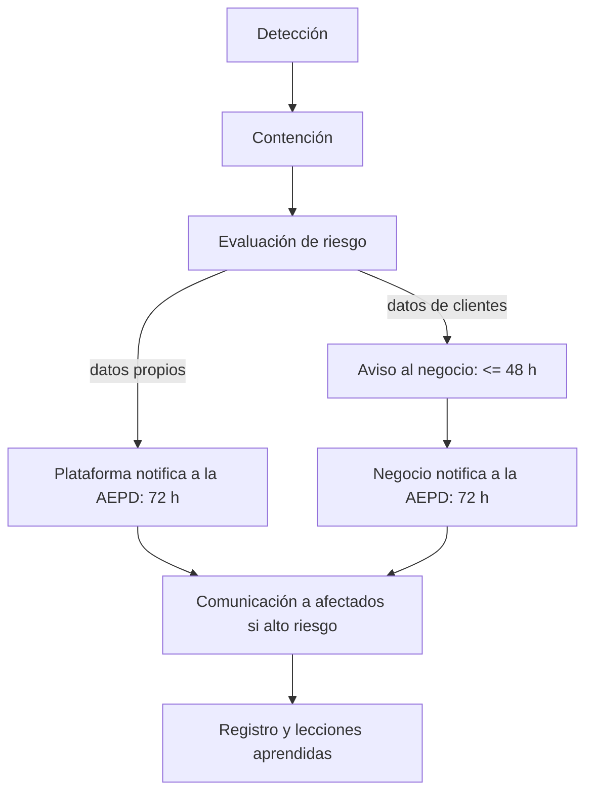

# Brechas de seguridad de datos personales

Procedimiento para una violación de la seguridad de datos personales (art. 4.12 RGPD): cómo detectarla, contenerla, evaluarla, avisar al negocio responsable y a la AEPD y registrarla. Léelo ante cualquier sospecha de acceso no autorizado, pérdida o exposición de datos. El runbook técnico (revocar tokens, bloquear claves) está en [Incidente de seguridad](../incidencias/incidente-seguridad.md); esta página añade la parte legal y los plazos.

!!! warning "No es asesoramiento jurídico"
    Procedimiento de trabajo **pendiente de revisión por abogado**, en particular los criterios de riesgo y los textos de comunicación. En caso de duda, avisa; es mejor notificar de más que tarde. Contención, rotación de secretos, borrado y acceso a producción requieren aprobación humana explícita y los ejecuta una persona (`CLAUDE.md`).

## Plazos clave

| Quién | Obligación | Plazo |
|---|---|---|
| **Plataforma (encargada)** | Avisar al negocio responsable | **Sin dilación indebida y, por contrato, ≤ 48 horas** desde que tiene conocimiento (art. 33.2 RGPD; [cláusula 8](contrato-de-encargado.md)) |
| **Negocio (responsable)** | Notificar a la AEPD si hay riesgo para las personas | **72 horas** desde que tiene conocimiento (art. 33.1), por la [sede electrónica de la AEPD](https://sedeagpd.gob.es) |
| **Negocio** | Comunicar a los afectados si hay **alto** riesgo | Sin dilación indebida (art. 34) |
| **Plataforma (responsable)** | En brechas de datos de demo, dueños, operadores, facturación: notificar ella misma a la AEPD | 72 horas |

Si se notifica después de 72 horas, hay que justificar el retraso. La información puede darse por fases.

## Roles ante una brecha

- Si afecta a **datos de clientes finales de uno o varios negocios**, la plataforma es encargada: avisa a cada negocio afectado y coopera; la decisión de notificar a la AEPD y a los afectados es del negocio (la plataforma puede preparar la información).
- Si afecta a **datos propios** de la plataforma (demo, dueños, operadores), la plataforma es responsable.
- Una brecha puede ser ambas cosas a la vez.

## Procedimiento



### 1. Detección

No hay una alerta automática específica de brechas ([Incidente de seguridad](../incidencias/incidente-seguridad.md)): la detecta una persona o un proveedor. Señales: login inesperado en el panel (`auth.login`, `auth.login_failed`, `auth.login_blocked` en el [registro de auditoría](../referencia/auditoria.md)), aviso de GitHub, Meta, Telegram, Google, Sentry o del proveedor VPS, alerta de acceso, token expuesto, pérdida de un portátil con clave de operación, datos en un lugar equivocado, un backup no cifrado fuera de sitio.

Apunta de inmediato **la hora en que se tuvo conocimiento** (arranca el reloj).

### 2. Contención

Con aprobación humana: revocar el token o la clave afectada, [rotar secretos](../procedimientos/rotar-secretos.md), bloquear la clave SSH (con otra verificada antes de cerrar sesiones), pausar el negocio afectado (`tenant_status`), desvincular al dueño, revocar invitaciones. Conserva logs con acceso restringido y **sin copiar datos personales a tickets**.

### 3. Evaluación de riesgo

Responde por escrito y fecha:

1. ¿Qué tipo de brecha? Confidencialidad (acceso o divulgación), integridad (alteración), disponibilidad (pérdida o indisponibilidad).
2. ¿Qué datos y de quién? Categorías, volumen aproximado de personas y registros, negocios afectados; ¿hay categorías especiales o menores?
3. ¿Estaban cifrados? (Los secretos de canal sí; los mensajes, no.) ¿Un atacante podría leerlos?
4. ¿Es probable un riesgo para derechos y libertades (suplantación, daño reputacional, pérdida de confidencialidad)? ¿Es alto?
5. ¿Se puede demostrar que no hubo acceso real? Si la brecha es improbable que suponga riesgo, no se notifica a la AEPD, pero **se registra** igualmente.

Apóyate en la herramienta de la AEPD [Asesora-Brecha](https://www.aepd.es/herramientas/asesora-brecha) (orienta sobre si hay que notificar) y en las directrices del EDPB sobre notificación de brechas (Guidelines 9/2022).

### 4. Aviso al negocio responsable (≤ 48 h)

A cada negocio afectado, por el contacto de guardia del Anexo I del contrato. Plantilla:

```text
Asunto: [URGENTE] Violación de la seguridad de datos personales

Le comunicamos que el [FECHA Y HORA] tuvimos conocimiento de una
violación de seguridad que puede afectar a datos de sus clientes
tratados por Autobot en su nombre.
- Naturaleza: [confidencialidad / integridad / disponibilidad]; [descripción]
- Datos afectados: [categorías] de aproximadamente [N] personas y [N] registros
- Posibles consecuencias: [ ]
- Medidas adoptadas y propuestas: [ ]
- Punto de contacto: [NOMBRE, EMAIL, TELÉFONO]
Mantendremos la información actualizada a medida que se complete. La
notificación a la AEPD (72 h desde que usted tiene conocimiento) y a los
afectados corresponde al responsable; le asistimos en lo que necesite.
```

### 5. Notificación a la AEPD

La hace el responsable por la sede electrónica de la AEPD (formulario de notificación de brechas, ver el [apartado de brechas de la AEPD](https://www.aepd.es)). Contenido mínimo del art. 33.3: naturaleza, categorías y número aproximado de afectados y registros, punto de contacto, consecuencias probables, medidas. La herramienta [Comunica-Brecha RGPD](https://www.aepd.es/herramientas/comunica-brecha-rgpd) ayuda a decidir si hay que **comunicar a los afectados**. La plataforma, cuando es responsable, notifica ella misma.

### 6. Comunicación a los afectados

Si hay alto riesgo (art. 34): lenguaje claro y sencillo, por el mismo canal en que se les atiende (WhatsApp o Telegram) además de otras vías. Plantilla:

```text
Hola. Te escribimos de parte de [NEGOCIO]. El [FECHA] detectamos que
[DESCRIPCIÓN BREVE] pudo afectar a [DATOS]. Qué puede pasar: [CONSECUENCIAS].
Qué hemos hecho: [MEDIDAS]. Qué puedes hacer tú: [RECOMENDACIONES, por
ejemplo desconfiar de mensajes sospechosos que usen tu nombre]. Contacto:
[EMAIL]. Puedes reclamar ante la AEPD (www.aepd.es).
```

### 7. Cierre

Causa raíz, correcciones (secretos rotados, permisos, parches), decisión sobre cambios en este procedimiento, actualización del [registro](registro-de-actividades.md) y de la [evaluación de riesgos](evaluacion-de-riesgos.md), y aviso a los proveedores que lo exijan (los términos de bots de Telegram piden remediar de inmediato fugas y brechas).

## Registro interno de brechas

Obligatorio (art. 33.5): **toda** brecha se documenta, también las que no se notifican. Un registro por incidente, fuera de logs públicos y sin datos personales en claro.

| Campo | Contenido |
|---|---|
| Id y fecha de conocimiento | `BR-AAAA-NNN`, fecha y hora |
| Fecha estimada de inicio y fin | |
| Descripción y causa | |
| Tipo | Confidencialidad / integridad / disponibilidad |
| Datos y categorías afectados | |
| Personas (nº aprox.), negocios afectados | |
| Cifrado u otras mitigaciones | |
| Evaluación de riesgo y decisión | Riesgo / alto riesgo / improbable; quién decidió |
| Avisos al negocio | Fecha y hora, destinatario |
| Notificación a la AEPD | Fecha, nº de expediente; o motivo de no notificar |
| Comunicación a afectados | Fecha y medio; o motivo |
| Medidas de contención y correctivas | |
| Cierre y lecciones | |

## Verificación

Credenciales antiguas rechazadas, acceso revisado, avisos dentro de plazo (hora de conocimiento, avisos y notificación anotados) y registro cerrado.

## Relacionado

[Incidente de seguridad](../incidencias/incidente-seguridad.md), [Rotar secretos](../procedimientos/rotar-secretos.md), [Contrato de encargado](contrato-de-encargado.md), [Seguridad y secretos](../arquitectura/seguridad-y-secretos.md), [Auditoría](../referencia/auditoria.md).
