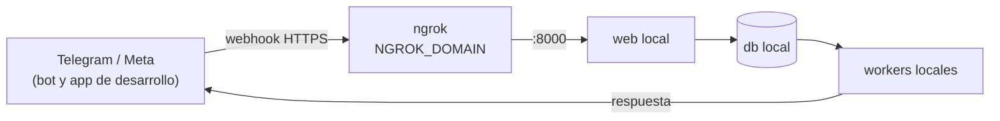

# Bot de demo en local

Cómo probar en tu máquina las puertas del bot de demo (Telegram y WhatsApp) con un bot y una app **de desarrollo propios**, a través de un túnel de [ngrok](https://ngrok.com) hacia `web`. Es el mismo mecanismo que producción (webhook, no polling). Léelo si vas a tocar el bot de demo o a enseñarlo desde tu portátil. Lo que se hace en el servidor (encender y apagar puertas, personas autorizadas, renovación del calendario) está en [Bot de demo (operación)](../procedimientos/demo.md).

!!! warning "Nunca uses los bots ni las apps de producción"
    Un bot de Telegram con webhook no admite polling a la vez, y un webhook apuntado a tu túnel se lo quita al servidor. Usa siempre un bot y una app de WhatsApp de desarrollo.



## Requisitos

- El entorno local en marcha (`make local`, [Entorno local](entorno-local.md)).
- `ngrok` instalado y un dominio reservado, guardado en `NGROK_DOMAIN` de `.env`.
- Para que la demo de `salon` reserve de verdad, `DEMO_SALON_CALENDAR_ID` en `.env` **antes** de sembrar los demos.

## Puerta Telegram

1. `make ngrok` abre el túnel hacia el puerto 8000 con `NGROK_DOMAIN` (también se puede pasar en la línea de comandos).
2. En `.env`: `PUBLIC_URL` con la URL https de ngrok, `DEMO_TELEGRAM_TOKEN` (bot de desarrollo), `DEMO_TELEGRAM_USERS` (ids de Telegram) y `DEMO_TELEGRAM_WEBHOOK_SECRET` (aleatorio, p. ej. `openssl rand -hex 32`).
3. Reinicia y registra el webhook:

```bash
docker compose restart web worker-inbound worker-calendar worker-periodic worker-outbound
docker compose exec web python manage.py telegram_set_webhook demo
```

4. En Telegram, escribe `/start` al bot: muestra los negocios de demo (`demo-autobuses`, siempre; `demo-peluqueria` solo si está `active`).

Si la URL de ngrok cambia (túnel sin dominio reservado), repite los pasos 2 y 3.

### Bot sin webhook

Para grabar fixtures de un negocio real antes de darlo de alta, `make telegram-poll SLUG=<slug>` hace long polling. No puede convivir con un webhook en el mismo bot: `docker compose exec web python manage.py telegram_set_webhook demo --delete` lo quita (nunca a un bot que use el servidor).

## Puerta WhatsApp

Necesita una app de WhatsApp **de desarrollo** con su propio número y cuenta, y los mismos pasos de alta que en producción ([alta de la puerta WhatsApp](../procedimientos/demo.md#alta-de-la-puerta-whatsapp)).

1. `make ngrok` abre el túnel.
2. En la app, el webhook de la suscripción es `<URL de ngrok>/webhooks/whatsapp-demo`, con `DEMO_WHATSAPP_VERIFY_TOKEN` como `verify_token`.
3. En `.env`: `PUBLIC_URL` y las cinco `DEMO_WHATSAPP_*` (`_PHONE_NUMBER_ID`, `_WABA_ID`, `_APP_SECRET`, `_ACCESS_TOKEN`, `_VERIFY_TOKEN`) de la app de desarrollo, más `DEMO_WHATSAPP_USERS`.
4. `docker compose restart web worker-inbound worker-calendar worker-periodic worker-outbound`.
5. Si la URL de ngrok cambia, repite los pasos 2 y 3.

## Sin canal real

Para probar solo la conversación, sin túnel ni credenciales: `make chat PACK=salon` o `PACK=bus` ([Entorno local](entorno-local.md#dia-a-dia)).

## Dónde está el código

- `Makefile`: `ngrok`, `telegram-poll`, `chat`.
- `apps/backend/src/autobot/channels/demo/`: selector de demos, puertas e invitaciones.
- `apps/backend/src/autobot/management/commands/telegram_set_webhook.py`.

## Relacionado

- [Bot de demo](../arquitectura/bot-de-demo.md) y [ADR-006](../arquitectura/adr/ADR-006-bot-de-demo.md).
- [Bot de demo (operación)](../procedimientos/demo.md) y [Variables de entorno](../referencia/variables-entorno.md).
