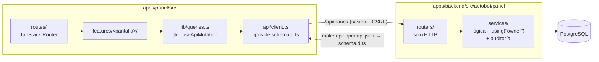

# Desarrollo del panel

Cómo está organizado el código del panel interno (`apps/panel/`), qué convenciones sigue y cómo añadir una pantalla o un endpoint. Léelo si vas a tocar el frontend o su API. Qué hace el panel y por qué solo se alcanza por túnel SSH, en [Panel](../arquitectura/panel.md) y [ADR-008](../arquitectura/adr/ADR-008-panel.md). Cómo se usa para operar, en [Operación del panel](../procedimientos/panel.md).

## Puesta en marcha

Requiere Node 24 y pnpm (`corepack enable` instala la versión fijada en `packageManager` de `apps/panel/package.json`).

```bash
pnpm -C apps/panel install
make up                # backend local (o make local)
make panel-dev         # Vite en desarrollo; /api se redirige a 127.0.0.1:8000
make panel-check       # Biome, tsc --noEmit, Vitest y el build de producción
```

`http://localhost:5173` pide usuario, contraseña y código TOTP. El usuario se crea con `manage.py panel_user create <usuario>`, y `make local` lo ofrece. En producción, el contenedor `panel` (con su propia Caddy en el puerto 8080) solo es alcanzable con `make panel-tunnel`, nunca por el Caddy público. El frontend nunca es la única barrera de validación ni de permisos: lo que importa se vuelve a comprobar en el backend.

## Estructura de `apps/panel/src`



| Ruta | Contenido |
|---|---|
| `routes/` | Rutas de TanStack Router **por ficheros**. `_app.tsx` es el layout autenticado (comprueba la sesión y redirige a `/login`); lo que cuelga de `_app/` son las pantallas. |
| `routeTree.gen.ts` | Árbol de rutas **generado** por el plugin de Vite. No se edita, pero **se commitea**: CI ejecuta `git diff --exit-code` sobre él. |
| `features/<área>/` | Código de cada pantalla: páginas, pestañas y sus tests (`tenants`, `demo-invites`, `activity`, `data`, `incidents`, `logs`, `onboarding`, `overview`, `system`, `auth`). |
| `components/` | Componentes compartidos (`page-header`, `confirm-dialog`, `status-dot`, `empty-state`, `error-state`…) y `components/ui/`, los de shadcn. |
| `api/` | `client.ts`, el cliente tipado (`openapi-fetch`) con CSRF y manejo de 401; y `schema.d.ts`, **generado**. |
| `lib/` | `queries.ts` (`qk`), `use-api-mutation.ts`, `status-levels.ts`, `errors.ts`, `format.ts`… |

Las rutas de `routes/` son finas: solo declaran la ruta y apuntan al componente de `features/`. Por ejemplo, `routes/_app/demo.tsx` hace `createFileRoute("/_app/demo")({ component: DemoInvitesPage })`. Los ficheros `*.test.tsx` dentro de `routes/` se ignoran en el árbol (`routeFileIgnorePattern` en `vite.config.ts`).

`api/schema.d.ts` y `apps/panel/openapi.json` salen del backend con `make api`. Los dos están en git y CI comprueba que estén al día. No los edites a mano.

## Convenciones

- **Claves de react-query:** viven en `src/lib/queries.ts` (`qk.*`), junto a los helpers de invalidación (`invalidateTenantEverything`, `removeTenantQueries`, `tenantRemoved`; ver «Refresco de datos») y las `queryOptions` compartidas (`tenantsQueryOptions`, `packsQueryOptions`, `packSchemaQueryOptions`). No se escriben claves literales en los componentes: una errata dejaría de invalidar en silencio.
- **Mutaciones:** las que avisan al usuario usan `useApiMutation` (`src/lib/use-api-mutation.ts`): toast de éxito, toast de error con el detalle del backend e invalidación de las consultas afectadas. Sin `success` ni `error`, no hay toast y el llamador muestra el error en línea.
- **Llamadas a la API:** `unwrap(api.GET(...))` lanza un `ApiError` normalizado (`code`, `message`, `details`, `status`), así que react-query solo ve el dato.
- **Estados:** la correspondencia entre estados del backend y niveles de `StatusDot` está en `src/lib/status-levels.ts`; un nivel desconocido se muestra como `unknown`.
- **shadcn:** los componentes de `components/ui/` se dejan tal cual, sin podar exports sin uso, para poder actualizarlos con el CLI.
- **Enlaces:** a una pantalla del panel siempre con `<Link>` de TanStack Router (`to="/clientes/$slug"` con `params`), nunca `<a href>`: un `<a>` interno sale de la SPA y recarga la página entera (vuelve a cargar el JavaScript y la sesión y pierde la caché de react-query y la precarga al pasar el ratón). Si la ruta llega del backend como texto, `AppLink` (`src/components/app-link.tsx`) navega con el router dentro del panel y deja un `<a>` normal para lo demás. Solo son `<a>` la documentación (`/docs/`, en pestaña nueva) y las páginas externas. En los tests, `renderWithRouter` (`src/lib/test-router.tsx`) monta el componente dentro de un router.
- **Estilo:** Biome formatea y lintea (`pnpm -C apps/panel check`); `make fix` lo aplica.

## Refresco de datos

- **Toda mutación de un cliente pasa `tenant: slug`** a `useApiMutation`: invalida con `invalidateTenantEverything` (`src/lib/queries.ts`) todas las claves del cliente (las de `qk` con el slug en la segunda posición, incluidas `activity` y `audit`) y las vistas globales (`tenants`, `overview`, `incidents`, `system`). Una clave nueva con slug se añade a `TENANT_SCOPED` y al test de `queries.test.tsx`. Se puede añadir `invalidate` para claves ajenas al cliente.
- **`appliesConfig`** (por defecto `true`, con `tenant`): tras el éxito se llama a `confirmApplied(client, slug)` (`src/lib/config-applied.ts`), que muestra «Aplicando el cambio…» / «Aplicado en N procesos» y vuelve a invalidar el cliente al terminar. Pasa `appliesConfig: false` en lo que no cambia configuración: «Comprobar» y acciones del alta, comprobación de salud, registrar el webhook, invitar o desconectar al dueño, olvidar un contacto, y las acciones de Incidencias (revisar, marcar enviado, reenviar, descartar, descartar todos, reintentar: `features/incidents/shared.ts` da `incidentsChanged()` y cada una pasa `tenant` si la incidencia es de un cliente). El borrado de un cliente no pasa `tenant`: hace `removeTenantQueries` (no hay nada que refrescar ni que confirmar, el borrado purga las filas en vez de publicar una revisión) más `invalidate` de las vistas.
- **`channel`** (por defecto `false`, con `tenant`): el estado del webhook de Telegram (`tenantWebhook`) llama a Telegram en cada lectura, así que no es `LIVE` y `invalidateTenantEverything` lo omite salvo con `{ channel: true }`. Pásalo en lo que toca el canal: credenciales, webhook, guardar o restaurar configuración, cambiar estado, comprobaciones y acciones del alta.
- **Resultados de «Comprobar» (`setup-checks`)**: el GET de pasos nunca llama a Meta, Telegram o Google, así que no devuelve esos resultados. Se guardan aparte en la clave `["setup-checks", slug]` (`src/lib/setup-checks.ts`, no está en `TENANT_SCOPED`: ninguna invalidación ni «Recargar» la toca), cada uno con la `version` del cliente en pantalla al obtenerlo. `useSetupSteps(slug, version)` devuelve el GET con esos resultados superpuestos (vía `select`) solo si su versión coincide con la actual: guardar un cambio de configuración cambia la versión y los resultados dejan de mostrarse. Un GET en vuelo no puede pisarlos porque viven en otra clave. Una mutación que obtiene un paso llama a `recordSetupResult(client, slug, paso, version)`.
- **Error con datos (`isError && !data`)**: con TanStack Query v5, un refresco fallido deja `data` y pone `isError`. Una pantalla muestra el `ErrorState` a pantalla completa solo si no hay datos; con datos sigue pintándolos y añade `<RefreshWarning onRetry>` (`components/refresh-warning.tsx`). Si no, un fallo en segundo plano desmontaría editores y diálogos y perdería lo escrito.
- **Incidencias:** `qk.incidents()` (abiertas), `qk.incidentsHistory()` y `qk.incidentCases(id)` comparten el primer elemento, así que invalidar `incidents()` refresca las tres; la barra lateral sale de `qk.overview()`. La bandeja es `LIVE` (30 s). La lista de casos de una tarjeta (`useInfiniteQuery`) se siembra con la vista previa embebida (`initialData`, con `cases_next_cursor` en la clave): «Ver más» continúa desde ese cursor. «Lo he revisado» no pide confirmación y devuelve tal cual el `seen_through` de la incidencia (una referencia opaca con la hora exacta del caso, como los cursores): nunca se envía al backend una hora leída en el navegador, porque la API las recorta a milisegundos; solo se confirman «Descartar», «Reenviar» y «Descartar todos».
- **Queries vivas**: `...LIVE` (`src/lib/queries.ts`) añade `refetchInterval` de 30 s sin refresco en segundo plano. Úsalo en datos que cambian por su cuenta; no en pasos del alta, estado del webhook, logs, consola, auditoría, vistas previas ni QR. Las listas `useInfiniteQuery` usan `...LIVE_FIRST_PAGE`, que deja de sondear en cuanto hay más de una página cargada (un refetch relee todas).
- El botón **Recargar** (`components/topbar.tsx`) invalida las queries activas; solo gira durante una recarga manual (`aria-busy`, descripción en `aria-describedby`). Los resultados de «Comprobar» no se pierden (viven en `setup-checks`). El editor de configuración no se ve afectado: su borrador vive en estado de componente y solo sigue al `detail` refrescado si no está modificado (`use-config-draft.ts`, con test).

## Cómo añadir una pantalla

Ejemplo: la página de Demo, `features/demo-invites/` y `routes/_app/demo.tsx`.

1. **Endpoint.** Si necesita datos nuevos, añade primero el endpoint (siguiente sección) y corre `make api`.
2. **Componente.** Crea `features/<área>/<nombre>-page.tsx`. Consultas con `useQuery` y claves de `qk`; escrituras con `useApiMutation`; los tipos, de `components["schemas"]["..."]` en `@/api/schema`. Usa `PageHeader`, `ErrorState` y `EmptyState` para cabecera, errores y listas vacías, y `ConfirmDialog` para acciones destructivas.
3. **Clave.** Añade la clave nueva a `qk` en `lib/queries.ts`.
4. **Ruta.** Crea `routes/_app/<ruta>.tsx` con `createFileRoute("/_app/<ruta>")`. Para rutas con parámetros se usa `$param` (`clientes/$slug.tsx`).
5. **Árbol.** Arranca `make panel-dev` (o ejecuta `pnpm -C apps/panel build`): el plugin regenera `routeTree.gen.ts`. **Commitéalo** junto con el resto.
6. **Menú.** Si debe salir en la barra lateral, añade la entrada a `NAV_SECTIONS` en `components/nav-sections.ts`.
7. **Tests.** Un `*.test.tsx` al lado del componente (ver más abajo).
8. **Puerta.** `make panel-check`.

## Cómo añadir un endpoint

La API del panel vive en `apps/backend/src/autobot/panel/` y se sirve en `/api/panel/`. Tiene tres capas:

- `routers/<área>.py`: un `Router` de django-ninja con esquemas de entrada y salida. Solo traduce HTTP.
- `services/<área>.py`: la lógica y el acceso a BD.
- `api.py`: monta cada router con `api.add_router`. Un router nuevo se importa y se añade ahí.

Pasos:

1. **Servicio.** Escribe la lógica en `services/`. Las consultas del panel van **siempre con `.using("owner")` explícito**: el rol `fp_owner` es el único que salta RLS y está permitido solo aquí, en migraciones, comandos de operación y `tenancy.store` (`CLAUDE.md`). Nunca sin ese `using`.
2. **Auditoría.** Toda escritura registra un evento con `autobot.ops.audit.record(actor=..., action="<área>.<verbo>", summary=..., tenant_id=..., target_type=..., target_id=...)`, **en la misma transacción** que el cambio (`transaction.atomic(using="owner")`): o se guardan los dos o ninguno. `details` no admite claves con forma de secreto (`token`, `password`…). Un ejemplo completo en `services/demo_invites.py` (`create_invite`).
3. **Router.** Define los `Schema` de entrada y salida, valida los límites en la entrada (`Field(ge=..., le=...)`) y llama al servicio con `actor=request.user.username`. Errores esperados: `ApiError(code, message, status)` (`panel/errors.py`), que sale como `{"code", "message", "details"}`; los de validación salen como 422.
4. **Autenticación.** No hay que hacer nada: `api = NinjaAPI(..., auth=PanelAuth())` exige sesión con TOTP verificado en todas las rutas, y las escrituras llevan además el chequeo de CSRF. Solo `auth/csrf` y `auth/login` están fuera. No añadas `auth=None` a una ruta nueva.
5. **Esquema.** Ejecuta `make api`: regenera `apps/panel/openapi.json` (con el comando `export_openapi`) y `apps/panel/src/api/schema.d.ts`. CI falla si no están al día.
6. **Documentación.** `docs/referencia/api-panel.md` se genera del esquema OpenAPI, así que no se edita a mano. Si añades una acción de auditoría, anótala en [Auditoría](../referencia/auditoria.md).
7. **Tests de backend** en `apps/backend/tests/platform/panel/test_<área>.py`:

```python
pytestmark = pytest.mark.django_db(transaction=True, databases=["default", "owner"])

def test_create_list_and_revoke(authed_client: Any) -> None:
    created = post(authed_client, "demo/invites", {"note": "peluquero Juan", "max_uses": 2, "expires_in_days": 7})
    assert created.status_code == 200, created.content
```

   La fixture `authed_client` (en `tests/platform/panel/conftest.py`) entra con usuario y TOTP; `get` y `post` llaman a `/api/panel/<ruta>`. Prueba, además del caso feliz, los límites de entrada, un id desconocido (404) y que la escritura y su auditoría se deshacen juntas.
8. **Tests del frontend** de la pantalla que lo use.

Si el endpoint escribe en tablas de datos de cliente o nuevas, mira antes [Migraciones y RLS](migraciones-y-rls.md).

## Tests del panel

Vitest con jsdom (`vitest.setup.ts`), Testing Library y `user-event`. Se ejecutan con `pnpm -C apps/panel test` o con `make panel-check`.

- `pool: "vmThreads"`: un jsdom por worker, no por fichero. Los tests que renderizan una ruta con carga diferida precargan la página en un `beforeAll`.
- Los tests de pantalla montan el árbol real (`routeTree` con un `createMemoryHistory`) y sustituyen `fetch` con `vi.stubGlobal`, devolviendo respuestas JSON según el método y la ruta. Ejemplo: `features/demo-invites/demo-invites-page.test.tsx`. Restaura el global en `afterEach(() => vi.unstubAllGlobals())`.
- Cuando un test cambia lo que muestra una pantalla, comprueba el efecto visible y la petición enviada, no los detalles de implementación.

## Pantalla Demo

`/demo` (`routes/_app/demo.tsx` y `features/demo-invites/demo-invites-page.tsx`) gestiona los **códigos de invitación** del bot de demo. Con un código, una persona que no está en la lista cerrada `DEMO_TELEGRAM_USERS` entra al bot de Telegram de demo ([Bot de demo](../arquitectura/bot-de-demo.md)). La pantalla permite:

- **Crear** una invitación: nota (para quién es, hasta 200 caracteres), usos máximos (1 a 1000) y caducidad en días (1 a 365, o sin caducidad).
- **Listar** las invitaciones, paginadas, con su estado (Activa, Caducada, Agotada o Revocada), los usos y cuántas personas han entrado.
- **Ver código**: dibuja el QR y el enlace `https://t.me/<bot>?start=<código>`. Los pide solo al abrir la fila. Sin `DEMO_TELEGRAM_BOT_USERNAME` el código sigue valiendo, pero no hay enlace ni QR.
- **Revocar** una invitación activa, tras una confirmación.

El backend está en `routers/demo_invites.py` y `services/demo_invites.py`: crear y revocar escriben `audit_event` (`demo_invite.create` y `demo_invite.revoke`) en la misma transacción. La tabla `demo_invite` está en `SENSITIVE_TABLES`, así que la consola SQL no la lee. El canje en el bot lo hace `autobot/channels/demo/invites.py`, no el panel. Cómo se reparten invitaciones al operar, en [Bot de demo (operación)](../procedimientos/demo.md).

## Pestaña Configuración del cliente

Junta el alta y la configuración en secciones desplegables ([ADR-027](../arquitectura/adr/ADR-027-alta-y-configuracion-en-una-pestana.md)). Cómo está hecha:

- **Secciones.** Se declaran en el backend (`services/forms.py`: `PLATFORM_SECTIONS`, `PACK_SECTIONS`, `SHOW_IF`) y llegan en `ui_schema.groups` con rutas con puntos (`config.services`). El frontend (`features/tenants/config/editor.tsx`) no conoce ningún campo: pinta un formulario rjsf por sección, con el sub-esquema que construye `sectionSchema` (`lib/form-draft.ts`), y añade «Otros ajustes» con lo que ninguna sección nombra y «Avanzado» al final.
- **Ayuda.** Lo breve está en el panel: la `description` de cada sección y la de cada campo (`Field(description=…)` del pack, que rjsf pinta debajo). Lo largo está en la documentación: `Section.docs` apunta a la página y el ancla, y llega como `ui_schema.groups[].docs` (`/docs/...`, con `ops.runbooks.docs_url`). `test_forms.py` comprueba que la página y el ancla existen y que ningún campo de `config` se queda sin descripción.
- **Pasos del alta.** Cada paso de `GET tenants/{slug}/setup` trae su `section` y se pinta dentro de ella (`setup-steps.tsx`). Un paso cuya sección no existe sale arriba, junto al banner de progreso.
- **Un solo borrador.** `use-config-draft.ts` guarda el documento entero; cada formulario lee y escribe solo sus rutas (`pickPaths` y `mergePaths`). Hay una única barra de guardado.
- **Valores por defecto.** rjsf rellena los valores por defecto del esquema al montar un formulario. Por eso el borrador empieza en el documento guardado **ya normalizado** (`getDefaultFormState`), «modificado» se compara contra esa versión (`sameValue`) y al guardar `withoutUntouchedDefaults` quita los valores por defecto que nadie tocó. Si cambias cómo se guarda, mantén las dos cosas: abrir la pestaña nunca es un cambio y el documento no congela los valores por defecto.
- **Tests.** Las secciones empiezan cerradas: ábrelas en el test (ver `openSection` en `config.test.tsx`) y responde `[]` a `/setup` en el `fetch` simulado. `lib/form-draft.test.ts` cubre los helpers puros.

## Dónde está el código

- `apps/panel/src/`, `apps/panel/vite.config.ts` y `apps/panel/package.json`.
- `apps/backend/src/autobot/panel/` (`api.py`, `auth.py`, `errors.py`, `routers/`, `services/`).
- `apps/backend/src/autobot/ops/audit.py`: `record`.
- `apps/backend/tests/platform/panel/` y `apps/panel/src/**/*.test.tsx`.
- `Makefile`: `panel-dev`, `panel-check`, `panel-tunnel`, `api` y `fix`.

## Relacionado

- [Panel](../arquitectura/panel.md), [ADR-008](../arquitectura/adr/ADR-008-panel.md) y [Seguridad y secretos](../arquitectura/seguridad-y-secretos.md).
- [Tests](tests.md), [Entorno local](entorno-local.md) y [Auditoría](../referencia/auditoria.md).
