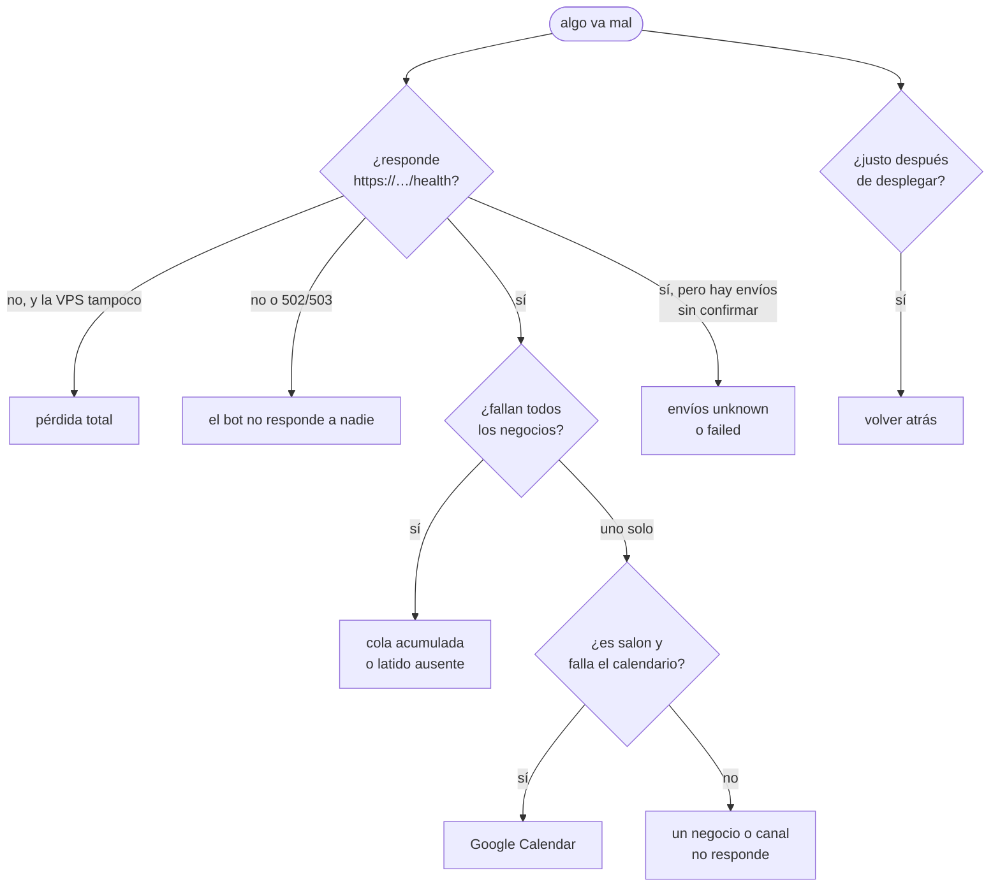

# Incidencias

Runbooks para cuando algo falla en producción. Cada uno sigue la [plantilla](plantilla.md): síntoma, diagnóstico, arreglo, verificación y relacionado. Empieza por el síntoma que ves.

!!! warning "Producción"
    Cualquier acción sobre datos de producción requiere aprobación humana explícita. Ningún agente ejecuta comandos contra el servidor de producción.

## Por síntoma

| Síntoma | Runbook |
| --- | --- |
| Ningún negocio responde; `/health` falla o da 502/503 | [El bot no responde a nadie](bot-no-responde.md) |
| Un negocio concreto no responde, otros sí | [Un negocio o canal no responde](negocio-o-canal.md) |
| La cola crece, falta el latido o hay trabajos fallidos | [Cola acumulada o latido ausente](cola-y-latido.md) |
| Un contenedor está caído, reiniciándose o con otra imagen | [Contenedor caído](contenedor-caido.md) |
| `salon` no ofrece huecos o no crea citas | [Google Calendar](calendar.md) |
| Mensajes sin entrega confirmada (`unknown` o `failed`) | [Envíos `unknown` o `failed`](envios-unknown.md) |
| Un despliegue nuevo rompe algo | [Volver atrás un despliegue](volver-atras.md) |
| La VPS no responde y no se recupera | [Pérdida total de la máquina](perdida-total.md) |
| Acceso inesperado, token expuesto, fuga de datos | [Incidente de seguridad](incidente-seguridad.md) |

## Por alerta del panel

Las incidencias se guardan en `ops_alert` (`apps/backend/src/autobot/ops/check.py`, `collect()` y `sync_alerts()`; las de contenedores, en `apps/backend/src/autobot/ops/containers.py`), y su naturaleza (condición o evento), título y consejo están en el registro `apps/backend/src/autobot/ops/incidents.py`. Una condición se cierra sola; un evento, con «Lo he revisado». La clave es el `kind`; los sufijos `<canal>`, `<servicio>`, `<codigo>`, `<bot>`, `<clase>` y `<tarea>` varían. El catálogo completo, con severidad, naturaleza y causa, está en [alertas](../referencia/alertas.md).

| Incidencia (`kind`) | Runbook |
| --- | --- |
| `inbound_delay`, `inbound_stuck`, `queue_lag_unknown` | [cola-y-latido](cola-y-latido.md) |
| `failed_job:<tarea>` | [Trabajos fallidos](cola-y-latido.md#trabajos-fallidos) |
| `outbound_stuck`, `outbound_ambiguous`, `notification_failed`, `owner_unlinked` | [envios-unknown](envios-unknown.md) |
| `outbound_rejected:<clase>` | [Envíos rechazados](envios-unknown.md#envios-rechazados) |
| `registry`, `tenant_unavailable`, `errors:<canal>`, `health:<codigo>`, `config_stale` | [negocio-o-canal](negocio-o-canal.md) |
| `tenant_silent`, `webhook_unsubscribed`, `webhook_errors`, `number_quality` | [negocio-o-canal](negocio-o-canal.md) |
| `auth`, `auth:<canal>`, `bot:notify:auth` | [negocio-o-canal](negocio-o-canal.md) y [rotar secretos](../procedimientos/rotar-secretos.md) |
| `bot:<bot>:<codigo>` (`demo_tg`, `notify`, `demo_wa`) | [negocio-o-canal](negocio-o-canal.md) |
| `calendar:<canal>`, `sweep:<canal>`, `calendar_outage` | [calendar](calendar.md) |
| `container_down:<servicio>`, `container_unhealthy:<servicio>`, `container_restarted:<servicio>`, `container_image:<servicio>`, `container_unexpected:<servicio>`, `containers_stale` | [contenedor-caido](contenedor-caido.md) |
| `containers_restore` | [restauración](../procedimientos/restaurar.md) |
| `deploy_aborted`, `deploy_rollback` | [volver-atras](volver-atras.md) |
| `backup_prune_overdue` | [Caducar snapshots](../procedimientos/backups.md#caducar-snapshots) |
| `inodes`, `inodes_critical`, `memory_high`, `swap_high`, `load_high`, `backup_stale`, `tls_expiring`, `tls_expiring_critical`, `tls_invalid` | [recursos-copias-y-certificado](recursos-copias-y-certificado.md) |
| `disk`, `disk_critical` | [Disco lleno](../procedimientos/mantenimiento.md#disco-lleno) |
| `billing`, `billing:demo_wa` | Sin runbook: umbral de mensajes facturables; ver [alta y baja de un negocio](../procedimientos/alta-baja-negocio.md) |
| Aviso de healthchecks.io (latido) | [cola-y-latido](cola-y-latido.md) |

## Relacionado

- [Alertas](../referencia/alertas.md), [cola y workers](../arquitectura/cola-y-workers.md), [efectos e idempotencia](../arquitectura/efectos-e-idempotencia.md).
- [Restauración](../procedimientos/restaurar.md) y [servidor](../procedimientos/servidor.md).
