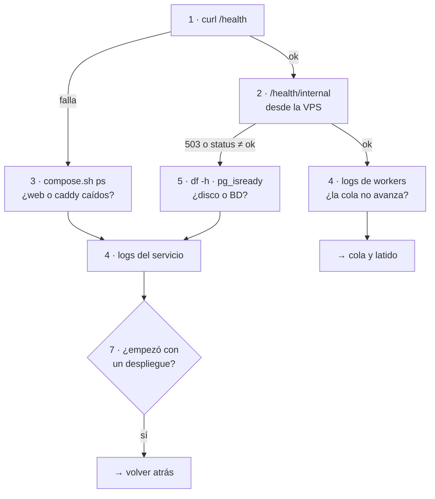

# El bot no responde a nadie

## Síntoma

Los dos packs dejan de contestar en todos los negocios. Un 502 público suele indicar que `web` no está sano; un 503 de `/health/internal` indica fallo de base de datos. Si healthchecks.io avisa o suena `disk_critical`, empieza aquí. Si `web` responde pero la cola crece, ve a [cola y latido](cola-y-latido.md).

## Diagnóstico

Anota hora y SHA sin copiar payloads ni ids de clientes.



1. Salud pública. Desde el portátil, sin usuario:

    ```bash
    curl -i https://<dominio>/health
    ```

    Responde solo «vivo».

2. Salud interna (BD y negocios). En la VPS, como `deploy`:

    ```bash
    curl -s http://127.0.0.1:8000/health/internal
    ```

    Caddy no publica esta ruta; solo se ve desde el servidor. Un `status` distinto de `ok` o `tenants.degraded`/`unreadable` altos apuntan a BD o configuración.

3. Estado de los servicios. En la VPS, como `deploy`, en `/srv/autobot`:

    ```bash
    deploy/scripts/compose.sh ps
    ```

4. Últimos logs. En la VPS, como `deploy`:

    ```bash
    deploy/scripts/compose.sh logs --tail=100 web web-panel worker-inbound worker-calendar worker-periodic worker-outbound db
    ```

5. Espacio en disco y base de datos. En la VPS, como `deploy`:

    ```bash
    df -h
    deploy/scripts/compose.sh exec -T db pg_isready
    ```

6. Logs técnicos. `docker logs` rota a los 100 MB. Si no alcanza, usa la pantalla Logs del panel (pestaña técnica) abriendo antes `make panel-tunnel HOST=<host>` en el portátil. VictoriaLogs no publica ningún puerto, y su caída no afecta al bot: `web` y los `worker-*` descartan los lotes que no pueden enviar y siguen respondiendo.

7. Si el fallo empezó con un despliegue (compara `var/.deployed-sha` con el último despliegue), ve a [volver atrás un despliegue](volver-atras.md).

## Arreglo

1. Reinicia solo el servicio averiado, tras identificarlo. En la VPS, como `deploy`:

    ```bash
    deploy/scripts/compose.sh up -d <servicio>
    ```

2. Si el disco está lleno, libera espacio según [mantenimiento](../procedimientos/mantenimiento.md) antes de reiniciar nada.
3. Si la base de datos está caída, no fuerces reenvíos: arréglala primero y deja que los reintentos normales de la cola actúen.
4. Si el síntoma es que los mensajes entran pero no salen y hay una alerta `provider_outage`, Meta o Telegram están caídos: ver [caída de un proveedor](envios-unknown.md#caida-de-un-proveedor). Las respuestas caducan a los 30 minutos y el contacto recibe una disculpa; no hay que reenviar nada a mano.

## Verificación

- `/health` vuelve a 200.
- Ambos workers completan su latido y el backlog deja de crecer (Sistema → Colas en el panel).
- Una consulta por el bot de demo termina.
- Registra causa y duración.

## Relacionado

- [Cola y latido](cola-y-latido.md), [contenedor caído](contenedor-caido.md), [volver atrás un despliegue](volver-atras.md).
- [Observabilidad](../arquitectura/observabilidad.md).
