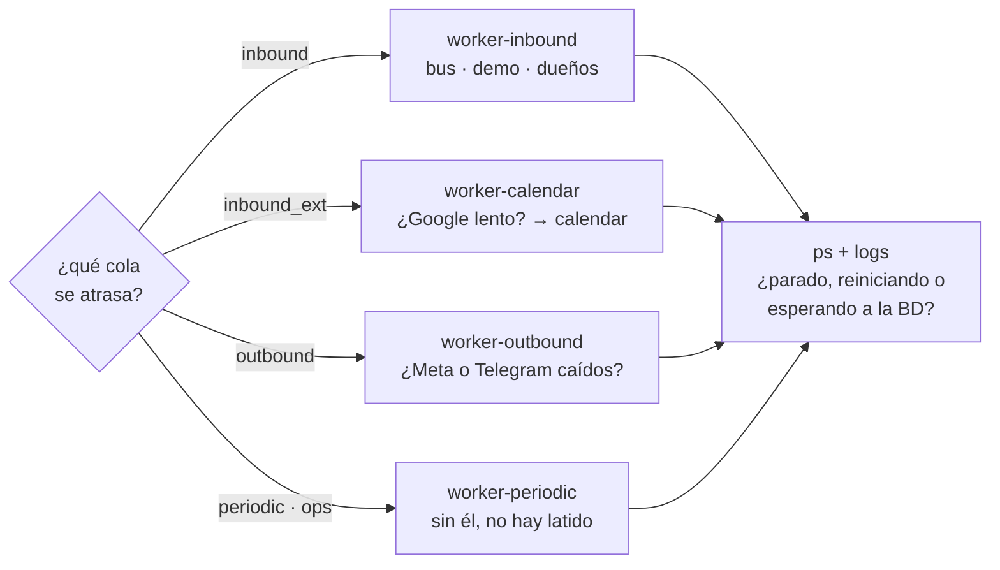

# Cola acumulada o latido ausente

## Síntoma

healthchecks.io avisa del worker, la cola tarda más de 30 s o el panel muestra una de estas incidencias: `inbound_delay` (trabajo inbound listo desde hace más de 2 minutos), `failed_job:<tarea>` (trabajos fallidos de una tarea, ver [trabajos fallidos](#trabajos-fallidos)), `inbound_stuck` (evento entrante sin trabajo) o `queue_lag:<cola>` (una cola va retrasada: su trabajo listo más antiguo espera más de lo normal, o un trabajo lleva demasiado «en curso»).

## Diagnóstico

`worker-inbound` procesa los mensajes de los packs sin Calendar, el bot de demo y los estados de entrega; `worker-calendar` procesa los de los packs con Calendar (cola `inbound_ext`); `worker-periodic` ejecuta las tareas periódicas, las barridas y el rescate de trabajos; `worker-outbound` envía.



1. Estado de los workers. En la VPS, como `deploy`, en `/srv/autobot`:

    ```bash
    deploy/scripts/compose.sh ps worker-inbound worker-calendar worker-periodic worker-outbound
    ```

2. Logs. En la VPS, como `deploy`:

    ```bash
    deploy/scripts/compose.sh logs --tail=100 worker-inbound worker-calendar worker-periodic worker-outbound
    ```

3. Trabajos. En el panel, Incidencias (los casos de `failed_job:<tarea>`), o Sistema → Colas: por cola, los pendientes, cuánto espera el más antiguo y cuántos hay en curso (y desde cuándo). Un `queue_lag:<cola>` con pendientes que crecen y ningún trabajo en curso indica un worker parado; con un trabajo en curso muy antiguo, un trabajo atascado en una llamada externa (el rescate `retry_stalled_jobs` solo libera los de un worker que dejó de latir).
4. Distingue un worker parado de errores de BD ([el bot no responde](bot-no-responde.md)) o de un proveedor externo.

## Arreglo

1. Si un contenedor terminó, reinícialo. En la VPS, como `deploy`:

    ```bash
    deploy/scripts/compose.sh up -d worker-inbound
    ```

    (o `worker-calendar`, `worker-periodic` o `worker-outbound`, según cuál).
2. Si hay trabajos fallidos, sigue [trabajos fallidos](#trabajos-fallidos). Si el panel no es accesible, en la VPS como `deploy`:

    ```bash
    deploy/scripts/manage.sh job_retry <id>
    ```

    Rechaza los trabajos de envío: no se reintentan a ciegas.
3. Nunca reintentes un envío `unknown`; usa [envíos sin confirmar](envios-unknown.md).
4. Si el problema es capacidad sostenida, registra métricas antes de cambiar concurrencia o número de workers.

## Trabajos fallidos

`failed_job:<tarea>` es un **evento**, uno por tarea (con su nombre en español): trabajos que terminaron `failed` después de la última revisión. Sus casos son esos trabajos.

1. Mira la causa en los logs del worker (`job` lleva el id del trabajo).
2. Si la tarea es idempotente, pulsa «Reintentar» en el caso. Si el panel no es accesible, en la VPS como `deploy`:

    ```bash
    deploy/scripts/manage.sh job_retry <id>
    ```

    Rechaza los trabajos de envío (`send_message`, `send_notification`): no se reintentan a ciegas.
3. Pulsa **«Lo he revisado»**. Un fallo posterior la reabre con «N nuevos desde tu revisión». Si reintentas todos sus trabajos fallidos, la incidencia se cierra sola (sin revisión).

Un trabajo parado (su worker murió) que no se pudo reencolar porque otro igual ya estaba en cola con el mismo `queueing_lock` (el siguiente `ops_check`, por ejemplo) se cierra como `aborted`, no `failed`: el de la cola hace su trabajo, así que no abre incidencia.

## Verificación

Llega un nuevo latido, el check vuelve a verde y los pendientes disminuyen sin duplicados. Una condición (`inbound_delay`, `queue_lag:<cola>`…) se cierra sola en el siguiente `ops_check` (cada 5 minutos); `failed_job:<tarea>` queda revisada.

## Relacionado

- Cómo funcionan la cola, las barridas, los reintentos, el pool de conexiones y las alertas persistidas: [cola y workers](../arquitectura/cola-y-workers.md).
- [Envíos `unknown`](envios-unknown.md), [contenedor caído](contenedor-caido.md), [alertas](../referencia/alertas.md).
