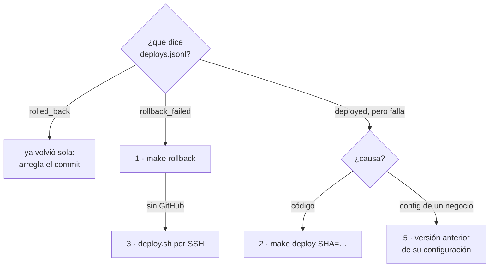

# Volver atrás un despliegue

## Síntoma

Un SHA nuevo rompe `/health` o el flujo tras desplegar, o llega `deploy_rollback` (la reversión automática se ejecutó) o `deploy_aborted` (el despliegue se abortó antes de cambiar la imagen). Las dos son eventos (ADR-031): no se cierran solas; se cierran con «Lo he revisado» en Incidencias. Cada despliegue fallido avisa por Telegram, aunque haya otro en la misma hora.

## Diagnóstico

`deploy/scripts/deploy.sh` revierte solo si `/health/internal` no queda sano en 60 s o si alguno de los cuatro workers se para o reinicia en sus primeros ~10 s. Si falla antes de cambiar la imagen (pull, migración o validación de configuración), mantiene la imagen anterior, devuelve el repositorio al SHA anterior y avisa con `deploy_aborted`.

1. SHA desplegado. En la VPS, como `deploy`:

    ```bash
    cat /srv/autobot/var/.deployed-sha
    tail -n 50 /srv/autobot/var/state/ops/deploys.jsonl
    ```

    El último registro dice si terminó en `deployed`, `rolled_back` o `rollback_failed`.
2. Logs de los servicios. En la VPS, como `deploy`, en `/srv/autobot`:

    ```bash
    deploy/scripts/compose.sh logs --tail=100 web web-panel worker-inbound worker-calendar worker-periodic worker-outbound
    ```

3. Resultado del workflow `deploy.yml` en GitHub, y si el aviso a ops llegó.

## Arreglo



El esquema de la base nunca vuelve atrás: solo el código.

1. Si la reversión automática falló, un operador autorizado, desde el portátil con la clave de operación:

    ```bash
    make rollback HOST=<host>
    ```

    Lee del servidor el `previous` del último despliegue correcto, pide confirmación y lo redespliega con `make deploy SHA=<previous>`. Se niega a encadenar un segundo `make rollback` sobre el mismo despliegue (volvería al SHA roto); para ir más atrás usa un SHA concreto.
2. Para un SHA concreto, desde el portátil:

    ```bash
    make deploy SHA=<sha-completo>
    ```

    Comprueba antes que su CI está en verde y aprueba el job en el entorno `production`.
3. Sin GitHub (SSH directo): primero comprueba que no hay otro despliegue en curso, porque se salta el candado que usa el CI. Con la clave de operador, desde el portátil, lee el `previous` del último `deployed`:

    ```bash
    ssh deploy@<host> 'tail -n 50 /srv/autobot/var/state/ops/deploys.jsonl'
    ssh admin@<host>
    ```

    y en la VPS, como `admin`:

    ```bash
    sudo -u deploy bash -lc 'cd /srv/autobot && git fetch origin main &&
      git merge-base --is-ancestor <sha> origin/main && git checkout --detach <sha> &&
      deploy/scripts/deploy.sh <sha>'
    ```

    La imagen de ese SHA tiene que seguir en GHCR (o en disco, si `prune.sh` aún no la quitó).
4. No reviertas migraciones: deben ser compatibles hacia atrás (expandir y contraer). `abort` y la reversión automática restauran la imagen anterior, nunca el esquema. Si una migración ya aplicada hay que deshacerla a mano, `deploy.sh` deja un volcado previo en `var/backups/pre-migrate.dump` (se sobrescribe en cada despliegue con migraciones pendientes y `prune.sh` lo borra a las 48 horas: si lo necesitas, cópialo antes).
5. Si la causa fue una configuración de negocio, no hace falta un SHA nuevo: la configuración está versionada en PostgreSQL y no vuelve atrás con la imagen. Publica una versión anterior importando un documento exportado (ver [negocio o canal](negocio-o-canal.md)):

    ```bash
    deploy/scripts/manage.sh tenant_config import <dir> --comment "Recuperación"
    ```

!!! warning "Aprobación humana"
    No cambies webhooks de canales reales sin autorización. Cualquier acción sobre datos de producción requiere aprobación humana.

## Verificación

`var/.deployed-sha` coincide con el SHA sano, `curl -s http://127.0.0.1:8000/health/internal` (en la VPS) devuelve `status: ok`, la cola continúa y una consulta por el bot de demo funciona. Cierra `deploy_aborted` o `deploy_rollback` con «Lo he revisado» en Incidencias.

## Relacionado

- [Despliegue](../procedimientos/despliegue.md), [el bot no responde](bot-no-responde.md), [contenedor caído](contenedor-caido.md).
- [Config y registro](../arquitectura/config-y-registro.md).
