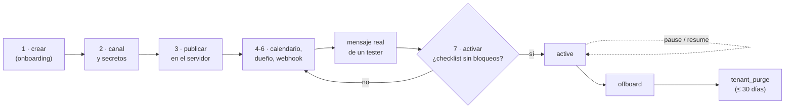

# Alta y baja de un negocio

Cómo dar de alta un negocio nuevo (documento, canal, secretos, dueño y activación) y cómo
darlo de baja y borrarlo. Léelo cuando entre o salga un cliente. El formato de la
configuración de cada pack está en [../referencia/packs/salon.md](../referencia/packs/salon.md)
y [../referencia/packs/bus.md](../referencia/packs/bus.md); la explicación no técnica del
canal WhatsApp, en [alta-whatsapp-meta.md](alta-whatsapp-meta.md).

!!! warning "Aprobaciones"
    Actuar sobre datos de producción y activar el canal real de un negocio requieren
    aprobación humana explícita. Las acciones sobre producción las ejecuta el operador;
    nunca un agente.

## Objetivo, cuándo y requisitos

- **Objetivo:** un negocio en estado `active` atendiendo por su canal, con dueño conectado;
  o dado de baja y borrado en un máximo de 30 días.
- **Cuándo:** firma o fin de un contrato.
- **Requisitos:** el pack elegido; el canal (WhatsApp o Telegram) con sus ids y secretos;
  para `salon`, el calendario de Google compartido con la cuenta de servicio; para `bus`,
  una entrada en la biblioteca de datasets ([horarios-bus.md](horarios-bus.md)); el panel
  por túnel (`make panel-tunnel`).

## Alta

Lo normal es el panel (todo lo que sigue se ejecuta ahí, sin terminal). El resto de la
sección explica qué hace cada paso y cómo hacerlo por terminal.



1. **Crear el negocio.** Panel: `Clientes → Nuevo cliente`, asistente de cinco pasos
   ([panel.md](panel.md#asistente-de-alta-de-un-cliente)); queda en `onboarding` y abre la
   pestaña Configuración, con el banner de lo que falta para activarlo. Por terminal (portátil, BD local): prepara un directorio con
   `document.yaml` (UUIDv7 propio, `public_id` aleatorio, `status: onboarding`) y los
   datasets en `datasets/<nombre>/`, e impórtalo en tu BD local con `make tenant-import DIR=<dir>
   [SECRETS=<yaml>]` (valida el conjunto antes de guardar nada).
2. **Declarar el canal y los secretos.** Los ids van en el documento; los secretos, en un
   YAML privado `slug: {campos...}` que nunca va en el documento ni en git: WhatsApp usa
   `app_secret`, `access_token` y `verify_token`; Telegram, `bot_token` y `webhook_secret`
   (32 caracteres o más). En el panel: Configuración, sección Canal, «Cambiar credenciales».
3. **Publicar en producción.** Por terminal, desde el portátil:
   `make tenant-push SLUG=<slug> [SECRETS=<yaml>] [HOST=<alias>]` exporta la BD local y la
   importa por SSH en el servidor (`tenant_config import`, que cifra los secretos y valida
   todo antes de guardar nada). Si el pack necesita datasets (`bus`) y no se incluyen, la
   importación falla: elige una entrada de la biblioteca (ADR-013) con
   [horarios-bus.md](horarios-bus.md), o da de alta desde el panel, que la elige en el
   asistente.
4. **`salon`:** el negocio comparte su calendario con la cuenta de servicio
   (panel, Configuración, sección «Calendario de Google», muestra el email) y declara su
   `calendar_id`. Las plantillas de WhatsApp deben estar creadas y aprobadas.
5. **Dueño.** Panel: ficha, Configuración, sección «Dueño y testers», «Invitar al dueño» (enlace de un solo uso,
   mostrado una vez). Por terminal: `make prod-manage CMD="owner_invite <slug>"`.
   `owner.notify` y `owner.summary_monthly` se cambian en la configuración versionada.
   `make prod-manage CMD="owner_unlink <slug>"` desconecta el chat.
6. **Webhook de Telegram** (si procede): «Registrar webhook» en la sección Canal o
   `make prod-manage CMD="telegram_set_webhook <slug>"`. Después, «Comprobar ahora» en el
   panel o `make prod-manage CMD="tenant_health <slug>"`. Con `onboarding`, solo se atiende
   a `testers.main`.
7. **Activar.** Antes: documento válido, ids y secretos completos, salud sin errores
   críticos, plantillas aprobadas y al menos un mensaje real de un tester por `main`. En el
   panel, el banner de alta de Configuración lista lo que falta (cada comprobación está en
   su sección) y «Activar» pide escribir el slug.

### WhatsApp: checklist del número

La app de Meta, la WABA y el número están en el Business Portfolio del negocio, con el
operador como administrador; una app y un número por negocio.

- SIM sin WhatsApp activo; Gmail y Business Portfolio del negocio.
- Verificación de empresa (2-5 días hábiles; necesaria para el nombre visible).
- Acceso del operador: Meta separa la **cuenta de WhatsApp** (el número) de la **cuenta de
  mensajería** (plantillas y facturación). Asigna las dos, más la app, y **control total**
  del Business Portfolio: sin él no se puede usar la configuración de WhatsApp de la app
  ni crear el System User.
- App de tipo Business con el producto WhatsApp; número añadido y verificado en WhatsApp
  Manager.
- System User con token permanente (`whatsapp_business_messaging`,
  `whatsapp_business_management`).
- Método de pago en la cuenta de mensajería (sin él Meta no envía mensajes facturables).
- Ids del canal y los tres secretos cargados en el panel.
- Sección «Canal» de la pestaña «Configuración» (ADR-027), con «Comprobar» antes y
  después (guarda antes: las comprobaciones usan lo guardado):

    ```mermaid
    flowchart LR
        W["Configurar webhook<br/>Meta verifica la URL"] --> N["Registrar número<br/>PIN de 6 dígitos"] --> S["Suscribir app<br/>(confirmación)"] --> R(["el número entrega<br/>sus mensajes"])
    ```

    - **Webhook de la app** → «Configurar webhook»: configura
      `https://api.<dominio>/webhooks/whatsapp/<public_id>` con el `verify_token` del
      negocio y el campo `messages`. Meta verifica la URL en ese momento: el servidor debe
      ser accesible y el negocio tener sus tres ids y tres secretos.
    - **Número registrado** → «Registrar número»: registra el número en la Cloud API con
      un PIN de verificación en dos pasos de 6 dígitos. El PIN no se guarda: apúntalo. Si
      ya estaba registrado, no se repite.
    - **App suscrita a la cuenta** → «Suscribir app» (`subscribed_apps`): pide
      confirmación, porque a partir de ahí el número real entrega sus mensajes a la
      plataforma.
    - Si una acción responde «Resultado desconocido», pulsa «Comprobar» antes de repetirla:
      nunca se reintenta sola.
- Plantillas del pack creadas y aprobadas en WhatsApp Manager (de 1 a 48 h); su estado se
  consulta en la sección «Canal» de «Configuración». `bus` no usa plantillas.

Coste: desde el 1/10/2026 Meta cobra también las respuestas dentro de la ventana de 24 h.
El resumen mensual al dueño estima el coste con `PRICE_EUR`
(`apps/backend/src/autobot/runtime/costs.py`); es una estimación interna, no la tarifa
real de la cuenta, que está en WhatsApp Business Manager de cada negocio. Telegram no
tiene coste por mensaje.

## Editar, pausar y cambiar datasets

- Editar la configuración: panel, Configuración (formulario o YAML, con diff y comentario;
  cada versión queda en el Historial). Por terminal: `tenant_config export <slug> <dir>`
  crea un directorio nuevo o vacío, sin secretos; tras editar, `tenant_config import <dir>
  --comment "Motivo"` crea otra versión. Los seis campos de identidad y estado no se
  cambian por importación.
- Pausar o reactivar: botón en la ficha, o `make prod-manage CMD="tenant_status <slug>
  pause"` (o `resume`).
- Datasets de un cliente ya dado de alta: [horarios-bus.md](horarios-bus.md). Nunca se
  publican directamente sobre el cliente.

Los cambios se aplican sin commit ni despliegue, en la siguiente comprobación de revisión
(cada proceso sondea cada dos segundos; un negocio nuevo se encuentra al instante, ADR-030).

## Baja

El operador registra la fecha efectiva de baja y ejecuta el borrado en un máximo de
30 días; `synced_at` no es una fecha de baja. Todos los comandos, desde el portátil:

1. `make prod-manage TTY=1 CMD="tenant_status <slug> offboard"` pide escribir el slug y
   publica la baja. Los webhooks tardíos se contestan con 200 sin guardar nada.
2. Si se acordó con el negocio, exporta sus datos desde el panel (menú «⋯», «Exportar
   datos del negocio»); detalle en [retencion-rgpd.md](retencion-rgpd.md).
3. `make prod-manage TTY=1 CMD="tenant_purge <slug>"` (o el panel, menú «⋯», «Eliminar
   cliente», deshabilitado si el negocio está activo) exige escribir de nuevo el slug y
   comprueba que sigue dado de baja. Si el canal es Telegram, retira primero el webhook; si
   falla, sigue y lo comunica. Borra todo lo del negocio (contactos, mensajes, secretos,
   versiones, auditoría y su fila: el slug queda libre; el alcance exacto está en
   [retencion-rgpd.md](retencion-rgpd.md)), y deja una entrada `tenant.purge` sin datos del
   negocio. Un webhook tardío de ese canal recibirá 404.
4. El negocio revoca el acceso del operador a Meta y deja de compartir el calendario.
5. Retira las copias locales de importación o guárdalas cifradas fuera del repositorio. Las
   copias de la BD caducan con la retención de backups.

## Verificación

- Alta: el negocio aparece `active` en el panel, la salud del canal está en verde y un
  mensaje real por el canal recibe respuesta.
- Baja: el negocio ya no aparece en la lista del panel y no quedan secretos ni datasets.

## Relacionado

Pack nuevo y su negocio de demo: [../desarrollo/anadir-un-pack.md](../desarrollo/anadir-un-pack.md).
Comandos: [../referencia/comandos.md](../referencia/comandos.md).
