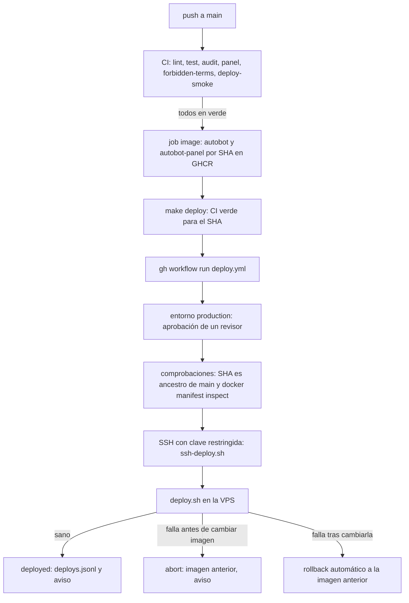

# Despliegue: de commit a producción

Cómo llega un commit de `main` a la VPS: qué comprueba el CI, qué publica, quién aprueba
y qué hace `deploy/scripts/deploy.sh` paso a paso, incluido el rollback automático. Léelo
antes del primer despliegue o cuando uno falle. Preparar la VPS (una sola vez) está en
[servidor.md](servidor.md); volver a una versión anterior, en
[../incidencias/volver-atras.md](../incidencias/volver-atras.md).

!!! warning "Aprobaciones"
    Ningún agente despliega a producción ni ejecuta comandos contra el servidor
    (`CLAUDE.md`). Despliega siempre una persona, y el entorno `production` de GitHub
    exige además la aprobación de un revisor.

## Objetivo, cuándo y requisitos

- **Objetivo:** poner en la VPS el SHA exacto de un commit de `main` ya probado, con
  imágenes inmutables, sin ventana de descarga y con vuelta atrás automática.
- **Cuándo:** cada vez que `main` tenga algo que publicar. No hay despliegue automático.
- **Requisitos:** CI en verde para ese SHA; VPS instalada
  ([servidor.md](servidor.md)); `gh` autenticado en tu portátil; la clave de operación SSH
  (alias `autobot` en `~/.ssh/config`, o `HOST=<alias>`) solo para `make rollback`,
  `make backup-now` y `make prod-*`.

## Visión de conjunto



## 1. CI (`.github/workflows/ci.yml`)

Se ejecuta en cada `push` a `main` y en cada pull request. En ramas distintas de `main`
cancela la ejecución anterior; en `main` no. Nueve jobs corren en paralelo y `image` espera
a todos:

| Job | Qué comprueba |
|---|---|
| `lint` | Que no haya datos de clientes ni ficheros de `var/` en git; `ruff check` y `ruff format --check`; `shellcheck` de `deploy/scripts/*.sh`, `deploy/postgres/*.sh` y `apps/backend/src/tools/*/*.sh`; `mypy`; `import-linter` (capas de `core`, `integrations` y `packs`) |
| `test` | PostgreSQL 18 de servicio con los roles de `init-roles.sh`; `pytest`; `makemigrations --check` y `lintmigrations`; que `apps/panel/openapi.json` esté al día con el backend |
| `audit` | `pip-audit` sobre las dependencias bloqueadas de `uv.lock` |
| `secrets-scan` | `gitleaks` sobre todo el historial de git, con `.gitleaks.toml` |
| `dockerfile-lint` | `hadolint` sobre los dos Dockerfile y `actionlint` sobre los workflows |
| `forbidden-terms` | `deploy/scripts/check-forbidden-terms.py`: ningún fichero versionado contiene nombres de clientes reales (solo se guardan sus hashes) |
| `panel` | En `apps/panel/`: tipos de la API (`schema.d.ts`) y `routeTree.gen.ts` versionados y al día, `biome`, `tsc`, `vitest`, el build y `pnpm audit --prod --audit-level high` |
| `deploy-smoke` | Que `compose.yaml` + `compose.prod.yaml` y los de local sean válidos; que los dos Caddyfile pasen `caddy validate` con las imágenes reales; que `make restore-test` (copia de seguridad y restauración completas) funcione sobre la imagen recién construida |

!!! note
    La versión de `uv` del CI sale de la línea `FROM ghcr.io/astral-sh/uv:…` de
    `apps/backend/Dockerfile`, y las de Caddy salen de `compose.prod.yaml` y de
    `apps/panel/Dockerfile`: una subida de Dependabot se valida sola.

### Job `image`

Construye dos imágenes con la caché de GitHub Actions, las analiza con Trivy y, solo si el
análisis pasa, las publica. Se etiquetan con el SHA completo:

- `ghcr.io/<propietario>/autobot:<sha>` desde `apps/backend/Dockerfile`: web y workers.
- `ghcr.io/<propietario>/autobot-panel:<sha>` desde `apps/panel/Dockerfile`: la SPA y su
  Caddy.

Trivy falla con cualquier vulnerabilidad HIGH o CRITICAL que tenga arreglo disponible
(`--ignore-unfixed`). Solo se **publican** (`docker push`) en los `push` a `main`; en un pull
request se construyen y analizan sin subirse. Las etiquetas son inmutables: el SHA es el único identificador de una versión.

## 2. `make deploy`

Desde el portátil, tras `git fetch`:

```bash
make deploy              # despliega origin/main
make deploy SHA=<sha>    # un SHA concreto de 40 caracteres
```

El `Makefile` hace dos cosas:

1. Comprueba con `gh run list --workflow ci.yml --commit <sha>` que el CI de ese SHA
   terminó en `success`; si no, se niega.
2. Lanza `gh workflow run deploy.yml -f sha=<sha>`.

## 3. Workflow `deploy.yml`

1. **Entorno `production`:** el job se queda esperando la aprobación del revisor. Debe
   estar restringido a `main` (ver [servidor.md](servidor.md)).
2. **Concurrencia:** el grupo `production-deploy` no cancela nada; un segundo despliegue
   espera al primero.
3. **Comprobación del SHA:** 40 hex y ancestro de `origin/main` (`git merge-base
   --is-ancestor`).
4. **Comprobación de las imágenes:** `docker manifest inspect` de `autobot:<sha>` y
   `autobot-panel:<sha>` en GHCR. Si el job `image` no llegó a publicar, falla aquí y no
   toca la VPS.
5. **SSH:** instala `DEPLOY_SSH_KEY` y `DEPLOY_KNOWN_HOSTS` (host fijado) y ejecuta
   `deploy/scripts/deploy.sh <sha>` en `DEPLOY_HOST` como `deploy`.

### Qué puede hacer la clave de CI: `ssh-deploy.sh`

En `authorized_keys` de `deploy`, la clave de CI va con `restrict,command=".../ssh-deploy.sh"`.
Esa orden forzada solo deja pasar `deploy/scripts/deploy.sh <sha de 40 hex>` y, antes de
ejecutarlo:

1. Toma el candado `var/.deploy.lock` (espera 10 s) y se lo pasa a `deploy.sh`
   (`AUTOBOT_DEPLOY_LOCK_HELD=1`).
2. Exige un árbol de trabajo limpio, hace `git fetch origin main`, comprueba que el SHA es
   ancestro de `origin/main` y que contiene `deploy.sh` y `compose.prod.yaml`.
3. Hace `git checkout --detach <sha>`: así los scripts, compose y Caddyfile en disco son
   los del SHA que se despliega.

## 4. `deploy.sh`, paso a paso

Se ejecuta en `/srv/autobot` como `deploy` (nunca como root). Un corte de la conexión SSH
no lo mata (ignora `SIGHUP`).

1. **Candado:** `var/.deploy.lock`, `flock` con espera de 10 s. Si hay otro despliegue,
   sale.
2. **`var/.frozen`:** si existe (lo crea [traslado.md](traslado.md) en el origen), se
   niega a desplegar.
3. **`ensure-env.sh`:** prepara `.env`. Genera los secretos internos que falten
   (contraseñas de PostgreSQL, `DJANGO_SECRET_KEY`, `SECRETS_ENCRYPTION_KEY`, secretos de
   webhook), vuelve a derivar `DB_*_URL` de las contraseñas, fija `COMPOSE_FILE`,
   `COMPOSE_PROJECT_NAME`, `DEPLOY_UID` y `PUBLIC_URL`, y **nunca inventa** credenciales
   externas: aborta y lista las variables que faltan. También exige `var/google_sa.json`.
4. **Estado previo:** lee `var/.deployed-sha` (el SHA que corre) y, si el último despliegue
   correcto de `deploys.jsonl` tuvo como `previous` el SHA actual, marca este como
   `via: rollback`. Anota cuántos negocios estaban ya degradados (`/health/internal`),
   para que uno ya enfermo no bloquee el despliegue.
5. **Mismo SHA:** si ya es el desplegado y está sano, registra `already` y sale; si no,
   recrea `web`, `web-panel`, `worker-inbound`, `worker-outbound` y `panel`.
6. **Descarga:** `pull db caddy`, `up -d --wait db`, `init-roles.sh` dentro de `db`,
   `pull web web-panel worker-inbound worker-outbound panel`. VictoriaLogs se actualiza aparte: si
   falla, solo avisa por consola. Un fallo en cualquiera de los demás pasos va a
   **abort**.
7. **Volcado previo a migrar:** si `migrate --check` dice que hay migraciones pendientes,
   `pg_dump -Fc` a `var/backups/pre-migrate.dump` (0600, solo en el servidor; no entra en
   restic; `prune.sh` lo borra a los 7 días). Por eso las migraciones solo pueden
   **expandir** el esquema (`CLAUDE.md`; ver [../desarrollo/migraciones-y-rls.md](../desarrollo/migraciones-y-rls.md)).
8. **Esquema y datos:** `migrate`, `apply_grants` (permisos de `fp_app`, `fp_readonly`),
   `tenant_config validate --all` (todas las configuraciones válidas) y `seed_demos`.
   Todo con `docker compose run --rm web-panel`, el servicio con la conexión `owner`
   ([ADR-020](../arquitectura/adr/ADR-020-api-del-panel-aparte.md)): el `web` público no la tiene.
9. **Cambio de imagen:** `up --no-deps --remove-orphans -d web web-panel worker-inbound
   worker-outbound panel`.
10. **Comprobación de salud:**
    - `web` (hasta 60 s): `/health/internal` con `status: ok`, negocios degradados no
      mayores que la línea base y ninguno ilegible.
    - Workers: cada uno debe seguir en marcha y sin reinicios durante ~10 s.
    - `panel` y `web-panel` (hasta 60 s): `/healthz` del panel y el healthcheck de Docker de
      `web-panel` (que no publica puerto) en `healthy`.
11. **Caddy:** `up --no-deps -d caddy` y recarga (`caddy reload`) si cambió
    `deploy/caddy/Caddyfile` respecto a `var/.caddy-config-sha`: `up` no recrea un
    contenedor porque cambie el contenido de un fichero montado.
12. **Registro:** escribe `var/.deployed-sha`, añade `{at, sha, previous, result, via}` a
    `var/state/ops/deploys.jsonl` (lo lee el panel, Sistema) y manda el aviso
    `deploy_ok` a ops.
13. **HTTPS:** comprueba `https://$PUBLIC_HOST/health` por loopback con `--resolve` hasta
    un minuto. Si falla, solo avisa (`deploy_https_check`); no revierte, porque el DNS o el
    certificado pueden tardar en el primer despliegue.

### Si algo falla

| Dónde falla | Qué pasa | `result` en `deploys.jsonl` |
|---|---|---|
| Pasos 6 a 8, antes de cambiar la imagen | `abort`: sigue la imagen anterior; devuelve el checkout al SHA previo; reaplica `apply_grants`; aviso `deploy_aborted` | `aborted` |
| Pasos 9 y 10, tras cambiar la imagen | `rollback`: vuelve a la imagen y checkout previos, repite las comprobaciones, aviso `deploy_rollback` | `rolled_back`, o `rollback_failed` si tampoco arranca |
| Mismo SHA y sin recuperar salud | Sale con error | `rollback_failed` |

!!! warning "El esquema no se revierte"
    `abort` y `rollback` devuelven el **código**, nunca el esquema de la base de datos.
    Si una migración ya aplicada hay que deshacerla, el volcado previo está en
    `var/backups/pre-migrate.dump` (restauración manual, con aprobación humana). Si
    `rollback_failed`, hace falta un operador: ver
    [../incidencias/volver-atras.md](../incidencias/volver-atras.md).

La primera vez (sin SHA previo) un fallo tras cambiar la imagen no tiene a qué volver:
exige actuación del operador.

## 5. Después del despliegue

Verificación:

1. El job de GitHub termina en verde y `deploys.jsonl` tiene una línea `deployed`
   (también en el panel, Sistema, historial de despliegues).
2. `curl https://<PUBLIC_HOST>/health` devuelve 200 desde fuera.
3. `make prod-compose ARGS="ps"` muestra los ocho servicios (`caddy`, `web`,
   `web-panel`, `worker-inbound`, `worker-outbound`, `panel`, `db`, `victorialogs`) en marcha.
4. Una consulta al bot de demo responde.

### Cambiar `.env` sin desplegar

`.env` solo se lee al crear los contenedores. Tras editarlo en la VPS (como `deploy`, en
`/srv/autobot`), recrea lo que lo usa; compose solo recrea los contenedores cuyo entorno
cambió:

```bash
# en la VPS, como deploy, en /srv/autobot
deploy/scripts/compose.sh up -d --no-deps web web-panel worker-inbound worker-outbound
# o, desde el portátil
make prod-compose ARGS="up -d --no-deps web web-panel worker-inbound worker-outbound"
```

### Comandos de operación en el servidor

Nunca `docker compose ...` a pelo: sin `SHA` ni `--env-file` falla.

| Para | En la VPS (como `deploy`, en `/srv/autobot`) | Desde el portátil |
|---|---|---|
| Un comando de `manage.py` en una imagen nueva (`run --rm web-panel`) | `deploy/scripts/manage.sh <comando> [args]` | `make prod-manage CMD="<comando> [args]"` (`TTY=1` si pregunta algo) |
| Cualquier otro `docker compose` (`ps`, `logs`, `exec`, `up`) | `deploy/scripts/compose.sh <args>` | `make prod-compose ARGS="<args>"` (`TTY=1` si es interactivo) |

Ambos usan el SHA de `var/.deployed-sha` y el `.env` de la raíz (`deploy/scripts/lib.sh`).
`manage.sh` ejecuta `python manage.py <comando>` en `web-panel`, que tiene la conexión `owner`.

## 6. Los dos Caddyfile

| Fichero | Quién lo usa | Qué hace |
|---|---|---|
| `deploy/caddy/Caddyfile` | Contenedor `caddy` de producción (público, 80/443, TLS automático) | Sirve `{$PUBLIC_HOST}`. Solo reenvía a `web:8000` las rutas de una lista cerrada: `/webhooks/whatsapp/*`, `/webhooks/telegram/*`, `/webhooks/telegram-demo`, `/webhooks/whatsapp-demo`, `/webhooks/telegram-notify` y `/health`; todo lo demás, 404 (`/health/internal` incluido). Añade `X-Autobot-Edge: public`, limita el cuerpo a 256 KB, pone cabeceras de seguridad y escribe el log de acceso sin query string ni cabeceras. Lo monta como fichero y `deploy.sh` lo recarga si cambia |
| `apps/panel/Caddyfile` | Contenedor `panel` (imagen `autobot-panel`) | Escucha en `:8080`, sin TLS ni API de administración. Sirve la SPA (`/srv`, con vuelta a `index.html`), `/healthz` y reenvía `/api/*` a `web-panel:8000` **quitando** `X-Autobot-Edge`, de modo que el panel solo funciona por túnel (`make panel-tunnel`, ADR-008), nunca por el Caddy público |

`make check-prod-config` prueba la lista de rutas del primero contra un upstream local, y comprueba sobre el compose de producción renderizado el reparto de credenciales (`web` sin `owner`; `web-panel` sin puerto), el endurecimiento de los contenedores, las redes y que el Caddy del panel apunta a `web-panel`.

## 7. Timers de systemd

Instalados por `bootstrap-server.sh`; los servicios se ejecutan como `deploy` en
`/srv/autobot`.

| Timer | Frecuencia | Hace |
|---|---|---|
| `autobot-backup.timer` | cada hora (con hasta 5 min de retraso aleatorio); el servicio tiene un límite de 2 h | `backup.sh`: volcado a restic. Detalle en [restaurar.md](restaurar.md) |
| `autobot-containers.timer` | cada minuto | `containers.sh`: instantánea de contenedores para el panel |
| `autobot-prune.timer` | a diario (hasta 30 min de retraso aleatorio) | `prune.sh`: borra imágenes Docker sin usar de más de 24 h y `pre-migrate.dump` de más de 7 días; espera al candado de despliegue |

Estado: `systemctl list-timers 'autobot-*'`; `systemctl is-enabled autobot-prune.timer`.

## 8. Dónde están los logs

| Qué | Dónde |
|---|---|
| Salida de `deploy.sh` | El log del job `Deploy` en GitHub Actions |
| Historial de despliegues | `var/state/ops/deploys.jsonl` y el panel (Sistema) |
| Logs técnicos de `web` y workers | Panel, Logs, pestaña Técnicos (VictoriaLogs, 31 días, máx. 5 GiB) |
| Logs de un contenedor, incluido el acceso de Caddy | `deploy/scripts/compose.sh logs --tail=100 <servicio>` (json-file, 5 ficheros de 20 MB por contenedor) |
| Timers | `journalctl -u autobot-backup.service` (o `-containers`, `-prune`) en la VPS |
| Trazas de excepciones | Sentry, si `SENTRY_DSN` está puesto |

## Inventario de `deploy/`

| Fichero | Para qué |
|---|---|
| `deploy/scripts/deploy.sh` | Despliega un SHA en la VPS (sección 4) |
| `deploy/scripts/ssh-deploy.sh` | Orden forzada de la clave de CI: solo permite `deploy.sh <sha>` |
| `deploy/scripts/ensure-env.sh` | Genera y valida `.env` antes de cada despliegue o restauración |
| `deploy/scripts/lib.sh` | Compartido por los scripts de producción: no root, raíz del repo, proyecto compose, `SHA` por defecto y el array `compose`; con `AUTOBOT_LIB_FUNCTIONS_ONLY=1`, solo funciones (`compose_in`, `ensure_state_dirs`) para los simulacros |
| `deploy/scripts/compose.sh` | `docker compose` contra producción con `SHA` y `.env` ya resueltos |
| `deploy/scripts/manage.sh` | `manage.py` en un contenedor `web-panel` efímero |
| `deploy/scripts/rollback_target.py` | Calcula el SHA de `make rollback` a partir de `deploys.jsonl`; se niega a encadenar dos rollbacks |
| `deploy/scripts/backup.sh` | Copia cifrada a restic (timer horario) |
| `deploy/scripts/restore.sh` | Restaura un snapshot en un destino vacío ([restaurar.md](restaurar.md)) |
| `deploy/scripts/restore-test.sh` | Simulacro local y de CI de copia y restauración (`make restore-test`) |
| `deploy/scripts/prune.sh` | Limpieza de disco (timer diario) |
| `deploy/scripts/containers.sh` | Instantánea de contenedores (timer por minuto) |
| `deploy/scripts/install-vm.sh` | Instalador de la VM, dentro de ella ([servidor.md](servidor.md)) |
| `deploy/scripts/bootstrap-server.sh` | Base del sistema (paquetes, Docker, cuentas, timers) y endurecimiento de SSH; lo llama `install-vm.sh` |
| `deploy/scripts/server-migrate.sh` | Traslado a otra VPS ([traslado.md](traslado.md)) |
| `deploy/scripts/install-local.sh` | `make local`: entorno de desarrollo completo ([../desarrollo/entorno-local.md](../desarrollo/entorno-local.md)) |
| `deploy/scripts/localprod.sh` | `make localprod-*`: reproduce producción en local (Caddy con TLS, `deploy.sh` real, registro Docker local, puertos y volúmenes aparte) |
| `deploy/scripts/check-forbidden-terms.py` | Puerta del CI contra nombres de clientes reales |
| `deploy/ci/forbidden-terms.sha256` | Hashes de esos nombres (nunca el texto) |
| `deploy/postgres/init-roles.sh` | Crea `fp_owner`, `fp_app` y `fp_readonly` y sus contraseñas; idempotente; lo ejecuta la imagen en el primer arranque, `deploy.sh` en cada despliegue y el CI. Los permisos de tablas los aplica `apply_grants` |
| `deploy/compose/compose.yaml` | Base común de local y producción |
| `deploy/compose/compose.prod.yaml` | Producción: Caddy, imágenes de GHCR, límites y reinicios |
| `deploy/compose/compose.local.yaml`, `dev-worker.py` | Desarrollo: contraseñas locales, recarga de workers |
| `deploy/caddy/Caddyfile` | Caddy público (sección 6) |
| `deploy/systemd/` | Unidades `autobot-backup`, `autobot-containers` y `autobot-prune` (servicio y timer) |
| `deploy/env/backup.env.example` | Plantilla de `var/backup.env` (restic, S3, ping de Healthchecks) |
| `deploy/env/server.env.example` | Plantilla de `var/server.env` en el portátil: solo `PUBLIC_HOST`, para `server-migrate.sh` |

Variables de entorno: [../referencia/variables-entorno.md](../referencia/variables-entorno.md).
Comandos: [../referencia/comandos.md](../referencia/comandos.md).

## Dónde está el código

`.github/workflows/ci.yml`, `.github/workflows/deploy.yml`, `Makefile` (sección
Producción), `deploy/`, `apps/backend/Dockerfile`, `apps/panel/Dockerfile` y
`apps/panel/Caddyfile`.
