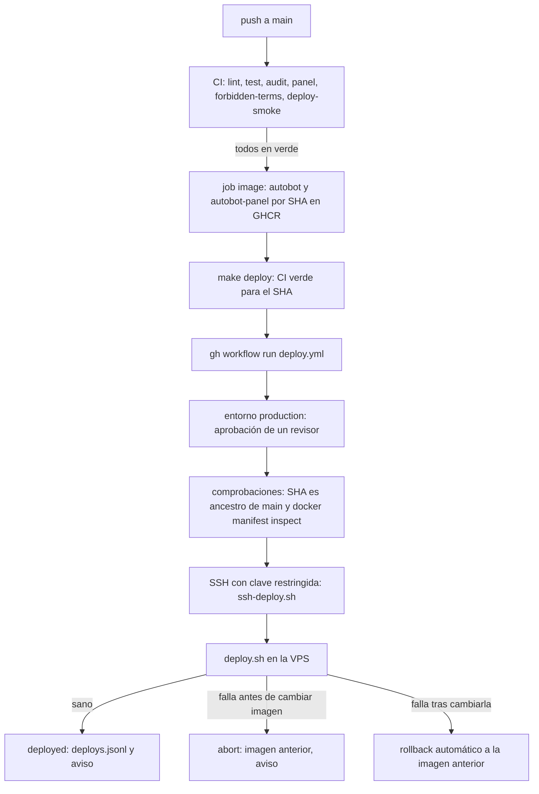

# Despliegue: de commit a producción

Cómo llega un commit de `main` a la VPS: qué comprueba el CI, qué publica, quién aprueba
y qué hace `deploy/scripts/deploy.sh` paso a paso, incluido el rollback automático. Léelo
antes del primer despliegue o cuando uno falle. Preparar la VPS (una sola vez) está en
[servidor.md](servidor.md); volver a una versión anterior, en
[../incidencias/volver-atras.md](../incidencias/volver-atras.md).

!!! warning "Aprobaciones"
    Ningún agente despliega a producción ni ejecuta comandos contra el servidor
    (`CLAUDE.md`). Despliega siempre una persona, y el entorno `production` de GitHub
    exige además la aprobación de un revisor.

## Objetivo, cuándo y requisitos

- **Objetivo:** poner en la VPS el SHA exacto de un commit de `main` ya probado, con
  imágenes inmutables, sin ventana de descarga y con vuelta atrás automática.
- **Cuándo:** cada vez que `main` tenga algo que publicar. No hay despliegue automático.
- **Requisitos:** CI en verde para ese SHA; VPS instalada
  ([servidor.md](servidor.md)); `gh` autenticado en tu portátil; la clave de operación SSH
  (alias `autobot` en `~/.ssh/config`, o `HOST=<alias>`) solo para `make rollback`,
  `make backup-now` y `make prod-*`.

## Chuleta: sacar una versión

Todo desde el portátil, en el clon del repo. El detalle de cada paso está en las secciones
siguientes.

1. **Revisar y subir:** `git status`, `git diff`, commit en `main` y `git push origin main`.
2. **Esperar al CI** (15-20 min):

    ```bash
    gh run watch $(gh run list --workflow ci.yml --branch main --limit 1 --json databaseId -q '.[0].databaseId') --exit-status
    ```

3. **Lanzar:** `git fetch && make deploy` (se niega si el CI de `origin/main` no está en verde).
4. **Aprobar** en GitHub: «Review deployments» → `production` → «Approve and deploy».

    ```bash
    gh run view --web $(gh run list --workflow deploy.yml --limit 1 --json databaseId -q '.[0].databaseId')
    ```

5. **Seguir** el despliegue (1-3 min) con el mismo `gh run watch` sobre `deploy.yml`.
6. **Comprobar:** llega «🟢 Desplegado <sha>» al chat de avisos; en el panel, Sistema muestra el
   SHA nuevo con una línea `deployed`; `curl https://<PUBLIC_HOST>/health` da 200; y lo que
   arreglaba el cambio funciona.

Si falla antes de cambiar la imagen, sigue la anterior (🔴 `deploy_aborted`); si falla después,
vuelve sola a la anterior (🔴 `deploy_rollback`). Para volver tú: `make rollback`
([volver atrás](../incidencias/volver-atras.md)). El esquema de la base nunca vuelve atrás: por
eso las migraciones solo añaden.

## Visión de conjunto



## 1. CI (`.github/workflows/ci.yml`)

Se ejecuta en cada `push` a `main` y en cada pull request. En ramas distintas de `main`
cancela la ejecución anterior; en `main` no. Nueve jobs corren en paralelo y `image` espera
a todos:

| Job | Qué comprueba |
|---|---|
| `lint` | Que no haya datos de clientes ni ficheros de `var/` en git; `ruff check` y `ruff format --check`; `shellcheck` de `deploy/scripts/*.sh`, `deploy/postgres/*.sh` y `apps/backend/src/tools/*/*.sh`; `mypy`; `import-linter` (capas de `core`, `integrations` y `packs`) |
| `test` | PostgreSQL 18 de servicio con los roles de `init-roles.sh`; `pytest`; `makemigrations --check` y `lintmigrations`; que `apps/panel/openapi.json` esté al día con el backend |
| `audit` | `pip-audit` sobre las dependencias bloqueadas de `uv.lock` |
| `secrets-scan` | `gitleaks` sobre todo el historial de git, con `.gitleaks.toml` |
| `dockerfile-lint` | `hadolint` sobre los dos Dockerfile y `actionlint` sobre los workflows |
| `forbidden-terms` | `deploy/scripts/check-forbidden-terms.py`: ningún fichero versionado contiene nombres de clientes reales (solo se guardan sus hashes) |
| `panel` | En `apps/panel/`: tipos de la API (`schema.d.ts`) y `routeTree.gen.ts` versionados y al día, `biome`, `tsc`, `vitest`, el build y `pnpm audit --prod --audit-level high` |
| `deploy-smoke` | Que `compose.yaml` + `compose.prod.yaml` y los de local sean válidos; que los dos Caddyfile pasen `caddy validate` con las imágenes reales; que `make restore-test` (copia de seguridad y restauración completas) funcione sobre la imagen recién construida |

!!! note
    La versión de `uv` del CI sale de la línea `FROM ghcr.io/astral-sh/uv:…` de
    `apps/backend/Dockerfile`, y las de Caddy salen de `compose.prod.yaml` y de
    `apps/panel/Dockerfile`: al subir una de esas versiones, el CI la valida sola.

### Job `image`

Construye dos imágenes con la caché de GitHub Actions, las analiza con Trivy y, solo si el
análisis pasa, las publica. Se etiquetan con el SHA completo:

- `ghcr.io/<propietario>/autobot:<sha>` desde `apps/backend/Dockerfile`: web y workers.
- `ghcr.io/<propietario>/autobot-panel:<sha>` desde `apps/panel/Dockerfile`: la SPA y su
  Caddy.

Trivy falla con cualquier vulnerabilidad HIGH o CRITICAL con arreglo disponible. La capa de
parches de Debian se rehace a diario (`SECURITY_UPDATES_DATE`), y una excepción solo se
admite en `.trivyignore`, con su motivo y una fecha de caducidad. Solo se publican en los
`push` a `main`, y las etiquetas son inmutables: el SHA es el único identificador de una
versión.

## 2. De `make deploy` a la VPS

1. **`make deploy`** (desde el portátil, tras `git fetch`; `SHA=<sha>` para uno concreto)
   comprueba que el CI de ese SHA terminó en `success` y lanza `gh workflow run deploy.yml`.
2. **Workflow `deploy.yml`:** espera la aprobación del entorno `production` (restringido a
   `main`); un segundo despliegue espera al primero; comprueba que el SHA es ancestro de
   `origin/main` y que sus dos imágenes existen en GHCR (si no, no toca la VPS); y entra por
   SSH como `deploy` con `DEPLOY_SSH_KEY`.
3. **`ssh-deploy.sh`:** la clave de CI va en `authorized_keys` con
   `restrict,command=".../ssh-deploy.sh"`, así que solo puede ejecutar `deploy.sh <sha>`.
   Antes toma el candado `var/.deploy.lock`, exige un árbol limpio y hace
   `git checkout --detach <sha>`, para que scripts, compose y Caddyfile sean los del SHA.

## 3. Qué hace `deploy.sh`

Se ejecuta en `/srv/autobot` como `deploy` (nunca root) y sobrevive a un corte de SSH. Las
ideas importantes:

- **Un solo despliegue a la vez** (`flock` sobre `var/.deploy.lock`) y ninguno si existe
  `var/.frozen` (lo pone [traslado.md](traslado.md) en el servidor de origen).
- **`ensure-env.sh`** genera los secretos internos que falten y **nunca inventa**
  credenciales externas: si falta una, aborta y la nombra. `SECRETS_ENCRYPTION_KEY` nunca
  se genera (ADR-022).
- **Volcado previo a migrar:** si hay migraciones pendientes, `pg_dump` a
  `var/backups/pre-migrate.dump` (se borra a las 48 h).
- **Migrar sin bloquear el tráfico:** `migrate` con `lock_timeout=5s`; si una migración
  tendría que esperar un candado, falla y el despliegue aborta. Después, `apply_grants`,
  `tenant_config validate --all` y `seed_demos`, todo desde `web-panel`, el único servicio
  con la conexión `owner` ([ADR-020](../arquitectura/adr/ADR-020-api-del-panel-aparte.md)).
- **Cambio de imagen** de `web`, `web-panel`, los cuatro workers y `panel`, y
  **comprobación de salud**: `/health/internal` sin más negocios degradados que antes,
  workers sin reinicios durante ~10 s y `panel`/`web-panel` sanos.
- **Caddy** se recarga solo si cambió `deploy/caddy/Caddyfile`. Ese Caddy público solo
  reenvía una lista cerrada de rutas (los webhooks y `/health`); el panel tiene su propio
  Caddy y solo se alcanza por túnel ([ADR-020](../arquitectura/adr/ADR-020-api-del-panel-aparte.md)).
- **Registro:** `var/.deployed-sha`, una línea en `var/state/ops/deploys.jsonl` (la que
  muestra el panel en Sistema) y el aviso `deploy_ok`. Por último comprueba
  `https://$PUBLIC_HOST/health`; si falla, solo avisa.

### Si algo falla

| Dónde falla | Qué pasa | `result` en `deploys.jsonl` |
|---|---|---|
| Antes de cambiar la imagen (descarga, volcado, migración) | `abort`: sigue la imagen anterior; devuelve el checkout al SHA previo; reaplica `apply_grants`; aviso `deploy_aborted` | `aborted` |
| Tras cambiar la imagen (salud) | `rollback`: vuelve a la imagen y checkout previos, repite las comprobaciones, aviso `deploy_rollback` | `rolled_back`, o `rollback_failed` si tampoco arranca |
| Mismo SHA y sin recuperar salud | Sale con error | `rollback_failed` |

!!! warning "El esquema no se revierte"
    `abort` y `rollback` devuelven el **código**, nunca el esquema de la base de datos.
    Si una migración ya aplicada hay que deshacerla, el volcado previo está en
    `var/backups/pre-migrate.dump` (restauración manual, con aprobación humana). Si
    `rollback_failed`, hace falta un operador: ver
    [../incidencias/volver-atras.md](../incidencias/volver-atras.md).

La primera vez (sin SHA previo) un fallo tras cambiar la imagen no tiene a qué volver:
exige actuación del operador.

## 4. Después del despliegue

Verificación:

1. El job de GitHub termina en verde y `deploys.jsonl` tiene una línea `deployed`
   (también en el panel, Sistema, historial de despliegues).
2. `curl https://<PUBLIC_HOST>/health` devuelve 200 desde fuera.
3. `make prod-compose ARGS="ps"` muestra los diez servicios (`caddy`, `web`,
   `web-panel`, `worker-inbound`, `worker-calendar`, `worker-periodic`, `worker-outbound`,
   `panel`, `db`, `victorialogs`) en marcha.
4. Una consulta al bot de demo responde.

### Cambiar `.env` sin desplegar

`.env` solo se lee al crear los contenedores. Tras editarlo en la VPS (como `deploy`, en
`/srv/autobot`), recrea lo que lo usa; compose solo recrea los contenedores cuyo entorno
cambió:

```bash
# en la VPS, como deploy, en /srv/autobot
deploy/scripts/compose.sh up -d --no-deps web web-panel worker-inbound worker-calendar worker-periodic worker-outbound
# o, desde el portátil
make prod-compose ARGS="up -d --no-deps web web-panel worker-inbound worker-calendar worker-periodic worker-outbound"
```

### Comandos de operación en el servidor

Nunca `docker compose ...` a pelo: sin `SHA` ni `--env-file` falla.

| Para | En la VPS (como `deploy`, en `/srv/autobot`) | Desde el portátil |
|---|---|---|
| Un comando de `manage.py` en una imagen nueva (`run --rm web-panel`) | `deploy/scripts/manage.sh <comando> [args]` | `make prod-manage CMD="<comando> [args]"` (`TTY=1` si pregunta algo) |
| Cualquier otro `docker compose` (`ps`, `logs`, `exec`, `up`) | `deploy/scripts/compose.sh <args>` | `make prod-compose ARGS="<args>"` (`TTY=1` si es interactivo) |

Ambos usan el SHA de `var/.deployed-sha` y el `.env` de la raíz (`deploy/scripts/lib.sh`).
`manage.sh` ejecuta `python manage.py <comando>` en `web-panel`, que tiene la conexión `owner`.

## 5. Timers de systemd

Instalados por `bootstrap-server.sh`; los servicios se ejecutan como `deploy` en
`/srv/autobot`.

| Timer | Frecuencia | Hace |
|---|---|---|
| `autobot-backup.timer` | cada hora (con hasta 5 min de retraso aleatorio); el servicio tiene un límite de 2 h | `backup.sh`: volcado a restic. Detalle en [restaurar.md](restaurar.md) |
| `autobot-containers.timer` | cada minuto | `containers.sh`: instantánea de contenedores para el panel |
| `autobot-prune.timer` | a diario (hasta 30 min de retraso aleatorio) | `prune.sh`: borra imágenes Docker sin usar de más de 24 h, `pre-migrate.dump` de más de 48 h y cualquier `pre-migrate.dump.tmp`; espera al candado de despliegue |
| `autobot-watchdog.timer` | cada 5 min | `watchdog.sh`: vigilante del host, independiente de la base y de Django; ver la sección siguiente |

Estado: `systemctl list-timers 'autobot-*'`; `systemctl is-enabled autobot-prune.timer`.

### Vigilante del host (`watchdog.sh`)

Lo único que avisa aunque la base de datos, Django o el panel estén caídos: usa solo
`bash`, `curl`, `df` y `docker`, y escribe directamente a Telegram con el bot de avisos
(`NOTIFY_BOT_TOKEN` y `OPS_TELEGRAM_CHAT_ID` de `.env`, los mismos que las alertas de ops;
el token viaja por stdin a `curl`, nunca en argumentos ni en la salida). Avisa si:

| Condición | Umbral |
|---|---|
| Disco | más del 90 % usado según el espacio disponible para `deploy` (`AUTOBOT_WATCHDOG_DISK_PCT`) |
| Base de datos | el contenedor `db` no está `running` y `healthy` |
| Instantánea del host | `var/state/ops/containers.json` (la escribe `containers.sh` cada minuto) sin actualizarse más de 15 min (`AUTOBOT_WATCHDOG_STALE_MIN`): fallan los timers, Docker o el disco |

Cada condición avisa **una vez por hora** (`AUTOBOT_WATCHDOG_REPEAT_SECS`; estado en
`var/state/watchdog/`) y una vez más al recuperarse. Durante un despliegue o una
restauración se omiten las dos últimas (el disco se vigila siempre). Si falta el bot en
`.env`, lo dice por el diario y no hace nada: `journalctl -u autobot-watchdog.service`.
Nada en disco registra la última pasada de `ops_check` (su latido va directo a
Healthchecks), así que un worker colgado lo sigue detectando el check externo
(`HEALTHCHECKS_PING_URL`).

## 6. Dónde están los logs

| Qué | Dónde |
|---|---|
| Salida de `deploy.sh` | El log del job `Deploy` en GitHub Actions y `var/deploy.log` en el servidor (se conserva aunque la conexión SSH se corte; rota a `deploy.log.1` pasado 1 MiB) |
| Historial de despliegues | `var/state/ops/deploys.jsonl` y el panel (Sistema) |
| Logs técnicos de `web` y workers | Panel, Logs, pestaña Técnicos (VictoriaLogs, 31 días, máx. 5 GiB) |
| Logs de un contenedor, incluido el acceso de Caddy | `deploy/scripts/compose.sh logs --tail=100 <servicio>` (json-file, 5 ficheros de 20 MB por contenedor) |
| Timers | `journalctl -u autobot-backup.service` (o `-containers`, `-prune`) en la VPS |
| Trazas de excepciones | Sentry, si `SENTRY_DSN` está puesto |

Qué hay en cada fichero de `deploy/`: [mapa del código](../arquitectura/mapa-del-codigo.md#despliegue-deploy).
Variables de entorno: [../referencia/variables-entorno.md](../referencia/variables-entorno.md).
Comandos: [../referencia/comandos.md](../referencia/comandos.md).

## Dónde está el código

`.github/workflows/ci.yml`, `.github/workflows/deploy.yml`, `Makefile` (sección
Producción), `deploy/`, `apps/backend/Dockerfile`, `apps/panel/Dockerfile` y
`apps/panel/Caddyfile`.
