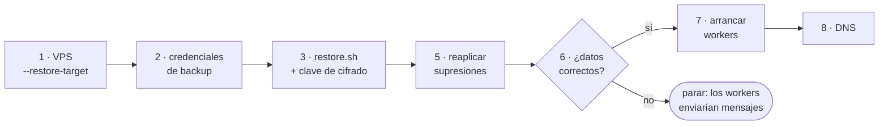
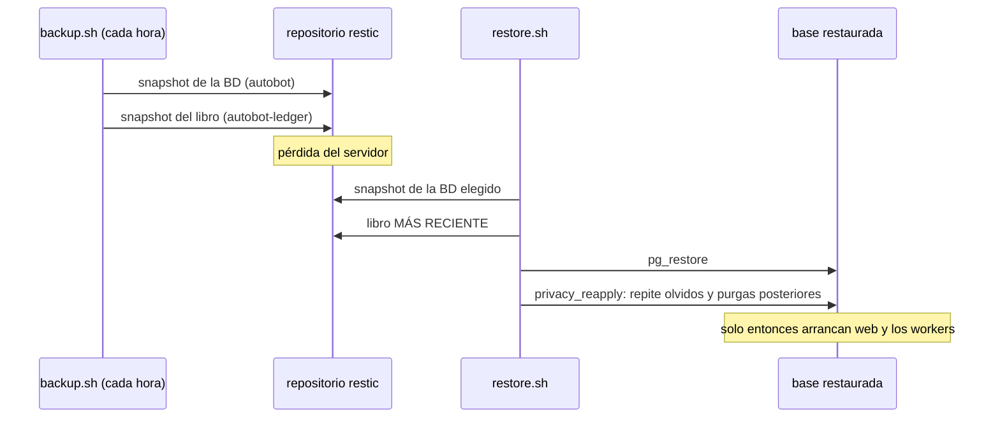

# Restauración y simulacro trimestral

Cómo restaurar un backup de restic en una VPS vacía, ya sea por una pérdida real o en el
simulacro trimestral. Léelo también para entender qué guarda y qué no guarda el backup. Si
has perdido la máquina original, sigue [../incidencias/perdida-total.md](../incidencias/perdida-total.md),
que añade las revisiones manuales de después; para volver a un SHA anterior sin perder
datos, [../incidencias/volver-atras.md](../incidencias/volver-atras.md); para un traslado
planificado, [traslado.md](traslado.md).

!!! warning "Aprobaciones"
    Restaurar y borrar la VPS temporal del simulacro son acciones sobre infraestructura y
    datos de producción: requieren aprobación humana explícita y las ejecuta una persona.
    No restaures sobre una instalación con volumen de BD existente: `restore.sh` se niega.

## Objetivo, cuándo y requisitos

- **Objetivo:** dejar una VPS con la base de datos, `.env`, certificados y el SHA del
  snapshot, lista para verificar antes de arrancar los workers.
- **Cuándo:** pérdida de datos o de servidor; simulacro trimestral (meta: menos de 2 horas).
- **Requisitos:** la contraseña de restic, las credenciales S3 y **la clave de cifrado de
  secretos** (`SECRETS_ENCRYPTION_KEY`), todo fuera del repositorio; la clave no viaja en el
  snapshot (ver [backups.md](backups.md));
  un snapshot reciente con tag `autobot` (comprueba su fecha y el ping de Healthchecks);
  una VPS Ubuntu 24.04 nueva.
- **Imagen en GHCR:** `restore.sh` descarga `${AUTOBOT_IMAGE}:<sha del snapshot>`. Si la
  retención de paquetes de GHCR ya la borró, falla al levantar `web` o `web-panel`, aunque el volcado sea
  correcto. La retención debe cubrir el snapshot más antiguo que `backup.sh` conserva
  (`--keep-daily 7 --keep-weekly 4 --keep-monthly 6`: hasta 6 meses).
- **Qué guarda el backup:** volcado de la BD, el `.env` **sin** `SECRETS_ENCRYPTION_KEY`
  (`var/backups/autobot.env`), `var/google_sa.json`, `.deployed-sha`, `Caddyfile`, estado de
  Caddy y `deploys.jsonl`. No guarda los logs técnicos, `pre-migrate.dump` ni la clave de
  cifrado (ADR-021).

## Pasos

1. **Prepara la VPS** (dentro de ella, con `sudo`): `sudo deploy/scripts/install-vm.sh
   --restore-target` ([servidor.md](servidor.md)). `restore.sh` se niega sin
   `/var/lib/autobot/bootstrap-complete`, que ese instalador escribe al terminar la base y
   el endurecimiento de SSH.
2. **Credenciales de backup**, como `deploy` en `/srv/autobot`: crea `var/backup.env`
   (plantilla `deploy/env/backup.env.example`) y `var/restic-password`, ambos con modo
   0600.
3. **Restaura**, como `deploy`, indicando de dónde sale la clave de cifrado (déjala en un
   fichero 0600, p. ej. `var/secrets-key`, que puedes borrar después, o pásala en el entorno):
   `AUTOBOT_SECRETS_KEY_FILE=/srv/autobot/var/secrets-key deploy/scripts/restore.sh --confirm-empty-target`
   (o `SECRETS_ENCRYPTION_KEY=<clave>`). Sin la clave, o con una que no descifre los secretos
   restaurados, el script falla con un mensaje claro. Con varias claves (rotación) sepáralas
   con comas. El script:
    1. Hace checkout del SHA del snapshot y restaura `.env` (con la clave que le has dado),
       `google_sa.json`, el
       `Caddyfile` y, si estaban, el estado de Caddy y `deploys.jsonl`.
    2. Ejecuta `ensure-env.sh` (recalcula `DEPLOY_UID` para esta máquina). La clave ya está
       en `.env` y nunca se genera una nueva (ADR-022).
    3. Levanta `db` y restaura el volcado con `pg_restore --clean`.
    4. Reaplica los roles (`init-roles.sh`) y los permisos (`apply_grants`), que
       `pg_restore --no-acl` pierde, y comprueba que la clave descifra los `tenant_secret`.
    5. Levanta `web`, `web-panel`, `panel`, `victorialogs` y `caddy`, **pero no los workers**: con los
       tokens reales enviarían mensajes antes de verificar los datos o cambiar el DNS.
    6. Escribe `var/.deployed-sha`.
4. **Si falla** después de crear el volumen, conserva `var/.restore-incomplete`: arregla
   la causa y vuelve a ejecutar el mismo comando (único reintento admitido). Si el snapshot
   era inválido y aún no se creó el volumen, corrige la fuente antes de repetir.
5. **Reaplica las supresiones** (obligatorio, ADR-019; ver más abajo) antes de verificar
   y de arrancar los workers: el snapshot puede traer de vuelta contactos olvidados o
   negocios purgados después de él.
6. **Verifica** (sección siguiente) antes de tocar el DNS.
7. **Arranca los workers**: como `restore.sh` ya no puede repetirse (`Existing deployment`),
   usa `deploy/scripts/compose.sh up -d worker-inbound worker-calendar worker-periodic worker-outbound`.
   `AUTOBOT_RESTORE_START_WORKERS=true` solo sirve dentro de la misma ejecución, cuando no
   hace falta verificar antes (por ejemplo, `make restore-test`).
8. **Apunta el DNS** a la nueva IP si cambió, y despliega con normalidad desde ahí
   ([despliegue.md](despliegue.md)).
9. **Simulacro:** anota SHA, snapshot, hora de inicio y fin y duración, y borra la VPS
   temporal (con autorización).

### Reaplicar olvidos y purgas (automático)

Un backup conserva lo que luego se olvidó con `contact_forget`, `tenant_purge` o el panel.
El **libro de supresiones** (tabla `privacy_suppression`, sin datos personales: ids y
HMAC; ADR-019) registra cada olvido o purga, pero vive en la misma base, así que el
snapshot no incluye los posteriores a él. No depende de nadie (ADR-025):

1. **Cada backup horario** sube el libro como snapshot propio con la etiqueta
   `autobot-ledger` (`backup.sh`), en el mismo repositorio cifrado.
2. **`restore.sh`** descarga el snapshot `autobot-ledger` **más reciente** (no el del
   snapshot que restauras), y tras restaurar la base, **antes de arrancar `web` o los
   workers**, ejecuta `privacy_reapply --ledger -` (por stdin: el contenedor efímero es de
   solo lectura y no ve ficheros de la VPS). Une el libro con la tabla restaurada, repite
   los olvidos y purgas (idempotente) y deja un evento `privacy.reapply`. Si informa de
   purgas bloqueadas, el script falla: repítelo con `deploy/scripts/manage.sh privacy_reapply`.
3. **Si el repositorio no tiene ningún snapshot `autobot-ledger`**,
   `restore.sh` lo avisa («WARNING: no suppression-ledger snapshot…») y reaplica solo lo que
   ya contenía la base restaurada. Entonces, si tienes una exportación manual
   (`make prod-manage CMD="privacy_ledger_export" > libro-supresiones.jsonl`, que sigue
   siendo una copia opcional), aplícala a mano:
   `deploy/scripts/manage.sh privacy_reapply --ledger - < libro-supresiones.jsonl`. Sin ella
   es una incidencia de protección de datos: anótalo y decide con el responsable qué datos
   olvidados pueden haber reaparecido (los de las horas entre el último libro y la pérdida).
4. La clave `SECRET_KEY` restaurada debe ser la original: los HMAC de identidad dependen
   de ella (sin ella solo se reaplican los olvidos por id de contacto).

### Simulacro local, sin servidor

`make restore-test` (necesita Docker y restic; el CI lo ejecuta también). Crea dos proyectos
temporales, restaura con `AUTOBOT_RESTORE_DB_ONLY=true`, compara conteos por tenant, y
arranca solo `web` para comprobar que `/health/internal` responde sin negocios ilegibles y
que la `SECRETS_ENCRYPTION_KEY` indicada descifra `tenant_secret`. Comprueba además que el
snapshot no contiene la clave y que `restore.sh` falla sin ella o con una equivocada. En una máquina que no es
VM, `restore.sh` salta la comprobación del marcador con
`AUTOBOT_RESTORE_SKIP_BOOTSTRAP_CHECK=true`, avisando en voz alta.

## Verificación

- `https://<PUBLIC_HOST>/health` (o `curl --resolve` contra la VPS nueva antes del DNS)
  devuelve 200.
- Por tenant, los conteos de `contact`, `inbound_event` y `outbound_message` coinciden con
  el origen o con el informe previo (en el panel, Datos, o `psql` en el contenedor `db`
  como `postgres`).
- `restore.sh` ejecutó `privacy_reapply` sin avisar de falta de libro; los contactos y negocios del libro ya no están.
- Un flujo por el bot de demo funciona.
- `deploy/scripts/compose.sh ps` muestra los servicios esperados; los workers, solo tras
  verificar.

## Dónde está el código

`deploy/scripts/restore.sh`, `deploy/scripts/backup.sh`, `deploy/scripts/restore-test.sh`,
`deploy/scripts/install-vm.sh` (`--restore-target`), `deploy/env/backup.env.example`; libro de supresiones: `autobot/runtime/suppressions.py`,
`autobot/runtime/privacy.py` (`reapply`) y los comandos `privacy_ledger_export` y
`privacy_reapply`.
