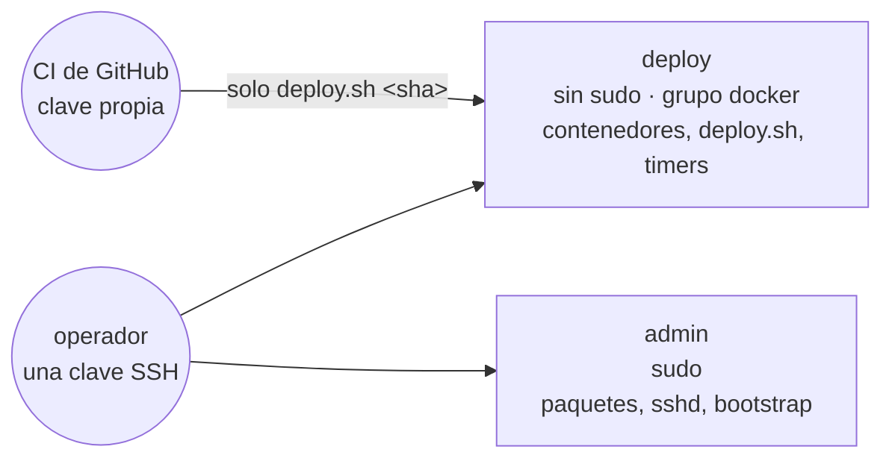

# Instalar y preparar la VPS

Cómo dejar una VM Ubuntu 24.04 lista para recibir despliegues: un solo comando dentro de
la VM (`install-vm.sh`), las cuentas que crea y los pasos manuales que quedan. Se hace una
vez, o para reparar o repetir la instalación. El despliegue de cada commit está en
[despliegue.md](despliegue.md), el traslado a otra máquina en [traslado.md](traslado.md) y
la recuperación en [restaurar.md](restaurar.md). Decisión: ADR-017.

!!! warning "Aprobaciones"
    Es un cambio de infraestructura del servidor: requiere aprobación humana explícita, y
    ningún agente lo ejecuta contra un servidor real (`CLAUDE.md`).

## Objetivo, cuándo y requisitos

- **Objetivo:** servidor con Docker, cuentas `deploy` y `admin`, SSH endurecido, `ufw`,
  timers y primer despliegue, listo para que el CI despliegue por SSH.
- **Cuándo:** VPS nueva; o reparar la instalación si el despliegue SSH falla
  (`sudo deploy/scripts/install-vm.sh --check` informa de qué pasos están hechos).
- **Requisitos:** VM Ubuntu 24.04 con acceso `root` o `sudo` por clave SSH; registro DNS de
  `api.<dominio>` hacia ella (puede hacerse después); cuenta de servicio de Google; los
  paquetes GHCR (`autobot`, `autobot-panel`) públicos o legibles; y el CI del commit en
  verde (el instalador comprueba que la imagen existe). Si ya los tienes, los tokens
  externos.

## Cuentas del servidor



Ambas entran **solo** con la misma clave SSH del operador (sin contraseña, sin root).

| Cuenta | Para qué | sudo |
|---|---|---|
| `deploy` | Dueña del clon en `/srv/autobot` y de los contenedores; ejecuta `deploy.sh`, `manage.sh`, `compose.sh` y los timers; también acepta la clave de CI, limitada a `deploy.sh <sha>` | No (pero está en el grupo `docker`, que equivale a root: no es una frontera de seguridad, solo evita accidentes) |
| `admin` | Mantenimiento del sistema: actualizar paquetes, reiniciar `sshd`, repetir el bootstrap | Sí |

Los comandos de `deploy/scripts/` se ejecutan como `deploy` en `/srv/autobot`; los que
necesitan `sudo`, como `admin`.

## Pasos

1. **En la VM**, clona el repositorio y lanza el instalador (con `sudo`, desde el clon):

    ```bash
    git clone https://github.com/<owner>/<repo>.git && cd <repo>
    sudo deploy/scripts/install-vm.sh --public-host api.<dominio> --google-sa ~/google_sa.json \
      [--env-file ~/install.env]
    ```

    - `--env-file` es un `CLAVE=valor` (modo 0600, fuera del repo) con credenciales
      externas opcionales: `DEMO_TELEGRAM_TOKEN`, `NOTIFY_BOT_TOKEN`,
      `OPS_TELEGRAM_CHAT_ID`, `SENTRY_DSN`, `HEALTHCHECKS_PING_URL`, los `DEMO_*` y los de
      backup (`RESTIC_REPOSITORY`, `AWS_*`, `HEALTHCHECKS_BACKUP_PING_URL`, que van a
      `var/backup.env`; plantilla en `deploy/env/backup.env.example`). Solo acepta claves
      conocidas.
    - Sin `--operator-key`, usa la única clave de `~/.ssh/authorized_keys` del usuario que
      ejecuta `sudo`; con varias, pasa `--operator-key <fichero.pub>`.
    - Sin Google todavía: `--no-google-sa` (Calendar no funcionará hasta subir el real).
    - Opciones útiles: `--sha`, `--only paso`, `--skip paso`, `--yes`, `--check`.

    El instalador ejecuta estos pasos en orden; cada uno comprueba antes si ya está hecho,
    así que se puede repetir el comando entero:

    ```mermaid
    flowchart LR
        K[ci-key] --> B[base] --> E[env] --> D[deploy] --> H[health] --> S["harden-ssh<br/>(confirmación)"] --> M[marker] --> G["github<br/>(opcional)"]
    ```

    | Paso | Qué hace |
    |---|---|
    | `ci-key` | Genera dentro de la VM la clave ed25519 de CI; la privada queda en `/root/autobot-ci-deploy-key` (solo root) |
    | `base` | `bootstrap-server.sh --base`: paquetes, Docker, swap, cuentas `deploy` y `admin`, clon en `/srv/autobot`, timers de systemd, reloj sincronizado (`systemd-timesyncd` activo y NTP encendido), `unattended-upgrades` (también con el repositorio de Docker; reinicio automático a las 03:30 hora del servidor si hace falta) y `autobot-docker-firewall.service`. La clave de CI se instala en `deploy` con `restrict,command=".../ssh-deploy.sh"` |
    | `env` | `.env` (valores explícitos y `ensure-env.sh`, que genera los secretos internos y nunca inventa los externos; la clave de cifrado solo se genera en la primera instalación: **cópiala al gestor de contraseñas** al terminar, ADR-022) y `var/google_sa.json` |
    | `deploy` | Primer despliegue del commit del clon (o `--sha`) por el mismo `ssh-deploy.sh` que usa el CI |
    | `health` | Comprueba web, web-panel, panel, workers, HTTPS, timers y que el reloj esté sincronizado (aviso, no fallo, si aún no lo está) |
    | `harden-ssh` | `bootstrap-server.sh --harden-ssh`: cierra root y contraseña, solo `admin` y `deploy`, `MaxAuthTries 4` y `LoginGraceTime 30`, `ufw` en 22/80/443 y `fail2ban`. **Pide confirmar** que has abierto otra sesión como `admin@` y `deploy@`; rechaza seguir si `sshd` no escucha solo en el 22 o la clave no está en ambas cuentas. Sin terminal y sin `--yes`, se omite y queda pendiente |
    | `marker` | Escribe `/var/lib/autobot/bootstrap-complete`, que exige `restore.sh`; solo con SSH endurecido |
    | `github` | Opcional: con `gh` autenticado en la VM y tu confirmación, crea el entorno `production` y sube `DEPLOY_HOST`, `DEPLOY_SSH_KEY` y `DEPLOY_KNOWN_HOSTS`, y borra la clave privada con `shred` |

    La consola del proveedor sigue siendo la salida de emergencia si `harden-ssh` sale mal.

2. **Pasos manuales.** Al final el instalador imprime lo que falta. Lo habitual:
    - **DNS** de `PUBLIC_HOST` a la IP de la VM.
    - **Secretos de GitHub**, si no se subieron con `gh`, desde el portátil:

        ```bash
        ssh admin@<host> 'sudo cat /root/autobot-ci-deploy-key' | gh secret set DEPLOY_SSH_KEY --env production
        ssh admin@<host> 'sudo shred -u /root/autobot-ci-deploy-key'
        ```

        y también `DEPLOY_HOST` y `DEPLOY_KNOWN_HOSTS`.
    - **Entorno `production` de GitHub** (Settings, Environments): restringirlo a la rama
      `main` y con revisores obligatorios. Sin eso, cualquier rama con acceso al workflow
      puede usar la clave de despliegue.
    - **Backups**, como `deploy` en la VPS: crea `var/backup.env` (con una credencial S3 **sin
      permiso de borrado**; la de purga vive en tu máquina, ver [backups.md](backups.md)) y
      `var/restic-password` (cópiala a tu gestor de contraseñas, junto a la
      `SECRETS_ENCRYPTION_KEY`, que no viaja en los snapshots), ejecuta **a mano** `restic init` (nunca es
      automático), lanza un `deploy/scripts/backup.sh` y arranca el timer con
      `sudo systemctl start autobot-backup.timer` (como `admin`). Fija la retención de
      paquetes de GHCR para cubrir los 6 meses de `--keep-monthly 6`
      ([restaurar.md](restaurar.md)).
    - **Healthchecks.io** (`HEALTHCHECKS_PING_URL`, `HEALTHCHECKS_BACKUP_PING_URL`), Sentry,
      chat de avisos y tokens de Telegram en `.env` (como `deploy`), y aplicar los cambios
      según [despliegue.md](despliegue.md#cambiar-env-sin-desplegar).
    - **Google:** la cuenta de servicio real, si se instaló el marcador vacío.
    - **Usuario del panel y webhooks** (sección siguiente).

3. **Crear el usuario del panel** (única forma de hacerlo; no hay registro ni recuperación
   por email). Desde el portátil:

    ```bash
    make prod-manage TTY=1 CMD="panel_user create <usuario>"
    ```

    Pide la contraseña dos veces y muestra **una sola vez** la URI `otpauth://` y su QR:
    escanéalo antes de cerrar la sesión. Recuperar el TOTP o cambiar la contraseña:
    [panel.md](panel.md#alta-del-operador).

4. **Registrar los webhooks** de los bots de la plataforma (portátil):

    ```bash
    make prod-manage CMD="telegram_set_webhook demo"
    make prod-manage CMD="telegram_set_webhook notify"
    ```

    Ver [demo.md](demo.md) y [../arquitectura/bot-de-duenos.md](../arquitectura/bot-de-duenos.md).

5. **Rotar la clave de CI** (si hace falta): `sudo deploy/scripts/install-vm.sh --only
   ci-key --rotate-ci-key` en la VM y repetir la entrega de secretos. Para preparar una VM
   solo para restaurar o recibir un traslado: `--restore-target` (sin `.env` ni
   despliegue; ver [restaurar.md](restaurar.md) y [traslado.md](traslado.md)).

## Verificación

- `sudo deploy/scripts/install-vm.sh --check` sin pendientes; repetir `install-vm.sh` no
  cambia nada.
- Sesiones de `deploy@` y `admin@` funcionando; la clave de CI rechaza cualquier orden
  distinta de `deploy.sh <sha>`.
- `systemctl list-timers 'autobot-*'` muestra los tres timers, y `systemctl is-active
  autobot-docker-firewall.service` está activo: `sudo iptables -S DOCKER-USER` muestra que solo
  pasan las conexiones a los puertos 80 y 443 (`--ctorigdstport`) y se descarta el resto con
  DNAT. `/etc/apt/apt.conf.d/51autobot-unattended-upgrades` fija los reinicios nocturnos.
- `sudo ufw status numbered` solo abre 22/80/443, y un escaneo de puertos contra la IP
  pública desde otra máquina confirma que solo responden esos tres. Los puertos 8000
  (`web`) y 8080 (`panel`) escuchan solo en `127.0.0.1`; `web-panel` no publica ningún puerto.
- Reloj: `timedatectl` muestra `System clock synchronized: yes` y `NTP service: active`
  (`timedatectl show -p NTPSynchronized` da `yes`). Importa para los códigos TOTP del panel,
  las marcas de tiempo de los webhooks, los bloqueos de restic y los plazos de retención;
  tras el arranque puede tardar un minuto en sincronizar.
- Disco: la alerta `disk` salta por encima del 80 % (🔴 `disk_critical` al 95 %) y mide `/`
  (el disco del host: Docker, volumen de PostgreSQL, temporales del backup) y
  `/srv/autobot/var/state/ops`; cuenta el más lleno.
- `https://<PUBLIC_HOST>/health` responde 200. El panel solo se alcanza con
  `make panel-tunnel`, nunca por el Caddy público.

## Operación posterior

- Operación diaria por SSH como `deploy` con `deploy/scripts/manage.sh` y
  `deploy/scripts/compose.sh` (o `make prod-manage` / `make prod-compose`): ver
  [despliegue.md](despliegue.md#comandos-de-operacion-en-el-servidor).
- Copia de seguridad manual: `make backup-now`, que usa la clave de operación; la de CI no
  puede. Caducar snapshots antiguos es `make backup-prune`, desde tu máquina
  ([backups.md](backups.md#caducar-snapshots)); su alerta viene desactivada.
- Memoria: los `mem_limit` de `compose.prod.yaml` suman 5,76 GB (`db` 2,5 GB con
  `shared_buffers=1GB`), calculados para la VPS objetivo de 4 vCPU y 8 GB. Se puede arrancar
  en 2 vCPU y 4 GB con los demos y los primeros clientes (son topes, no reservas); se amplía
  al crecer o si salta `memory_high` ([ADR-005](../arquitectura/adr/ADR-005-vps-docker-compose.md#proveedor-y-tamano),
  [capacidad y crecimiento](../arquitectura/capacidad-y-crecimiento.md#servidor-y-proveedor)).
  Cada contenedor lleva `memswap_limit` igual a su `mem_limit` (sin swap: una fuga muere por
  OOM y se reinicia, en vez de hundir la VPS en swap) y cada `/tmp` en `tmpfs` tiene
  `size=` (64 MB en `web`, `web-panel` y workers; 16 MB en `panel` y `victorialogs`).
- Healthchecks de Docker: `db` (con `start_period: 60s` para la recuperación tras un
  apagado sucio), `web`, `web-panel`, `panel` y `caddy` (API de administración en
  `127.0.0.1:2019`). Los workers no tienen: `procrastinate healthchecks` solo comprueba la
  conexión y la tabla de la base (no que el worker procese) y arrancaría un proceso Django
  completo cada intervalo; `deploy.sh` ya vigila que no se reinicien y el latido externo de
  `ops_check` cubre uno colgado.
- Vigilante del host: `autobot-watchdog.timer` (disco, `db`, instantánea del host) avisa a
  Telegram sin depender de la base ([despliegue.md](despliegue.md#vigilante-del-host-watchdogsh)).
- Los secretos de canal están cifrados en la BD con `SECRETS_ENCRYPTION_KEY`; configúrala
  en `.env` antes del primer despliegue y conserva su copia con los backups
  ([rotar-secretos.md](rotar-secretos.md)).

## Dónde está el código

`deploy/scripts/install-vm.sh`, `deploy/scripts/bootstrap-server.sh`,
`deploy/scripts/ensure-env.sh`, `deploy/scripts/docker-user-firewall.sh`, `deploy/env/`, `deploy/systemd/`.
