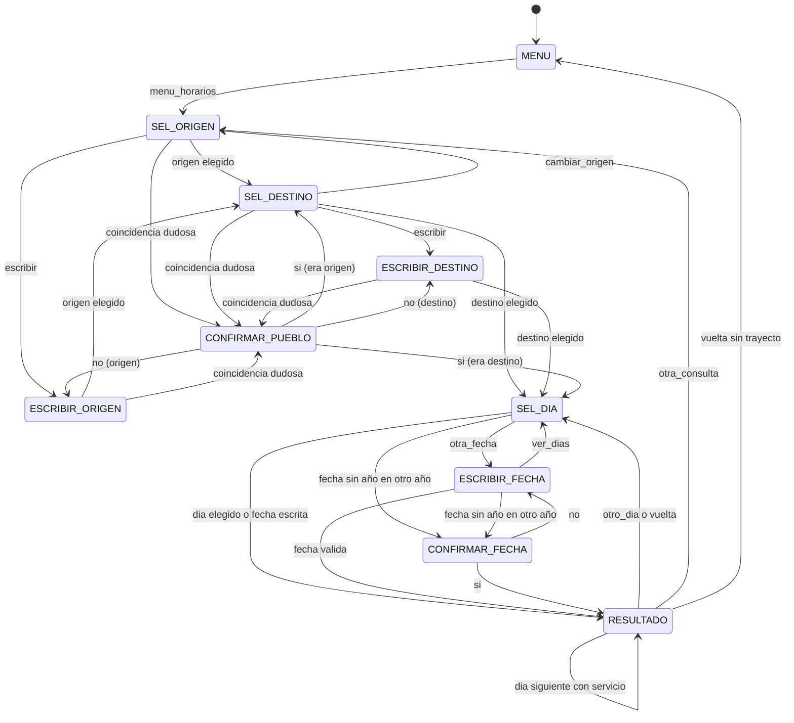
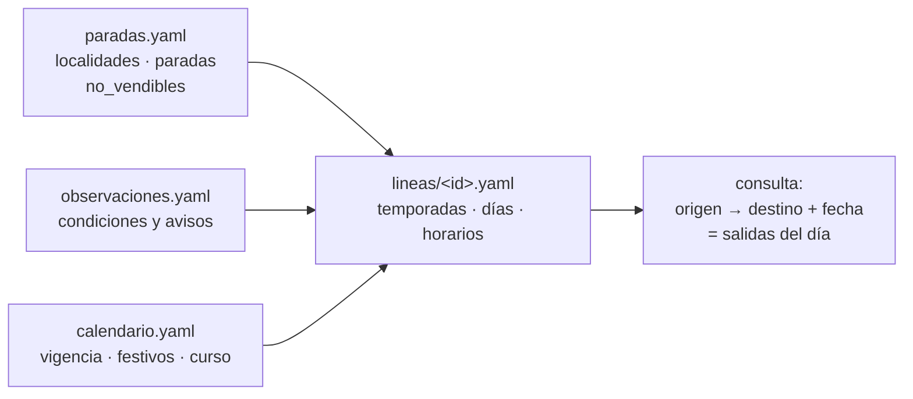

# Pack `bus`

Referencia del pack de horarios de autobús: su configuración, la máquina de estados de la
conversación y el formato del dataset de horarios. Léela cuando configures un negocio `bus`,
toques su flujo o edites un dataset. El concepto de pack está en
[packs](../../arquitectura/packs.md); cómo se bajan, validan y suben los horarios, en
[horarios de bus](../../procedimientos/horarios-bus.md).

`bus` responde consultas de horarios por origen, destino y día, y ofrece contacto y pueblos
por línea. El cálculo usa únicamente el dataset versionado del tenant. No hay avisos
proactivos ni trabajos periódicos del pack. La conversación caduca a los 30 minutos
(`conversation_timeout_min`). Un dato sin horario se muestra como «horario no disponible», no
como «sin servicio».

## Configuración

El bloque `config` del documento versionado es `BusConfig`
(`apps/backend/src/packs/bus/config.py`). Rechaza claves desconocidas: un error tipográfico
falla al importar, no se ignora.

| Campo | Tipo y límites | Por defecto | Uso |
|---|---|---|---|
| `business_name` | texto no vacío | obligatorio | Nombre de la empresa en los mensajes. |
| `contact_phone` | texto, 1 a 30 caracteres | obligatorio | Teléfono de contacto. |
| `office_hours` | lista de bloques `{days, ranges}` | `[]` | Horario de oficina. `days`: al menos un día (`lunes`, `martes`, `miercoles`, `jueves`, `viernes`, `sabado`, `domingo`), sin repetir en el bloque; `ranges`: al menos una franja `HH:MM-HH:MM`, sin solapes. Un día no puede estar en dos bloques. |
| `links` | mapa de claves `web`, `compra_online`, `bonos`, `pdf_horarios` a URL | `{}` | Enlaces que ofrece el bot. Cada valor debe ser una URL `http` o `https` válida; otras claves se rechazan. |
| `start_menu_towns` | lista de 1 a 8 nombres | obligatorio | Pueblos frecuentes del menú de origen. Sin duplicados (se comparan sin tildes ni mayúsculas) y sin nombres vacíos. |
| `next_day_search_days` | entero >= 1 | `45` | Cuántos días se busca hacia delante para «el próximo día con salidas». |
| `schedule_disclaimer` | texto, hasta 200 caracteres | `Horarios orientativos; confirma con la compañía.` | Última línea de cada respuesta de horarios (no en «no se vende este trayecto» ni «sin trayecto»). Vacío la oculta. El cuerpo se recorta antes para que siempre quepa en 4.096 caracteres. |

`start_menu_towns` se resuelve contra el dataset al cargar el tenant (`packs/bus/datos.py`,
`cargar`): cada nombre debe coincidir exactamente (sin tildes ni mayúsculas) con una
localidad del dataset y tener al menos un viaje. Si no, el negocio queda degradado. El resto
de pueblos se busca por nombre o alias.

Los días de oficina se declaran una vez, con franjas `HH:MM-HH:MM` sin solapes.

## Conversación

Estado y reglas de `apps/backend/src/packs/bus/conversation.py`. El estado es un JSON con
`step` (sin `step`, `MENU`), `campo` (`origen` o `destino`), `origen`, `destino`, `fecha`
(ISO), `pendiente` (localidad por confirmar) y `fecha_pendiente` (fecha sin año por
confirmar). Si el estado guardado referencia ids que ya no existen (por ejemplo, tras cambiar
el dataset), se vuelve al menú.



Desde **cualquier** estado: las palabras `menu`, `inicio`, `hola`, `salir`, `cancelar`,
`volver` y `atrás` y el botón `menu` vuelven a `MENU`; los botones `otra_consulta` y
`menu_horarios` llevan a `SEL_ORIGEN`.

| Estado | Qué espera el cliente |
|---|---|
| `MENU` | Cabecera «🚌 {negocio}», cuerpo «¿Qué necesitas?» y dos botones: «🚌 Ver horarios» o «ℹ️ Información» (teléfono, horario de oficina y enlaces). Debajo, siempre, la plataforma añade la línea del [aviso inicial](../../arquitectura/packs.md#aviso-inicial). |
| `SEL_ORIGEN` | Elegir uno de los pueblos del menú (`loc:<id>`), escribir uno, o ver los pueblos por línea (`lineas:`, `linea:`). Un pueblo sin hora de paso ofrece consultar otro en su lugar (`usar:<id>`). |
| `ESCRIBIR_ORIGEN` | Escribir el pueblo de origen. |
| `SEL_DESTINO` | Lo mismo para el destino, entre los alcanzables desde el origen, y «Cambiar origen». |
| `ESCRIBIR_DESTINO` | Escribir el pueblo de destino. |
| `CONFIRMAR_PUEBLO` | «Sí» o «No» a «¿Te refieres a…?» (también vale «sí» escrito). Otro nombre se busca de nuevo. |
| `SEL_DIA` | Lista de los próximos 7 días con un resumen de salidas, o una fecha escrita, u «otra fecha». |
| `ESCRIBIR_FECHA` | Una fecha (`día/mes[/año]`) o «Ver lista de días». |
| `CONFIRMAR_FECHA` | «Sí» o «No» a «¿Te refieres al 23/08/2027?». |
| `RESULTADO` | El horario y los botones de resultado. |

### Botones de resultado

`_botones_resultado` ofrece como máximo tres, en este orden:

1. El botón de día, según el caso: con salidas, «📅 Otro día» (`otro_dia`) o, si hoy ya no
   quedan salidas y mañana está dentro de la vigencia del calendario, «📅 Mañana»
   (`dia:<fecha>`); sin servicio ese día pero con un día posterior con servicio,
   «📅 Día d/m» (`dia:<fecha>`); en cualquier otro caso, «📅 Otro día».
2. «🔄 Ver la vuelta» (`vuelta`): intercambia origen y destino; si la vuelta no existe o no se
   vende, lo dice y vuelve al menú.
3. «🔍 Otra consulta» (`otra_consulta`): vuelve a elegir origen.

Un trayecto no vendible muestra solo «Otra consulta». Cada consulta que encuentra salidas
emite la métrica `schedule_query` (ver [Resumen mensual](#resumen-mensual-al-dueno)).

### Reglas de la conversación

- **Fecha escrita** (`día/mes[/año]`, separador `/`, `-`, `.` o espacio): `10 30` no es una
  fecha. Si no se entiende o ya pasó, el mensaje lleva siempre dos botones, «📅 Ver lista de
  días» y «↩️ Menú»; las palabras `menu`, `inicio`, `hola`, `salir`, `cancelar`, `volver` y
  `atrás` vuelven al menú desde cualquier paso.
- **Año nunca en silencio**: una fecha sin año se resuelve al año actual. Si cae en otro año y
  no es evidente (p. ej. `23/08` en septiembre, o `29/02` que saltaría a 2028) se pregunta
  «¿Te refieres al 23/08/2027?» [Sí] [No]; solo se acepta sin preguntar el año siguiente
  cuando queda más cerca por delante que por detrás (`5/1` a finales de diciembre). Todo
  resultado de un año distinto del actual muestra el año en la cabecera.
- **Botones viejos**: un `loc:` de una pregunta anterior se elige si existe, y cualquier otro
  id que no es del paso se ignora y se repite el paso; solo el texto escrito se busca como
  pueblo. Un `dia:` de un día ya pasado (lista mostrada antes de medianoche) vuelve a la lista
  de días con «Esa fecha ya ha pasado».
- **Logs**: al no reconocer un texto solo se registra el paso y su longitud
  (`[NO_RECONOCIDO] paso=origen longitud=12`); nunca el texto.
- **Sin órdenes de atención**: `persona`, `baja`, `stop` o `alta` se buscan como cualquier
  pueblo escrito. La atención humana es el teléfono de «ℹ️ Información»
  ([ADR-028](../../arquitectura/adr/ADR-028-aviso-en-una-linea-sin-persona-ni-baja.md)).
- **Horarios orientativos.** Toda respuesta con horarios termina con `schedule_disclaimer`.
  El dataset no guarda una fecha de actualización, así que el aviso no la incluye.

### Limitaciones conocidas

- **Viajes que cruzan la medianoche** no se pueden representar: en las tablas las horas nunca
  retroceden y cada viaje pertenece al día de su salida. Un servicio nocturno hay que partirlo
  en dos viajes (hasta las 23:59 y desde las 00:00) o dejarlo fuera del dataset.
- **Resultados muy largos**: si el resultado supera los 4.096 caracteres se recorta por la
  última salida completa, se añade «…y N salidas más. Para verlas todas, llama al …» y solo se
  explican las notas (⚠️) de las salidas que se muestran.

## Dataset de horarios

El dataset está versionado en la BD, en una biblioteca independiente de cualquier
cliente (ADR-013); el cliente se queda con una copia de la entrada elegida.
`manage.py dataset_library pull bus timetable <nombre> <dir>` saca una entrada a un
directorio con esta estructura:



| Archivo | Campos y formato |
|---|---|
| `paradas.yaml` | `localidades: {id: {nombre, alias?}}`; `paradas: {COD: {nombre, localidad}}`, con código de tres mayúsculas; `no_vendibles` son pares de ids sin billete en ambos sentidos; `pendientes` registra códigos `Pnn`. Una localidad pendiente lleva `pendiente`, `ver`, `minutos` y, opcionalmente, `aviso`. |
| `observaciones.yaml` | Mapa `id: {letra, tipo, ambitos, texto}`. `tipo` es `condicion` o `aviso`; `ambitos` usa `parada`, `viaje` o `linea`. Las condiciones que el motor sabe aplicar son `a_demanda`, `solo_viernes_lectivo` y `solo_si_viajeros`; cualquier otro id con `tipo: condicion` es un error de validación (un dataset antiguo con un id distinto se corrige renombrándolo a uno de estos). Una condición nueva necesita lógica explícita en el motor. |
| `calendario.yaml` | `vigencia: DD/MM/AAAA - DD/MM/AAAA`; `festivos` es fecha → nombre y `festivos_locales` es localidad → (fecha → nombre); `curso` declara `inicio_clases`, `fin_clases`, `vacaciones` (`DD/MM/AAAA - DD/MM/AAAA`) y `no_lectivos`; `sin_servicio_todas_las_lineas` usa `DD/MM`; `pendientes` es opcional. |
| `lineas/<id>.yaml` | Una línea por fichero con id `a-z0-9-`: `nombre`, `nombre_corto?` (≤24), `telefono_demanda?`, `avisos?`, `no_circula?`, `temporadas`, `dias`, `horarios` y `pendientes?`. |

El id de una localidad (`loc:<id>`) y el de una línea (`linea:<id>:<página>`) se
muestran como id de botón o de fila: la validación los rechaza si, con su
prefijo, superarían los 64 bytes del límite común de canal.

Una línea declara `temporadas` como `invierno: 01/09 - 22/06` o `anual: todo
el año`; entre todas cubren el año sin huecos ni solapes. En `dias`, cada
temporada asigna cada clase (lunes a domingo y festivos) a `horario`,
`sin_servicio` o `sin_datos`. Puede agrupar clases con `lunes-viernes`,
`lunes-jueves`, `martes-viernes`, `sabados-domingos`, `domingos-festivos` y
`sabados-domingos-festivos`, sin declarar una clase dos veces. `sin_datos`
señala una laguna conocida y no equivale a ausencia de servicio.

`horarios` es una lista de `{temporada, dias, tabla}`. Cada tabla de texto
empieza con al menos dos códigos de parada, en orden de recorrido, y cada fila
posterior representa un viaje con un valor por parada. `-` indica que no para;
`HH:MM` indica paso; `HH:MM>HH:MM` indica llegada y salida en una parada
intermedia; letras anexas (`09:55D`) remiten a `observaciones.yaml`. Tras una
barra vertical se pueden declarar ids de observaciones de ámbito `viaje`, códigos
pendientes `Pnn` y `bus:<id>` para el mismo vehículo compartido por líneas.
Las horas nunca retroceden y cada viaje tiene al menos dos pasos. `no_circula`
es una lista de nombres de mes (por ejemplo, `[agosto]`). `avisos` en la línea
aplican a todos sus viajes; `telefono_demanda` permite
explicar paradas a demanda. Los nombres con coma dentro de mapas YAML en línea
deben ir entre comillas.

Ejemplo mínimo de tabla:

```yaml
horarios:
  - temporada: anual
    dias: lunes-viernes
    tabla: |
      ADA    VFC    COR
      06:40  06:55  07:35
      08:50  09:00  09:40
```

Bajar, editar, validar y subir una versión nueva (`make bus-*`, la biblioteca y la
aplicación a cada cliente) es un procedimiento: está en
[horarios de bus](../../procedimientos/horarios-bus.md).

## Resumen mensual al dueño

El pack declara un único gancho `summary` para el resumen periódico al dueño
(ADR-007), que lee esta métrica de plataforma
(`RecordMetric`, aún emitida por `conversation.py`):

| Métrica | Unidad | Se emite cuando |
|---|---|---|
| Consultas de horario | recuento | la conversación encuentra un itinerario (`con_salidas`); un menú, un error o "sin horarios" no cuentan |

`bus` no vende nada, así que no declara ninguna métrica en euros: es el
comportamiento esperado, no una limitación. Para activar el resumen mensual del
negocio, añade en su documento exportado:

```yaml
owner:
  summary_monthly: true
```

Requiere que el dueño ya esté vinculado al bot de avisos (`manage.py owner_invite
<slug>`: ver [alta y baja de un negocio](../../procedimientos/alta-baja-negocio.md)). Llega por el
mismo bot el día 1 de cada mes, con los datos del mes anterior ya cerrado, y también se puede consultar en
cualquier momento escribiéndole al bot ("Cómo va el mes").

La plantilla inicial del demo está en `apps/backend/src/packs/bus/template/document.yaml`; su dataset está en `apps/backend/src/packs/bus/template/datasets/timetable/`.
Su dataset es ficticio. Al crear un negocio desde la plantilla se vacían `business_name`,
`contact_phone` y `start_menu_towns` (`template_blank`), y hay que rellenarlos con los datos reales.

## Dónde está el código

- `apps/backend/src/packs/bus/formato/`: el único parser y validador del dataset (`validar()`), un módulo por
  fichero (`localidades`, `calendario`, `observaciones`, `linea` y `tabla`, `buses`) más `temporadas` y
  `normalizar`, que usa también el motor de consulta. El modelo (`Modelo`, `Linea`, `Viaje`…) está en `modelo.py`.
- `loader.py` calcula al cargar los índices (`localidad_viajes`, `lineas_pueblos`, `lineas_con_pueblos`) y
  `query.py` guarda por par origen-destino lo que no depende de la fecha, para que listar siete días o buscar
  el siguiente día con salidas no repita el trabajo.
- `apps/backend/src/tools/bus/`: las herramientas de terminal (`make bus-*`), incluida la comparación de versiones
  (`diff.py`) que usa `make bus-revision`.
- `apps/backend/src/packs/bus/config.py` (`BusConfig`), `conversation.py` (máquina de estados),
  `interactive.py` y `messages.py` (respuestas), `datos.py` (carga del dataset y `start_menu_towns`).
- Escenarios de conversación: `apps/backend/tests/packs/bus/`.
