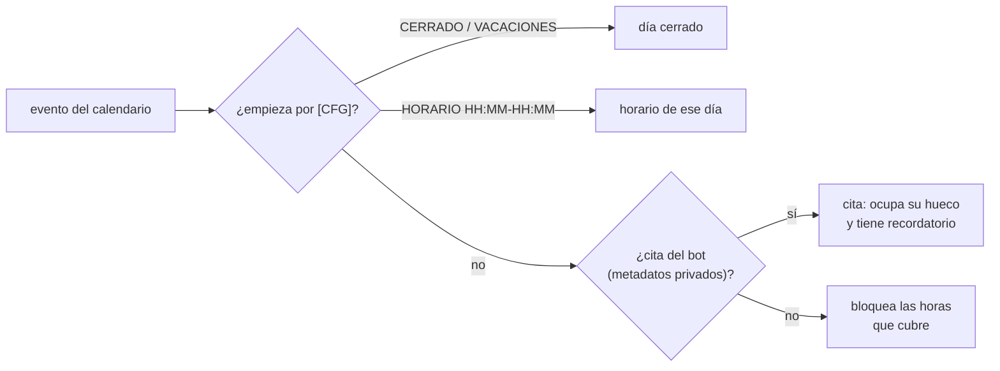
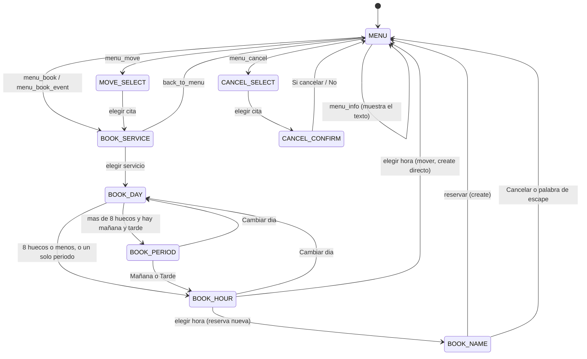

# Pack `salon`

Referencia del pack de peluquería: qué ofrece al cliente, cada campo de su configuración con
sus límites, la máquina de estados de la conversación y los avisos proactivos. Léela cuando
vayas a configurar un negocio `salon` o a tocar su flujo. Cómo se crea y se publica la
configuración está en [alta y baja de un negocio](../../procedimientos/alta-baja-negocio.md);
el concepto de pack, en [packs](../../arquitectura/packs.md).

`salon` gestiona reservas sobre Google Calendar. En el menú el cliente puede pedir, mover o
cancelar citas. Si `special_event.active` está activo aparece la reserva del evento; si
`info_text` tiene texto aparece «ℹ️ Información». La reserva ofrece solo huecos libres, los vuelve
a comprobar bajo candado antes de escribir y usa un id de evento determinista, de modo que
reintentar el mismo mensaje no duplica la cita.

!!! note "Un solo calendario por negocio"
    Hoy `SalonConfig` tiene un único `calendar_id`. El soporte de varios peluqueros
    (ADR-015) está aceptado pero **no implementado**.

## Configuración

La configuración vigente está en PostgreSQL. Se edita en el bloque `config` de un
`document.yaml` exportado con `tenant_config export` y se publica con `tenant_config import`
(ver [comandos](../comandos.md)). El esquema es `SalonConfig`. Rechaza claves desconocidas en
cualquier nivel: un error tipográfico falla al importar.

| Campo | Tipo y límites | Por defecto | Uso |
|---|---|---|---|
| `business_name` | texto, 1 a 60 caracteres | obligatorio | Nombre que ve el cliente (cabecera del menú, recortada a 60). |
| `contact_phone` | texto, 1 a 30 caracteres | obligatorio | Teléfono que muestran los mensajes del bot. |
| `calendar_id` | texto no vacío | obligatorio | Calendario de Google donde se guardan las citas. |
| `services` | de 1 a 9 entradas | obligatorio | Servicios, ver más abajo. |
| `opening_hours` | al menos un día | obligatorio | Franjas semanales `HH:MM-HH:MM`; un día ausente significa cerrado. |
| `slot_step_min` | entero > 0 | `30` | Paso, en minutos, entre las horas ofrecidas. |
| `min_notice_min` | entero >= 0 | `0` | Antelación mínima para reservar. |
| `booking_window_days` | entero de 1 a 90 | `21` | Cuántos días hacia delante se puede reservar. |
| `max_active_bookings` | entero >= 1 | `5` | Citas futuras por cliente; al llegar al tope no puede pedir otra. |
| `reminders_enabled` | booleano | `false` | Activa los recordatorios del barrido. |
| `reminder_window_hours` | par `[mín, máx]` de enteros | `[23, 25]` | Horas antes de la cita en que se envía el recordatorio. Regla: `0 <= mín < máx`. |
| `manual_confirmations_enabled` | booleano | `false` | Avisa a los clientes de citas creadas a mano. |
| `manual_confirmations_since` | fecha y hora **con zona horaria** | `null` | Solo las citas manuales creadas desde ese instante reciben aviso. Obligatoria si se activa; sin zona horaria se rechaza. |
| `holidays` | objeto o `null` | `null` | Calendario de festivos, ver [Festivos](#festivos). |
| `special_event` | objeto | inactivo | Evento especial, ver [Evento especial](#evento-especial). |
| `info_text` | texto, hasta 4096 caracteres | vacío | Texto de «ℹ️ Información» (el contacto del negocio: es la salida a una persona); vacío oculta la opción. |
| `texts` | objeto | ver [Textos](#textos) | Textos del bot sobrescribibles. |

Las claves de `opening_hours` son `lunes`, `martes`, `miercoles`, `jueves`, `viernes`, `sabado`
y `domingo`, sin tildes. Las franjas no pueden solaparse y cada una empieza antes de acabar.

### Servicios

`services` es un mapa cuya clave (`a-z0-9_`) es el id interno. La clave, con el prefijo
`service_`, no puede pasar de 64 bytes (límite común de canal).

| Campo | Límites |
|---|---|
| `name` | 1 a 24 caracteres (es el título de la fila de la lista) y no puede estar en blanco |
| `price_eur` | número >= 0, o `null` si no se muestra precio |
| `duration_min` | entero > 0: lo que ocupa en el calendario |
| `client_presence_min` | entero > 0 y **>= `duration_min`**: tiempo que el cliente está en el local |

### Evento especial

```yaml
special_event:
  active: true
  name: Día de la novia      # hasta 80 caracteres
  days:
    "2026-06-13": ["10:00-14:00"]
```

`active`, `name` (hasta 80 caracteres) y `days` (fecha → franjas `HH:MM-HH:MM`). Un evento
**activo exige nombre y días**; si no, la config se rechaza. Con el evento activo el menú
añade «Cita {name}», cuyas reservas solo ofrecen los días y franjas de `days`. Los días del
evento no se ven afectados por los festivos: los eliges tú explícitamente.

### Festivos

```yaml
holidays:
  country: ES          # código ISO; lo valida la librería `holidays`
  subdivision: MD      # comunidad autónoma (AN, CT, MD…) o null
  closed_dates: ["2026-05-15"]   # fiestas locales, vacaciones, cierres puntuales
  open_dates: ["2026-12-08"]     # festivo en el que sí se abre
```

Campos: `country` (código ISO, por defecto `ES`), `subdivision` (región o `null`),
`closed_dates` y `open_dates`. Con `holidays` definido, los festivos oficiales del país y la región (más `closed_dates`) no
aparecen en la lista de días ni tienen huecos, y la reserva lo revalida bajo candado.
`open_dates` reabre un festivo con su horario semanal normal. Cada lista admite hasta 366
fechas y una fecha no puede estar en las dos. Sin `holidays` solo cuenta el día de la
semana.

### Textos

`texts` sobrescribe los mensajes del bot. Cada valor es un texto de 1 a 512 caracteres (se
recortan los espacios de los extremos; no pueden quedar vacíos). Las claves, con su valor por
defecto en `packs/salon/messages.py` (`SalonTexts`):

| Clave | Cuándo se muestra |
|---|---|
| `welcome` | Cabecera del menú principal. |
| `name_prompt` | Pide el nombre para la reserva. |
| `name_text_only` | El cliente envió algo que no es texto cuando se pedía el nombre. |
| `no_slots` | El día elegido se llenó mientras tanto. |
| `no_days` | No queda ningún día con huecos (se añade el teléfono). |
| `unsupported` | Audio, imagen o sticker en un paso de lista. |
| `list_hint` | Texto libre donde se espera elegir de una lista. |
| `past_booking` | La cita ya pasó: no se puede mover ni cancelar. |
| `cancel_kept` | El cliente respondió «No» al confirmar la cancelación. |
| `slot_taken` | Otro cliente ocupó el hueco (`SlotTaken`). |
| `no_bookings` | Mover o cancelar sin ninguna cita próxima. |
| `cancelled` | Cita cancelada. |
| `missing` | No se encontró la cita, o no es del contacto. |
| `confirmed` | Reserva creada o recordatorio confirmado. |
| `moved` | Cita movida. |
| `move_cancel_failed` | Al mover, la nueva se creó pero no se pudo cancelar la anterior. |

## El calendario

El bot trata el calendario de Google como fuente de verdad. Eventos con significado especial:



- `[CFG] CERRADO` y `[CFG] VACACIONES` cierran el día.
- `[CFG] HORARIO HH:MM-HH:MM` fija el horario de ese día, también si era festivo o estaba
  cerrado.
- Cualquier otro evento (un cumpleaños, «Vacaciones» sin el prefijo `[CFG]`) **no cierra el
  día por sí solo**, pero **bloquea las horas que cubre**; uno de día completo las bloquea
  todas. Es la opción conservadora: nunca se reserva sobre algo que el peluquero apuntó. Para
  cerrar un día usa `[CFG] CERRADO`.
- El bot reconoce sus citas por metadatos privados de Calendar. Una cita creada a mano
  necesita `Telefono:` (o `WaId:`) en la descripción para que el barrido pueda identificarla;
  `Tel:` no se reconoce.

Para probar cambios sin tocar el calendario real se usa `FakeCalendar`
(`apps/backend/src/packs/salon/testing.py`, que también alimenta `manage.py chat`) o el
negocio de demo `demo-peluqueria` ([demo](../../procedimientos/demo.md)). Si Calendar deja de
responder, sigue [Google Calendar sin acceso](../../incidencias/calendar.md).

## Conversación

Estado y reglas de `apps/backend/src/packs/salon/conversation.py`. El estado es un JSON con
`step` (sin `step`, `MENU`) y los datos del paso; si el estado guardado no tiene lo que su
paso necesita, o es un modo evento con el evento ya desactivado, se vuelve al menú.



`back_to_menu` (el botón «Volver al menú» o «Cancelar») vuelve a `MENU` desde cualquier paso.

| Estado | Qué espera el cliente | Siguiente paso |
|---|---|---|
| `MENU` | Lista con Pedir cita, Mover cita, Cancelar cita, el evento especial si está activo y Contacto si hay `info_text`. | `BOOK_SERVICE`, `MOVE_SELECT` o `CANCEL_SELECT`. |
| `BOOK_SERVICE` | Elegir uno de los servicios (hasta 9, sin paginación). | `BOOK_DAY`. |
| `BOOK_DAY` | Lista de días con hueco, paginada. | `BOOK_PERIOD` o `BOOK_HOUR`. |
| `BOOK_PERIOD` | Botones Mañana, Tarde y Cambiar día. | `BOOK_HOUR`. |
| `BOOK_HOUR` | Lista de horas libres, paginada. | `BOOK_NAME`, o crea directamente al mover. |
| `BOOK_NAME` | Escribir el nombre (texto), o «Usar {nombre}» si el contacto ya tiene uno. | Reserva y `MENU`. |
| `MOVE_SELECT` | Elegir la cita a mover. | `BOOK_SERVICE`. |
| `CANCEL_SELECT` | Elegir la cita a cancelar. | `CANCEL_CONFIRM`. |
| `CANCEL_CONFIRM` | Botones «Sí, cancelar» y «No». | `MENU`. |

### Reglas

- **Mañana o tarde.** Si el día tiene más de 8 huecos y existen huecos de mañana y de tarde,
  se pregunta el periodo (`BOOK_PERIOD`). Con 8 o menos, o con un solo periodo, la lista de
  horas sale directamente.
- **Tope de citas.** Al empezar una reserva se cuentan las citas futuras del contacto; si ya
  tiene `max_active_bookings`, se le dice que es el máximo y se vuelve al menú. Si Calendar
  falla al contarlas, la reserva sigue (el tope falla abierto; el hueco se revalida después).
- **Modo evento.** `menu_book_event` solo existe con `special_event.active`. En ese modo los
  días y franjas salen de `special_event.days`. Mover una cita que cae en un día del evento
  activo reserva también en modo evento.
- **Hueco ocupado (`SlotTaken`).** Al crear, el hueco se revalida bajo el candado
  `cal:<fecha>`. Si otro cliente lo ocupó, se muestra `texts.slot_taken` y se vuelve a la
  lista de horas con los huecos actualizados. Si el día se llenó, se ofrecen otros días.
- **Nombre.** Entre 2 y 100 caracteres, con al menos una letra, sin `[cfg]`, y se limpia de
  `*`, `_`, `` ` ``, `~` y saltos de línea. Las palabras de escape (`cancelar`, `volver`,
  `atrás`, `salir`, `no`, `nada`, `hola`, `gracias`, `adiós`, `ayuda`, `menú`, `inicio`…)
  no son nombres y vuelven al menú. Cualquier otra palabra, también «Baja» o «Persona», es un
  nombre: la plataforma ya no tiene esas órdenes
  ([ADR-028](../../arquitectura/adr/ADR-028-aviso-en-una-linea-sin-persona-ni-baja.md)).
- **Cancelar** pide confirmación («¿Cancelar Corte de pelo del martes 24 de marzo a las
  10:00?»). Una cita ya pasada no se puede cancelar ni mover.
- **Mover = crear y luego cancelar.** El cliente elige la cita, el servicio, el día y la
  hora; no se le pide el nombre (se reutiliza el de la cita). Se crea la cita nueva con id
  determinista (`operation="move"`) y después se cancela la anterior. La cita que se mueve
  no bloquea los huecos que ocupa. Si la cancelación de la anterior falla, la nueva se
  queda, el cliente recibe `texts.move_cancel_failed` y el dueño el aviso `move_cancel_failed`.
- **Texto libre** en un paso de lista no pierde el progreso: se repite el paso con
  `texts.list_hint`. En el menú, cualquier texto muestra el menú. Un audio o una imagen
  recibe `texts.unsupported` y se repite el paso (en el paso del nombre se pide escribirlo).
- **Sin días.** Si no queda ningún día con hueco se dice y se da el teléfono.
- **Cambio de hora.** Los huecos que no existen por el cambio de hora (02:00 a 03:00 el
  último domingo de marzo) no se ofrecen, y la hora repetida de octubre se ofrece una vez.

### Botones de los avisos proactivos

Los avisos que manda el barrido llevan botones cuyo id empieza por `reminder_confirm:`,
`reminder_cancel:` o `booking_cancel:`, seguido del id del evento de Calendar. Se atienden
**desde cualquier estado**, sin pasar por la máquina:

| Botón | Efecto |
|---|---|
| `reminder_confirm` | Marca la cita como `Estado: confirmada` y responde `texts.confirmed`. |
| `reminder_cancel` | Cancela la cita de un toque (sin confirmación extra). |
| `booking_cancel` | Cancela la cita de un toque (botón de la confirmación de cita manual). |

Son de un toque porque son la respuesta explícita a un aviso de esa cita. Antes de actuar se
comprueba que la cita pertenece al contacto; si no, se responde `texts.missing`. Un id de
evento más largo que 64 bytes nunca se trunca: se omite el aviso.

## Barrido de Calendar y plantillas

El pack declara un periodic `calendar_sweep` (cada 15 minutos; se descarta si llega con más
de 60 minutos de retraso). Hace **una lectura de Calendar** y propone avisos que la
plataforma persiste de forma idempotente:

- **Recordatorio** (`reminders_enabled`): citas del bot o manuales cuya hora cae dentro de
  `reminder_window_hours` desde ahora.
- **Confirmación de cita manual** (`manual_confirmations_enabled`): citas manuales creadas
  desde `manual_confirmations_since`. El barrido las marca como `Estado: pendiente`. Solo
  funciona en canales con teléfono de destino.
  Una cita que empieza en menos de 30 minutos no recibe aviso ni marca `pendiente`: el aviso
  nacería caducado (`not_after`), y no se deja una cita pendiente sin avisar a nadie.

El envío real requiere canal activo, plantillas aprobadas y consentimiento. Las plantillas de
WhatsApp las crea el operador en el WhatsApp Manager de cada negocio y las aprueba Meta
([alta de WhatsApp en Meta](../../procedimientos/alta-whatsapp-meta.md)):

| Nombre en Meta | Texto | Botones |
|---|---|---|
| `confirmacion_cita` (Utility, `es_ES`) | «Hola {1}, tu cita ha sido confirmada para el {2} a las {3}. Si necesitas cancelarla, pulsa el botón.» | Cancelar cita |
| `recordatorio_cita` (Utility, `es_ES`) | «Recuerda que tienes cita el {1} a las {2}. ¿Confirmas tu asistencia?» | Confirmar, Cancelar |

Si el barrido no se completa durante más de una hora, salta la alerta `sweep:<canal>` (ver
[alertas](../alertas.md)).

## Avisos al dueño

El pack declara cuatro avisos: `booking_created`, `booking_cancelled`, `booking_moved` y
`move_cancel_failed`. Llegan por el bot de avisos y necesitan el vínculo de Telegram del dueño
y el interruptor correspondiente en `owner.notify`
([bot de dueños](../../arquitectura/bot-de-duenos.md)).

## Resumen mensual al dueño

El gancho `summary` (`packs/salon/summary.py`) lee las citas y los ingresos estimados
**directamente del calendario**, no de mensajes ni de métricas (ADR-007): una cita cancelada
o movida no se cuenta dos veces y una cita añadida a mano también cuenta.

Un evento del periodo cuenta como cita si lo creó el bot, o si su título (normalizado, sin
acentos ni mayúsculas) es exactamente el nombre de un servicio o empieza por ese nombre
seguido de un guion (`-`, `–` o `—`), por ejemplo `Corte de pelo - Juan`. Si varios servicios
coinciden, gana el de nombre más largo. Cualquier otro evento no cuenta, aunque tenga un
teléfono en la descripción. Los ingresos suman el `price_eur` **actual** de cada cita con
servicio reconocido; una cita sin precio cuenta pero no suma. No hay línea de citas
canceladas.

Para activarlo, en el documento exportado:

```yaml
owner:
  summary_monthly: true
```

Requiere que el dueño esté vinculado al bot de avisos (`manage.py owner_invite <slug>`, ver
[alta y baja de un negocio](../../procedimientos/alta-baja-negocio.md)). Llega el día 1 de
cada mes con los datos del mes anterior, y se puede pedir en cualquier momento escribiéndole
al bot («Cómo va el mes»).

## Plantilla de demo y operación

La plantilla inicial está en `apps/backend/src/packs/salon/template/document.yaml`. Al crear
un negocio desde ella se vacían `calendar_id`, `contact_phone`, `business_name` e
`info_text`, para que el negocio nuevo use sus propios datos.

Desde el panel (pestaña «Configuración»), `opening_hours` tiene un editor por día y
`services` una tabla con id numérico automático. Por terminal: edita el YAML, ejecuta
`make check`, prueba una reserva y una cancelación con `FakeCalendar` o `demo-peluqueria`, y
publica con `tenant_config import <dir> --comment "Motivo"`. Comprueba Calendar y plantillas
con `tenant_health <slug>` antes de activar el canal real. Para los secretos, ver
[rotar secretos](../../procedimientos/rotar-secretos.md).

## Dónde está el código

- `apps/backend/src/packs/salon/config.py` (`SalonConfig`, `Service`, `SpecialEvent`,
  `HolidaysConfig`) y `messages.py` (`SalonTexts`, plantillas de WhatsApp).
- `apps/backend/src/packs/salon/conversation.py`: máquina de estados; `interactive.py`: las
  respuestas; `booking.py`: huecos y reserva idempotente; `slots.py`: cálculo de huecos.
- `apps/backend/src/packs/salon/sweep.py`: `calendar_sweep`; `summary.py`: resumen mensual;
  `pack.py`: declaración del pack.
- Escenarios de conversación: `apps/backend/tests/packs/salon/`.
